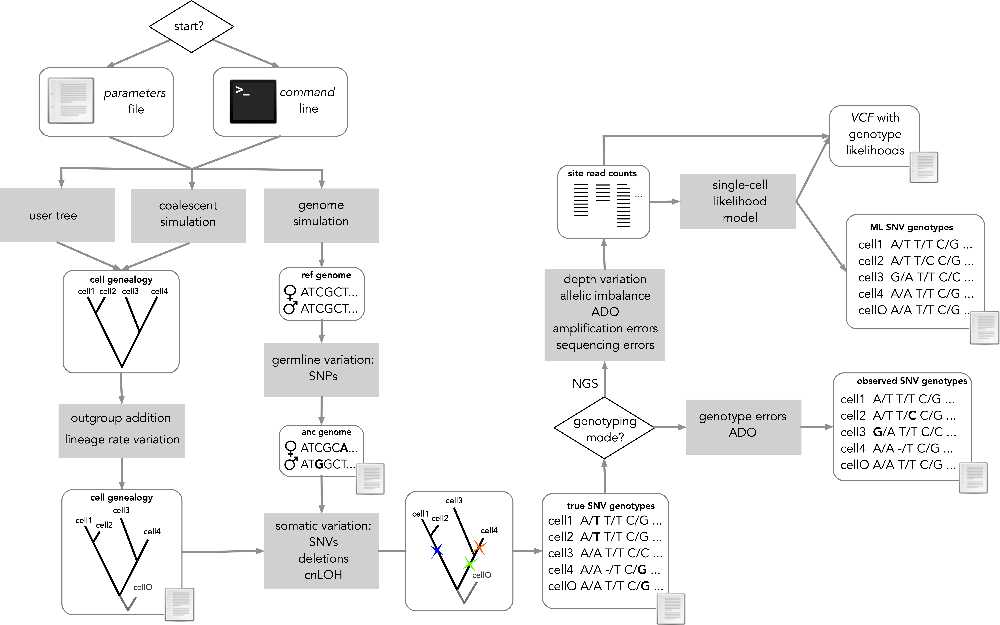
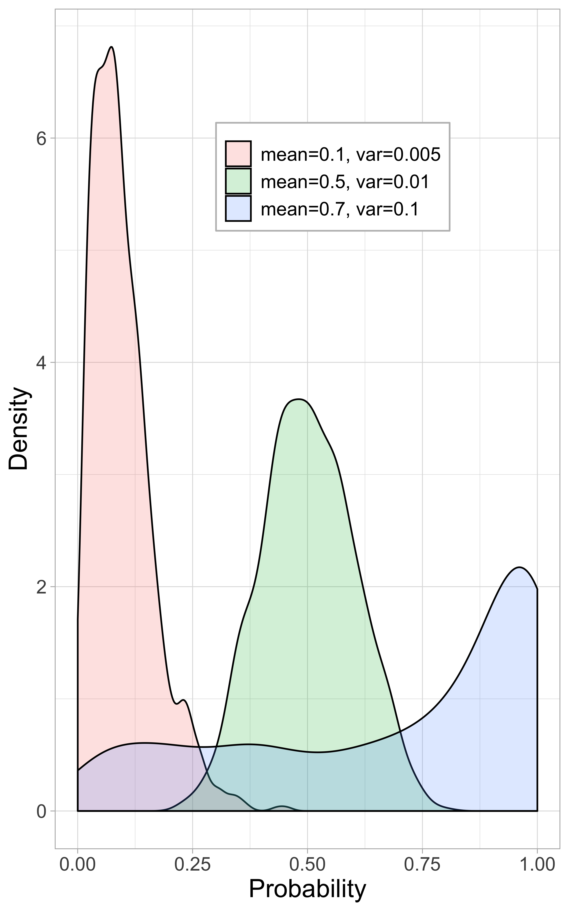
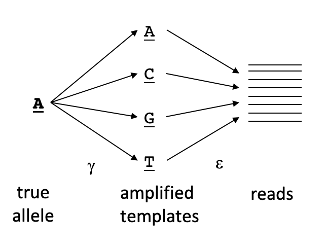
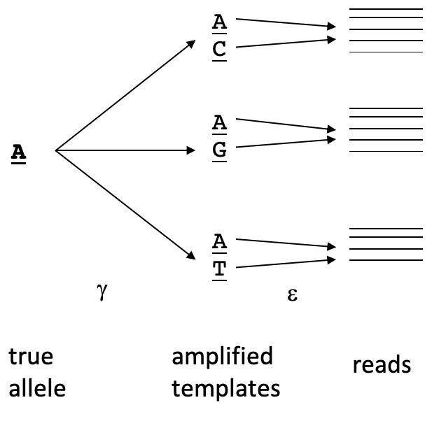

# 1. About CellCoal

CellCoal simulates the somatic evolution of single-cells including genotypes resulting from single-cell DNA sequencing. CellCoal generates a coalescent tree and can simulate a sample of diploid genomes from somatic cells –no recombination– from a growing population, together with another genome as outgroup. A typical example would be a sample of single-cell genotypes from a growing tumor population together with a healthy cell used as outgroup. CellCoal implements multiple mutation models for single-nucleotide variants (0/1, DNA, infinite and finite site models, point deletions, copy-neutral LOH, cancer mutational signatures) and is able to generate a .VCF file with NGS read counts and genotype likelihoods considering technical artifacts like allelic imbalance, allelic dropout, sequencing error, amplification error, plus doublet cells.

# 2. Citation

If you use CellCoal, please cite it as:

Posada D. 2020. CellCoal: coalescent simulation of single-cell sequencing samples. *Molecular Biology and Evolution* 37: 1535-1542. [https://academic.oup.com/mbe/article/37/5/1535/5728646](https://academic.oup.com/mbe/article/37/5/1535/5728646){target="_blank"}.

# 3. Getting started

1.  **Download**: get the program from the GitHub repository at <https://github.com/dapogon/cellcoal>. Under the Code tab you will see a section call *release*. Click on it download the source code in .zip (or tar.gz) format. Then unzip the *cellcoal-x.y.z.zip* file (for example, cellcoal-2.0.1.zip). You should see now a folder called *cellcoal-x.y.z*. Move into the folder to compile and run the program.

2.  **Compile**: type `make`. The program should compile without much problem in Linux/MacOSX. A *Makefile* is provided for the gcc compiler. The executable file will be located in the *bin* folder (e.g., `bin/cellcoal-2.0.1`). The Makefile detects OpenMP support automatically (see section 4.1): it uses `-fopenmp` when the compiler supports it and, on macOS, Homebrew's `libomp` if it is installed (`brew install libomp`); otherwise the program is compiled single-threaded, with identical results. To compile without OpenMP type `make OMPFLAG=`. Compilation flags include `-O3 -ffp-contract=off -fno-math-errno`; please do not add `-ffast-math` or `-march=native` if you need identical results across machines.

    **Alternatives to compiling**: `make install [PREFIX=/usr/local]` installs the program as `cellcoal`, with the manual, the examples and `cellcoal-bulk-vaf`. Each release also has prebuilt tarballs for Linux (x86_64, static) and macOS (Apple silicon) among its assets. With Homebrew: `brew tap dapogon/cellcoal https://github.com/dapogon/cellcoal && brew install cellcoal`. A conda recipe is in the folder *conda* of the repository.

3.  **Run**: `bin/cellcoal-x.y.z`. In this case, the program arguments will be read from a file called *parameters*. Alternatively, arguments can be entered directly in the command line, or from a specific parameter file with a different name.

4.  **Inspect results**: Once the run is finished, different output files will be written by default inside a folder called *Results*.

# 4. Basic usage

CellCoal does not have a Graphical User Interface (GUI). It works on the Linux/Mac command line in a non-interactive fashion. It can run in two main ways parsing its arguments from a parameter file, or parsing its arguments directly from the command line.

If no arguments are passed in the command line, CellCoal will look for a file called *parameters* in the current working directory:

`bin/cellcoal-x.y.z`

The *parameters* file is a text file that contains the different arguments for the program. The arguments correspond to different letters whose case (uppercase or lowercase) makes a difference. Comments within brackets are allowed. To avoid unexpected problems, users are encouraged to maintain the same order of the arguments as in the example files. For clarity, the example parameters files are divided in different blocks or sections including related arguments.

Alternatively, users can specify their own parameter file **(option -F)**, for example:

`bin/cellcoal-x.y.z -Fexamples/parameters.ISM.binary`

Otherwise, CellCoal will run under the arguments specified in the command line, using default values for the absent arguments. For example, one could type:

`bin/cellcoal-x.y.z -n100 -s20 -l1000 -e10000 -g1.0e-04 -k1 -i1 -b1 -j250 -p0.0 -f0.3 0.2 0.2 0.3 -r0.00 0.03 0.12 0.04 0.11 0.00 0.02 0.68 0.68 0.02 0.00 0.11 0.04 0.12 0.03 0.00 -1 -2 -3 -4 -6 -9 -v -x -#200011`

where *-n* is the number of replicates, *-s* is the number of sampled cells, *-l* is number of sites, *-e* is the effective population size, *-g* is the growth rate, *-k* is the root branch length ratio, *-i* is the rate variation among branches, *-b* specifies the alphabet (DNA), *-j* is a fixed number of mutations, *-p* is the proportion of alternative model sites, *-f* are base frequencies, *-r* is the mutation matrix, *-1* to *-x* control output options, and *-#* is the seed for random number generation.

A brief usage guide plus the current default values for the different parameters can be obtained with the argument -?:

`bin/cellcoal-x.y.z -?`

## 4.1 Parallel execution and reproducibility

Since version 2.0.0 CellCoal uses OpenMP to generate read counts and to print the VCF file in parallel. The number of threads is controlled with the environment variable `OMP_NUM_THREADS`, for example:

    OMP_NUM_THREADS=4 bin/cellcoal-2.0.1 -Fexamples/parameters.GTR.reads

If the variable is not set, OpenMP uses all the available cores. Use `OMP_NUM_THREADS=1` to run on a single core.

The genotype likelihoods of SNV sites can be kept in memory to avoid recalculating them when printing. The amount of memory used for this cache can be set, in megabytes, with the environment variable `CELLCOAL_GL_CACHE_MB` (default 256; 0 disables the cache). This setting only affects speed and memory, never the results.

> **Reproducibility.** For a given seed (option -#) and a given set of arguments, the results are identical in every run and *independent of the number of threads*. To achieve this, the read counts of each site are generated from an independent random stream derived from the seed and the site number. As a consequence, **the results obtained with a given seed in version 2.0.0 are different from those obtained with versions 1.x** (the statistical properties are the same). If you need to reproduce an old analysis, use the original version. Note that if no seed is specified the current time is used, and that when the arguments are read from a parameter file (option -F) the seed has to be specified inside that file.

# 5. CellCoal implementation

The main steps of CellCoal are:

1.  Coalescent simulation of the genealogy of a sample of cells (the user can also specify a tree with branch lengths).

2.  Addition of an outgroup and optionally, modification of the branch lengths.

3.  Simulation of a reference and an ancestral genome, with or without germline variation.

4.  Addition of mutations, LOH and deletions along the tree in order to obtain the true genotypes.

5.  Addition of technical errors without generating read counts (ADO + genotype errors) OR Addition of technical errors while generating read counts (ADO + amplification error + sequencing error.

6.  Estimation of genotype likelihoods under various models

7.  Print genotypes/haplotypes to files.

8.  Print summary statistics.

{width=100%}

Fig. 1. Main flow of CellCoal.

## 5.1 Coalescent genealogy

CellCoal simulates a cell genealogy under the standard neutral coalescent, going backward in time (Fig. 2 left). Note that the coalescent assumes the cell sample comes from a much larger population, which in this case can be constant or growing. In the coalescent we use the *effective population size (N)*, a well-known quantity in population genetics that refers to the number of individuals in an ideal population.

> In CellCoal, time is scaled in units of *N* generations

CellCoal can consider continuous exponential population growth (Fig. 2 middle) (Slatkin and Hudson, 1991) (SH91) and multiple demographic periods (Fig. 2 right). For the latter, the exponential growth rate during the period (positive or negative) will be deduced from the specified *N* at the beginning and at the end of the period. The growth rate derived for the last period will continue into the indefinite past. This implementation is borrowed from Hudson (2002).

CellCoal also implements the coalescent parameterization of Ohtsuki and Innan (2017) (OI17) for cancer cell populations. The only difference with the SH91 model is a factor of *2b*, where *b* is the birth rate, due the consideration of overlapping generations, and the use of absolute times (expected time until a birth event). Note that if we believe that the cancer cell population starts from a single ancestral cell then we do not get an exponential growth model exactly, so both OI17 and SH91 are approximations.

> CellCoal implements two parameterizations of the coalescent with exponential growth, the first proposed the Slatkin and Hudson (1991) model, and the second developed by Ohtsuki and Innan (2017) \>(OI17) specifically for cancer cell populations.

{width=100%}

Fig. 2. A random coalescent genealogy for a sample of 4 cells under constant (left), and growing population size (middle) and demographic periods (right). The effective population size is indicated as blue background. In the right, from Period 0 to Period 1 the population size experiences a severe bottleneck.

### 5.1.1 Adding an outgroup

After the sample genealogy is simulated, two additional branches are added: a **root branch** and an **outgroup branch** (Fig. 3), in order to include an outgroup cell in the sample. In phylogenetics an outgroup is a distant taxon that serves as a reference and is often used for rooting purposes. The length of these two branches is controlled by the user (Fig. 3).

{width=60%}

Fig. 3. Outgroup addition. The length of the root branch will be controlled by the user with the parameter -k, which specifies the length of this branch as a proportion of the sample MRCA mean depth. The length of the outgroup branch depends on the parameter -q, which is the length of this branch as a proportion of the sample/outgroup most recent common ancestor (MRCA) mean depth. In this example, the corresponding values were -k0.5 -q1.0.

In a tumor scenario, the outgroup cell will be naturally a healthy cell (Fig. 4)

{width=70%}

Fig. 4. Addition of a healthy cell in a tumor scenario. In this case we expect that the healthy cell has evolved much slower than the tumoral cells, so a small (or zero) outgroup might make more sense. In this example, the corresponding values where -k0.5 -q0.05.

### 5.1.2 Rate variation among lineages

The standard coalescent results in an ultrametric tree, where all the tips are at the same distance from the most recent common ancestor (MRCA) of the sample. These branches can be modified by introducing rate variation among linages/branches, here using multipliers sampled from a Gamma distribution (see Fig. 5). This approach was introduced by Yang (for an easy review see Yang 1996) to add substitution rate variation among different nucleotide sites in a DNA sequence. Biologically this is interesting if we want to simulate for example a situation under which some lineages evolve at different rates.

{width=60%}

Fig. 5. Rate variation among branches. Rate variation among lineages can be a product for example of changes in the mutation rate.

### 5.1.3 Rate switches along the genealogy

Alternatively to the gamma rate variation, a few *rate switches* can be introduced in the genealogy (option -N). Each switch chooses one branch of the ingroup tree at random, with probability proportional to its length (the root branch is excluded, and the same branch is never chosen twice), and multiplies by a given factor the length of that branch *and* of all the branches descending from it. Because mutations accumulate along branches, a factor larger than 1 produces a clade with an accelerated mutation rate (for example, a mutator lineage), and a factor smaller than 1 a clade that evolves more slowly. If a switch falls inside the subtree of another switch, their factors are multiplied. With the noisy option -y2 or higher, the node chosen by each switch, its factor and the cells in the affected clade are printed on screen for each replicate (for example, `node 17 *0.20 ( 1 5 9 7 )`); the log file records the number of switches and their factors. For example, `-N2 4 0.2` introduces two switches, one that makes a clade evolve four times faster and another that makes a clade evolve five times slower. This option cannot be combined with rate variation among lineages (-i). See section 6.2.

## 5.2 Genotype evolution models

CellCoal simulates the evolution of cell genotypes along the genealogy by adding somatic mutations (single-nucleotide variants -SNVs-, copy-neutral loss of heterozygosity events -cnLOH-, and point deletions), starting from an ancestral genome at the *sample/outgroup MRCA*. CellCoal considers two possible **alphabets (0/1 or DNA; option -b)** and several single-nucleotide mutation models (infinite and finite sites models, including trinucleotide mutational signatures), which can be mixed along the genome.

> The default SNV model is a diploid infinite site model (ISM).

> Note that CellCoal does not simulate copy number alterations or structural variants.

### 5.2.1 Generation of reference and ancestral genomes

The first step to generate the cell genotypes is the generation of a **reference genome**. Under the binary alphabet, it will consist of all 0s. For DNA, the reference genome will be simulated at random according to the specified nucleotide frequencies, unless genetic signatures are specified, in which case the reference genome will be simulated according to the trinucleotide frequencies in the human genome (version GRCh37). Alternatively, for DNA data, the user can specify its own reference genome in a FASTA file.

The **ancestral genome** at the sample/outgroup MRCA of the genealogy will be simulated by introducing **germline variation (option -c)** (single nucleotide polymorphisms or SNPs) into the reference genome at a rate specified by the user. Logically, if this rate is 0, the reference and the ancestral genomes will be identical. Once the ancestral genome is in place, mutations are introduced according to the specified mutation model.

> The reference genome can be simulated according to the trinucleotide frequencies in the human genome (version GRCh37); germline SNPS can be added afterwards.

### 5.2.2 Infinite-site SNV models

CellCoal implements several types of **single-nucleotide mutation models (option -m)**. Infinite-sites models (ISM) allow a given site to change only once. However, in a diploid scenario we can implement this model in at least two ways. Under the **diploid ISM**, a given site can change only once in either the maternal and paternal genomes. That is, the change will be for example either 0/0 -\> 1/0 or 0/0 -\> 0/1 but not both (where 0 is the ancestral allele and 1 the derived one). In consequence, under the diploid ISM, homozygous mutants (1/1) are not possible. A different implementation of the ISM, called here **haploid ISM**, considers instead maternal and paternal sites as different locations, so it allows for two somatic mutations to take place at the same site if they occur in the maternal and paternal genome. Thus, under this model 1/1 genotypes are possible. In both ISMs, the number of somatic mutations is distributed as a *Poisson* according to the total tree length (which is a function of the mutation rate and time), unless a **fixed number of mutations (option -j)** is requested. For the haploid ISM the expected number of mutation events along the tumor genealogy (the coalescent tree of the sampled cells) can be easily calculated:

$$ E\left( \text{number of mutations} \right) = \Theta \sum_{i=1}^{n-1} \frac{1}{i} $$

where $\Theta$ = 4*N*$\mu$*L*, being *N* the **effective population size (option –e)**, $\mu$ the **mutation rate per site per generation (option -u)**, and *L* the **number of sites (option -l).** This expectation is reported in the log file (when the genealogy is constant in size) and does not include the mutations that occur on the branch leading to the healthy (outgroup) cell or on the transforming branch, so the observed mean number of mutation events is higher when those branches are present (see options -k and -q). Alternatively, it is also possible to specify a **fixed number of mutations** **(option -j)** to take place along the genealogy.

The specific sites where the ISM mutations occur are selected uniformly along the genome, unless mutational signatures are requested (see below). The particular branches of the cell genealogy where mutations are located are selected according to their lengths. That is, longer branches will receive more mutations on average.

### 5.2.3 Infinite-site mutational signatures

For DNA data, mutational signatures (sensu Alexandrov *et al.* 2013) can be simulated under a **diploid infinite trinucleotide model (ISTM) (option -S)**, that considers the nucleotide context of the mutated site (bases immediately 5’ and 3’). Currently, 30 distinct signatures can be incorporated (<https://cancer.sanger.ac.uk/cosmic/signatures>) and mixed in different proportions. As in ISMs, the number of somatic mutations is distributed as a *Poisson* according to the total tree length.

Importantly, for computational efficiency, in the current implementation we assume that the genomic context is constant along the tree. That is, we select a site based on the context in the ancestral genome, before locating it in a given tree branch. Thus, this assumption will be broken in the case of contiguous mutations.

> IMPORTANT: In order to get the expected counts under each signature, one should always simulate long genomes, otherwise rare trinucleotide will not be available and, depending on the signature, could significantly bias the observed counts. For the same reason, the number of mutations should be small relative to the number of available sites of the most frequent contexts: under the infinite-sites model a site cannot mutate twice, so when the contexts favored by a signature (for example, CpG sites in signature 1) are exhausted, the observed proportions drift away from the signature.

### 5.2.4 Infinite-site copy-neutral LOH

**Copy-neutral loss of heterozygosity (cnLOH) (option -H**) events (e.g., A/G -\> A/A, or A/G -\> G/G) can be added assuming a haploid ISM, which means that cnLOH cannot happen in the same site twice unless they occur in a different maternal/paternal genome. As for SNVs, the number of cnLOH events will be distributed as a *Poisson* according to the total cnLOH tree length (which in this case is a function of the cnLOH rate and time). The specific sites where the cnLOH events occur are selected uniformly along the genome. The particular branches of the cell genealogy where cnLOH events are located are selected according to their (cnLOH) lengths.

### 5.2.5 Infinite-site single-nucleotide deletions

**Single-nucleotide deletions (option -d)** (e.g., N/N -\> –/N, or N/N -\> N/–) can be added also assuming a haploid ISM. As for SNVs, the number of point deletions will be distributed as a *Poisson* according to the total deletion tree length (which in this case is a function of the deletion rate and time). The specific sites where the deletions occur are selected uniformly along the genome. The particular branches of the cell genealogy where deletions are located are selected according to their (deletion) lengths.

### 5.2.6 Finite-site SNV models

CellCoal also implements several **finite-sites mutation models (option -m)** (FSM) for SNVs. In this case, multiple mutations can happen along a branch. Typically, these models assume a continuous Markov process and are very typical in phylogenetics, where they are often referred as substitution models (<https://en.wikipedia.org/wiki/Models_of_DNA_evolution>).

For 0/1 data, the model implemented is known as Cavender-Farris-Neyman or Mk2 model (see Lewis 2001), and is equivalent to a Jukes-Cantor (1969) model for two alleles. For DNA data, reversible (assume that the rate X-\>Y is the same as Y-\>X) and non-reversible models can be built by specifying the **nucleotide frequencies (option -f)** (at equilibrium; they are not expected to change along the genealogy), a **transition/transversion rate ratio (option -t)** or a full 4x4 **instantaneous mutation rate matrix (option -r)**, plus **rate variation among sites** **(option -a)** (using a Gamma distribution; see Yang 1996). One can define in this way popular models like Jukes-Cantor (1969), Hasegawa-Kishino-Yano (1985) or General-Time-Reversible (Tavaré 1986). It is also possible to specify non-reversible models (i.e., asymmetrical rates among nucleotides).

### 5.2.7 Mixed ISM-FSM

Both ISM and FSM for SNVs can be incorporated by setting up a **proportion of sites expected to evolve under each type of model (option –p).** Each site is then assigned to the alternative model (option -m) with probability p, and to the default diploid ISM with probability 1-p. Also, a **relative mutation rate (option –w)** can be specified for the sites evolving under the alternative model

## 5.3 Single-cell genomics

CellCoal can simulate the technical artifacts resulting from single-cell genomics, like allelic dropout (ADO), allelic imbalance, sequencing error, amplification error, plus doublet cells. For this, CellCoal implements two different strategies:

1.  **No sequencing reads are generated**; instead ADO and genotyping errors are directly imposed on the evolved genotypes at the tip of the genealogy.

2.  **Read counts are simulated** at a variable depth along the genome, including allelic imbalance, ADO, amplification and sequencing errors. Then, genotype calling is performed under different maximum likelihood models for single-cells.

### 5.3.1 Fixed or variable allelic dropout (ADO)

During the amplification of single-cells, one or both alleles at a single site can be lost, so a truly heterozygous genotype might appear as a homozygote (e.g., 0/1 =\> 0/\_ or 0/1 =\> \_/1). CellCoal can remove alleles from single chromosomes at a **fixed ADO rate per genotype (option -D)**. Alternatively, ADO rates per genotype can be specified to vary **across cells (option -P)** and/or **across sites (option -Q)** according to a *Beta-binomial* distribution. The ADO rate of each cell and the ADO rate of each site are sampled once and reused for all the genotypes of that cell or site (this was not done correctly before version 2.0.0). In this case, the total ADO rate is the combination of both:

`totalADO = ADOcell + ADOsite - (ADOcell * ADOsite)`

> CellCoal uses a *Beta-binomial* distribution (<https://en.wikipedia.org/wiki/Beta-binomial_distribution>) to add flexibility in the specification of different parameters, in particular to model variations across cells and sites. CellCoal uses a *Beta* parameterization based on mean and variance (see Fig. 6 for a few examples).

{width=40%}

Fig. 6. Examples of probability densities for three different *Beta* distributions.

### 5.3.2 Genotyping error

**Genotype errors (option -G)** can be directly introduced in the observed genotypes at a given rate per genotype, which is sampled from a *Beta-binomial* distribution (therefore, if desired, it can change across cells and sites). For DNA data, nucleotides are substituted by a different one according to a user-defined error matrix (option -X); the rows of the matrix are normalized, so the substituted nucleotide is drawn with probabilities proportional to the entries of its row (with the default matrix each of the three other nucleotides has probability 1/3; before version 2.0.0 the first non-zero entry was always chosen). These errors encapsulate into a single class different types of error than can take place along the single-cell genomics pipeline, like amplification, sequencing and calling errors.

### 5.3.3 Sequencing coverage

For each individual genotype the program will generate read counts at a certain sequencing coverage or depth. For a given site the number of reads will follow a *Poisson* distribution around the **mean coverage (option -C)**, unless **coverage dispersion (option -V)** is specified, in which case the coverage per site will follow a *Negative Binomial* distribution. Reads will randomly assigned to the maternal or paternal genome, according to a given **allelic imbalance (option -I)** whose *Beta-binomial* mean by default is 0.5 (i.e., the same probability for maternal or paternal read). If the genotype is haploid due to ADO, the expected **haploid coverage reduction (option -R)**, which is 0.5 by default, can also be specified.

### 5.3.4 Amplification error

In order to obtain enough DNA material from single-cells for sequencing library construction, the genomes of single cells are most often amplified. During this amplification step, the DNA polymerase can introduce nucleotide errors that can appear in a high proportion of the resulting templates for that site if occurring during the first amplification cycles. If many templates contain an error, many reads will be also be wrong for the specific site. The **amplification error (option -A)** for a given maternal/paternal site follows a *Beta-binomial* distribution with mean and variance specified by the user. The probability of the different types of errors (e.g., A=\>C, A=\>G, A=\>T ,etc.) can be indicated using an **4x4 error matrix (option – X)**. CellCoal considers two different amplification error models:

**Four-template model**: In this case all four bases can be present, due to *multiple* amplification errors, in the set of amplified templates (Fig. 7).

{width=55%}

Fig. 7. Four-template model for amplification ($\gamma$) and sequencing ($\varepsilon$) error.

**Two-template model**: In this case only the original base and a single alternative can be present, due to a *single* amplification error, in the set of amplified templates (Fig. 8).

{width=50%}

Fig. 8. Two-template model for amplification ($\gamma$) and sequencing ($\varepsilon$) error.

### 5.3.5 Sequencing error

Once the genomes have been amplified, during sequencing, additional errors can add to the reads. **Sequencing error (option -E)** is assumed to be constant across sites and cells. The probability of the different types of errors (e.g., A=\>C, A=\>G, A=\>T, etc.) uses the same 4x4 error matrix **(option – X)** as the amplification error.

### 5.3.6 Cell doublets

Sometimes, due to errors during the cell isolation process, a single sequencing library can contain DNA templates from two cells, and therefore reads which are assume to come from a single cell come in fact from two different cells. This is called a *doublet*. CellCoal can consider the effect of cell doublets by producing reads from two of the sampled cells and joining these reads as if they originated from a single cell, given a user-specified **doublet rate per cell (option -B)**.

### 5.3.7 Genotype likelihoods

CellCoal can simulate genotype likelihoods for single-cell NGS data, given the read counts simulated, and the sequencing and amplification errors specified by the user, plus ADO, under three different models: GATK standard, 4-template and 2-template models. The basic model used to calculate the genotype likelihoods is similar to that implemented in GATK (DePristo et al. 2011; see also Korneliussen et al. 2013):

$$ \Pr\left( D \middle| G = \{ A_{1},A_{2}\} \right) = \prod_{i = 1}^{M}{\Pr\left( b_{i} \middle| G = \{ A_{1},A_{2}\} \right)} = \prod_{i = 1}^{M}\left( \frac{1}{2}\ p\left( b_{i} \middle| A_{1} \right) + \frac{1}{2}\ p\left( b_{i} \middle| A_{2} \right) \right) $$

where

*G* = genotype

*A* = allele

*M* = number of reads

*b~i~* = observed base in read *i*

$\varepsilon$ = probability of sequencing error

Moreover, it is straightforward to include ADO in this computation, as in Zafar et al. (2016):

$$ \begin{aligned} \Pr\left( D \middle| G = \{ A_{1},A_{2}\} \right) = (1-\delta) \prod_{i = 1}^{M}{\Pr\left( b_{i} \middle| G = \{ A_{1},A_{2}\} \right)} + \\ \delta \left( \frac{1}{2} \prod_{i = 1}^{M}{\Pr\left( b_{i} \middle| G = \{A_{1}, -\} \right)} + \frac{1}{2} \prod_{i = 1}^{M}{\Pr\left( b_{i} \middle| G = \{ -, A_{2}\}\right)}\right) = \\ (1-\delta) \prod_{i = 1}^{M}\left( \frac{1}{2}\ p\left( b_{i} \middle| A_{1} \right) + \frac{1}{2}\ p\left( b_{i} \middle| A_{2} \right) \right) + \\ \delta/2 \prod_{i = 1}^{M} p \left(b_i|A_1 \right) + \delta/2 \prod_{i = 1}^{M} p \left(b_i|A_2 \right) \end{aligned} $$

where $\delta$ is the probability of ADO at a given site.

Importantly, CellCoal can calculate the genotype likelihoods, with or without ADO, under three different models: GATK-like, 4-template and 2-template models, which only differ in how the probability of a particular read given the true allele, *p(b\|A)*, is calculated, as explained in the next three subsections.\
\

#### 5.3.7.1 GATK-like model

It assumes the same sequencing error rate ($\epsilon$) for all bases and sites, and no amplification error. In this case, the probability of a particular read given the true allele, *p(b\|A)*, is:

$$ p\left(b|A\right) = \left\{\begin{matrix} \varepsilon/3, b\neq A \\ 1 - \varepsilon, b = A \\ \end{matrix} \right. $$

 where

*b* = observed base in read

*A* = true allele

$\varepsilon$ = probability of sequencing error per site

\

#### 5.3.7.2 Four-template amplification error model

This model extends the previous one in order to consider the amplification error, which, together with the sequencing error, can be different for distinct bases **(option – X**) and that is sampled for each site from a *Beta-binomial* distribution with mean and variance specified by the user **(option -A)**. It allows for multiple amplification errors at a single site, and therefore that all four templates are possible (the correct one and the other three; see Fig. 6 above). In this case, *p(b\|A)* is:

$$ p\left(b|A\right) = \sum_{j = 1}^{4}{p\left( t_{j} \middle| A \right)\ p\left( b|t_{j} \right)} = \sum_{j = 1}^{4}\gamma_{A \rightarrow t_{j}}\varepsilon_{t_{j} \rightarrow b} $$

where

$$ \gamma_{i \rightarrow j} = \left\{ \begin{matrix} \gamma e_{i \rightarrow j}, i \neq j \\ 1 - \gamma, i = j \\ \end{matrix} \right.\ \ \ ,\ \ \ \varepsilon_{i \rightarrow j} = \left\{ \begin{matrix} \varepsilon e_{i \rightarrow j}, i \neq j \\ 1 - \varepsilon, i = j \\ \end{matrix} \right.\ $$

and where

*b* = observed base in read

*A* = true allele

*t~j~* = amplified allele template

$\varepsilon$ = probability of sequencing error for a given site

$\gamma$ = probability of amplification error for a given site

$\gamma_{i \rightarrow j}$ = probability of amplification of base *i* into template base *j*

$\varepsilon_{i \rightarrow j}$ = probability of sequencing error from template base *i* to read base *j*

$e_{i \rightarrow j}$ = relative probability of amplification/sequencing error from base *i* to base *j*\
\

Note that if the amplification and sequencing errors are constant, the probability of observing a read *r* coming from an allele *A* simplifies to:

$$ p\left( b \middle| A \right) = \left\{ \begin{matrix} \left( 1 - \gamma \right)\ \varepsilon/3\ + \ \gamma\ \frac{1 - \varepsilon/3}3, b \neq A \\ \left( 1 - \gamma \right)\left( 1 - \varepsilon \right)\ + \ \gamma\ \varepsilon/3,b = A \\ \end{matrix} \right.\ $$

\

#### 5.3.7.3 Two-template amplification error model

This model is very similar to the previous one, but it assumes that only a single amplification error can occur at a single site, and that therefore only two templates (the “correct” one and a wrong one) are possible (see Fig. 7 above). In this case *p(b\|A)* is:

$$ p\left(b|A\right) = \sum_{\substack{j = 1 \\ j \neq A}}^{4}{p\left( t_{j} \middle| A \right)\ p\left( b|t_{j} \right)} = \sum_{\substack{j = 1 \\ j \neq A}}^{4}e_{A \rightarrow t_{j}} \ [(1-\gamma) \ \varepsilon_{A \rightarrow b} + \gamma \ \varepsilon_{t_j \rightarrow b}] $$

where

*b* = observed base in read

*A* = true allele

*t~j~* = amplified allele template

$\varepsilon$ = probability of sequencing error for a given site

$\gamma$ = probability of amplification error for a given site

$\gamma_{i \rightarrow j}$ = probability of amplification of base *i* into template base *j*

$\varepsilon_{i \rightarrow j}$ = probability of sequencing error from template base *i* to read base *j*

$e_{i \rightarrow j}$ = relative probability of amplification/sequencing error from base *i* to base *j*\
\

# 6. Arguments

## 6.1 Coalescent arguments

In this section we describe the arguments that control the simulation of the cell genealogy under the neutral coalescent. Here we can indicate the number of replicates, the number of cells in the sample, the number of sites or loci, and characteristics of the population from which the cells have been sampled, like effective population size, exponential growth or demographic periods.

    [COALESCENT]
    [number of replicates] n100
    [number of cells] s20
    [number of sites] l1000
    [effective population size] e10000
    [exponential growth rate] g1e-4 [ln2=0.6931 max]
    [demographics] [h2 1000 100 40000 200 30000 20000]
    [birth rate] K2
    [death rate] L0.3

**n#: number of replicates; integer \[1-inf)**

The number of cell samples to be generated. Each sample is an independent realization of the whole process (coalescent, mutations, NGS; see below).

**s#: number of cells; integer \[2-inf)**

The number of cells to be generated for each sample.

**l#: number of sites; integer \[1-inf)**

The total length, in base pairs or nucleotides, of the genomic region simulated. This length includes variable and non-variable sites.

**e#: effective population size; integer \[1-inf)**

The effective size of the population from which the sample was theoretically drawn.

**h# \# \# \# demographic periods; several integers \[1-inf)**

The number of demographic periods, from present to past, and the effective population size during those periods. The first number specifies the number of periods. Then for each period there should be three consecutive numbers indicating the effective population size at the beginning and at the end of the period, and the duration of the period in generations. This option is incompatible with the *exponential growth rate option (-g)* below.

> These parameters are looking back in time, so it is not a good idea to imply a negative growth rate for the last period, as the coalescent time could become infinite in the past.

**g#: exponential growth rate; double (-inf, +inf)**

The rate of exponential growth per individual per generation. This option is incompatible with the **demographic periods (-h) option**.

> The coalescent looks back in time, so it is not a good idea to specify a negative growth rate, as the coalescent time could become infinite in the past.

**K#: birth rate (OI17 model); double \[0-inf)**

Cell division rate (birth rate) per time unit, in the Ohtsuki and Innan (2017) model. Assumed to be constant over time.

**L#: death rate (OI17 model); double \[0-inf)**

Cell death rate per time unit, in the Ohtsuki and Innan (2017) model. Assumed to be constant over time.

> In the OI model, birth rate \>\> death rate, so there is exponential growth with rate = birth rate - death rate

## 6.2 Genealogy modifiers

    [GENEALOGY MODIFIERS]
    [root branch length ratio] k0.5
    [outgroup branch length ratio] q1.0
    [rate variation among branches] i1.2
    [tree rate switches] [N2 4 0.2]

**k#: root branch length ratio; double \[0-inf)**

Length of the root branch as a proportion of the mean depth of the *sample MRCA*. Note that this branch is attached before introducing rate variation among branches. See Figs. 3-4.

**q#: outgroup branch length ratio; double \[0-inf)**

Length of the outgroup branch as a proportion of the mean depth of the *sample/outgroup MRCA*. Note that this branch is attached before introducing rate variation among branches. See Figs. 3-4.

**i#: rate variation among branches; double (0-inf)**

Amount of rate variation among lineages, specified with the alpha shape parameter of a continuous *Gamma* distribution with mean 1. The smaller the shape the strongest the heterogeneity introduced. See Fig. 5.

**N# \# \# ...: tree rate switches; integer \[1-numCells\] followed by that many doubles (0-inf)**

Number of rate switches along the genealogy, an integer between 1 and the number of ingroup cells, followed by one rate multiplier per switch (each a double \> 0). Each switch chooses a branch at random, with probability proportional to its length (no branch is chosen twice), and multiplies the length of that branch and of all the branches descending from it by its multiplier (see section 5.1.3). For example, `N2 4 0.2` makes two switches, one with multiplier 4 and another with multiplier 0.2. With the noisy option -y2 or higher, the chosen nodes, their multipliers and the cells in each affected clade are printed on screen for each replicate; the log file records the number of switches and their multipliers. This option cannot be used together with rate variation among lineages (option -i).

## 6.3 Mutation models

    [MUTATION MODEL]
    [alphabet binary:0 DNA:1] b1
    [germline SNP rate] [c1e-5]
    [mutation rate] u1e-6
    [deletion rate] d1e-6
    [CN\_LOH rate] [H1e-5]
    [fixed number of mutations - ISM] [j1000]
    [trinucleotide genetic signature - ISM] S2 11 0.3 22 0.7
    [alternative mutation model ISMhap:0 Mk2:1 finiteDNA:2] [m0]
    [proportion of alternative model sites] [p0]
    [alternative/default model relative mutation rate] [w1]
    [base frequencies] [f0.3 0.2 0.2 0.3]
    [transition/transversion ratio] [t1.7]
    [rate variation among sites] [a1.0]
    [mutation matrix ACGT x ACGT] [r0.00 0.03 0.12 0.04
    0.11 0.00 0.02 0.68
    0.68 0.02 0.00 0.11
    0.04 0.12 0.03 0.00]

**b#: alphabet: integer \[0/1\]**

Alphabet for the simulated characters, which can be binary or DNA nucleotides, as follows:

    0 = binary (0,1 states)
    1 = DNA (A,C,G,T states)

**c#: germline mutation rate: double \[0-inf)**

Germline mutation rate per site per generation, which is the same as the probability of introducing a mutation in the ancestral genome (i.e., a SNP in comparison with the reference genome).

**u#: somatic mutation rate: double \[0-inf)**

Nucleotide mutation rate per site per generation.

**d#: somatic deletion rate: double \[0-inf)**

Deletion rate per site per generation under a haploid ISM.

**H#: copy-neutral loss-of-heterozygosity rate: double \[0-inf)**

Copy-neutral LOH rate per site per generation under a haploid ISM.

**j#: fixed number of mutations: integer \[0-inf)**

Number of ISM mutations to be added along the genealogy.

**S# \# #: trinucleotide genetic signature/s: integer \[1-inf), integer \[1-30\], double \[0-1\]**

Genetic signatures to be implemented, and their proportions. The first number should be the number of distinct signatures, followed by the signature/s IDs and the expected proportion of mutations to be drawn from each particular signature. If these proportions do not add to one they will be rescaled. For example:

S1 5 1.0 implies that mutations will come from signature 5 only.

S2 11 0.3 22 0.7 implies that mutations will come from two signatures: from signature 11 with probability 0.3, and from signature 22 with probability 0.7.

> Note that to get the expected counts under each signature it is important to simulate long genomes, otherwise rare trinucleotide will not be available and, depending on the signature, could bias the observed counts.

**m#: alternative mutation model: integer \[0-2\]**

Alternative mutation model (the default model is ISM diploid). The options are as follows:

    0 = ISM haploid
    1 = MK2
    2 = finite DNA

**p#: proportion of alternative model sites: double \[0-1\]**

Proportion of sites that will be simulated under the alternative model specified with the -m option.

**w#: alternative/default model relative mutation rate: double \[0-inf)**

Ratio of the mutation rate for sites evolving under the alternative mutation model, relative to the mutation rate for the sites evolving under the null mutation (option -u).

**f# \# \# #: base frequencies: double \[0-inf)**

Nucleotide ACGT frequencies at equilibrium for the DNA finite-site models. If they do not add to one they will be rescaled.

**t#: transition/transversion ratio: double (0-inf)**

Ratio of the number of *transitions* to the number of *transversions* for DNA finite-site models. This ratio, often referred as ti/tv, is 0.5 when *transitions* and *transversions* are equally probable, as there are twice as many possible *transversions* as *transitions* .

**a#: rate variation among sites: double (0-inf)**

Amount of mutation rate variation among sites, specified with the *alpha shape parameter* of a continuous gamma distribution with mean 1. The smaller the shape the strongest the heterogeneity introduced.

**r#4×4: mutation matrix: double \[0-inf)**

This 4×4 matrix specifies the relative mutation rates (instantaneous substitution rates in the case of finite-site models; often called in this case as Q-matrix) among the different nucleotides, in order ACGT for rows and columns. It does not need to be symmetrical, but all diagonals should be zero. If this option is active, the transition/transversion ratio (-t) is ignored. For example, for the Jukes-Cantor (1969) model this matrix would be:

$$ \mathbf{Q} = \left[\begin{array} {rrrr} 0 & 1 & 1 & 1 \\ 1 & 0 & 1 & 1 \\ 1 & 1 & 0 & 1 \\ 1 & 1 & 1 & 0 \\ \end{array}\right] $$

For the General-Time-Reversible (GTR) (Tavaré 1986) model: 

$$ \mathbf{Q} = \left[\begin{array} {rrrr} 0 & 2.1 & 0.3 & 5.6 \\ 2.1 & 0 & 1.5 & 7.8 \\ 0.3 & 1.5 & 0 & 1.4 \\ 5.6 & 7.8 & 1.4 & 0 \\ \end{array}\right] $$

And for a General-Time-Non-Reversible (GTnR) model: 

$$ \mathbf{Q} = \left[\begin{array} {rrrr} 0 & 2.1 & 0.3 & 5.6 \\ 1.9 & 0 & 1.5 & 7.8 \\ 2.1 & 3.7 & 0 & 1.4 \\ 0.8 & 2.4 & 0.9 & 0 \\ \end{array}\right] $$

## 6.4 scWGA parameters

    [scWGA PARAMETERS]
    [fixed allelic dropout (ADO)] [D0.2]
    [ADO per cell] [P0.1 0.01]
    [ADO per site] [Q0.1 0.01]
    [maternal allelic imbalance] [I0.5 0.01]
    [amplification error] A0.2 0.01 0
    [doublet rate per cell] [B0.0]

**D#: fixed allelic dropout (ADO) rate: double \[0-1\]**

Fixed probability of not amplifying one allele, per genotype and cell.

**P#: ADO per cell (mean, variance): double \[0-1\] double (0-inf)**

Probability of allelic dropout at a given genotype, per cell. This probability follows a *Beta-binomial* distribution with *mean* and *variance* specified by the user.

> WARNING: In CellCoal, for the *Beta-binomial* distributions the variance has to be bigger than 0 and smaller than *mean* × (1-*mean*).

**Q#: ADO per site (mean, variance): double \[0-1\] double (0-inf)**

Probability of allelic dropout at a given genotype, per site. This probability follows a *Beta-binomial* distribution with *mean* and *variance* specified by the user.

**I#: maternal / paternal allelic imbalance: (mean, variance): double \[0-1\] double (0-inf)**

Probability of a read coming from the maternal chromosome relative to the probability of coming from the paternal chromosome. This probability follows a *Beta-binomial* distribution with *mean* and *variance* specified by the user.

**A# \# #: amplification error (mean, variance, model): double \[0-1\] double (0-inf) int \[0/1\]**

Expected *Beta-binomial* probability (*mean*) of introducing an amplification error per read per site, plus the *variance* of this error across sites, plus the amplification model (0: four-template-model; 1: two-template model). For DNA data, the specific amplification error is selected according to the error matrix (option -X).

**B#: doublet rate per cell: double \[0-1\] double (0-inf)**

Probability of a doublet per cell, which follows a *Beta-binomial* distribution with *mean* and *variance* specified by the user. Doublets are simulated at the level of the sequencing reads, so this option only has an effect when reads are simulated (option -C).

## 6.5 Genotyping parameters

    [GENOTYPING PARAMETERS]
    [genotyping error; no reads] [G0.1 0.01]

**G#: genotyping error (mean, variance): double \[0-1\] double (0-inf)**

Probability of introducing an error (false positive or false negative), as a result of amplification/sequencing/calling altogether, per genotype and cell.

This probability follows a *Beta-binomial* distribution with *mean* and *variance* specified by the user. Note that the variance has to be bigger than 0 and smaller than *mean* × (1-*mean*).

In the case of DNA data, the specific error is selected according to the error matrix (option -X).

If this option is active, no reads are simulated. In fact, it is not allowed to specify -G and -C (see below) at the same time.

## 6.6 NGS parameters

    [NGS PARAMETERS]
    [sequencing coverage; reads simulated] C10
    [coverage dispersion] [V5]
    [haploid coverage] [R0.5]
    [sequencing error] [E0.00]
    [error matrix ACGT x ACGT] X0 1 1 1
    1 0 1 1
    1 1 0 1
    1 1 1 0

**C#: sequencing coverage: integer \[1-inf)**

Expected number of reads per site and cell. It is the mean of a *Poisson* distribution if there is no dispersion (option -V). In the case of dispersed coverage (option -V \> 0), this is the mean of a *Negative Binomial distribution*. If there is no allelic imbalance (option -I = 0.5), then the reads are randomly assigned to the maternal/paternal chromosomes.

**V#: coverage dispersion: double (0-inf)**

Alpha shape of the gamma distribution in a Negative Binomial distribution (i.e., *dispersion* parameter) whose mean *mu* is the sequencing coverage (option -C). The smaller this value is, the more dispersed is the coverage.

> Note: A *Negative-binomial* distribution can arise as a mixture of *Poisson* distributions with mean distributed as a Gamma distribution with scale parameter (1 - *prob*)/*prob* and shape parameter *dispersion*, where *prob* = *dispersion*/(*dispersion*+*mu*). The variance is *mu* + *mu*^2^/*dispersion*.

**O#: coverage dispersion between sites: double (0-inf)**

Some sites are covered more than others in all the cells (mappability, capture or amplification bias). With this option the depth expected at each site, in every cell, is multiplied by a gamma variate with mean 1 and shape # (variance 1/#), drawn once per site and shared by all the cells; the smaller the value, the larger the differences between sites. It combines with the dispersion within a site (option -V). For example, with -O3 the squared coefficient of variation of the depth of the pooled (bulk) reads across sites is about 1/3. Without this option sites have no systematic differences in depth.

**J#: coverage dispersion between cells: double (0-inf)**

Some cells are sequenced deeper than others (library size, amplification efficiency). With this option the depth expected in every cell, at all its sites, is multiplied by a gamma variate with mean 1 and shape # (variance 1/#), drawn once per cell and replicate and shared by all its sites. It multiplies with the between-site factor (option -O) and with the dispersion within a genotype (option -V): the three act on the mean of the Poisson (or Negative Binomial) distribution of the reads of each allele as mean = coverage x site factor x cell factor, and the Negative Binomial of option -V adds independent noise on top. A doublet adds the reads of its donor, which keeps the cell factor of the donor. For example, with -J4 the squared coefficient of variation of the mean depth between cells is about 1/4.

**R#: haploid coverage: double \[0-1\]**

Expected proportion of reads (*expected* *coverage*, option -C) to be obtained from a haploid template (e.g., after a deletion or ADO) in comparison with the expected coverage for a diploid region.

**E#: sequencing error: double \[0-1\]**

Probability of introducing a (constant) sequencing error per read site. For DNA data, the specific sequencing error is selected according to the error matrix (option -X)

**X#4×4: error matrix: double \[0-inf)**

This 4×4 matrix specifies the relative error rates among the different nucleotides due to sequencing or amplification errors (the matrix is the same for both types of errors), in order ACGT for rows and columns. It does not need to be symmetrical, but all diagonals should be zero.

## 6.7 Output options

All the output files produced by the program are printed inside folder called by default *Results*, located at the same level as the executable. CellCoal always writes a log file; a vcf file is also written when read counts are simulated (option -C).

The *log file* contains a summary of the simulation settings. The *vcf* file contains the SNV genotypes in standard VAriant Calling Format (.VCF; <https://samtools.github.io/hts-specs/VCFv4.3.pdf>).

Other, optional outfiles can contain full information on genotypes (-1, -3) or haplotypes (-2, -4, -9), or about the trees (–6), times (–7). For a detailed description of these options see below.

    [OUTPUT]
    [print SNV genotypes] 1
    [print SNV haplotypes] 2
    [print full genotypes] 3
    [print full haplotypes] 4
    [print ancestors] 5
    [print trees] 6
    [print times] [7]
    [print CATG] [8]
    [print PILEUP] [9] [print bulk read counts] [0] [no VCF] [Z] [gzip VCF] [z] [min VAF in VCF] [M]
    [print true haplotypes] [Y]
    [print replicates in individual folders] v
    [print consensus IUPAC haplotypes] [x]
    [results folder name] oresults
    [user tree file] [Tusertree.0001]
    [user genome file] [Uusergenome.fas]

**1: print SNV genotypes**

Prints the observed (if no reads are produced) or maximum likelihood (ML) (if reads are produced, option -C) maternal and paternal genotypes at variable sites (single nucleotide variants – SNVs), to a file called *snv_gen* inside the *Results* folder, in *Phylip* format (<http://evolution.genetics.washington.edu/phylip/doc/sequence.html>). If the option -v is active, each replicate will be printed to an individual file called *snv_gen.####*, where \#### is the replicate number, in a subfolder *snv_genotypes_dir* inside the *Results* folder.

**2: print SNV haplotypes**

Prints the observed/ML maternal and paternal haplotypes at SNV sites to a file called *snv_hap* inside the *Results* folder. If the option -v is active, each replicate will be printed to an individual file called *snv_hap.####*, in a subfolder *snv_haplotypes_dir* inside the *Results* folder. If the option -x is active, a single consensus sequence with IUPAC codes will be printed (see option -x below).

**3: print full genotypes**

Prints the observed/ML genotypes at all sites to a file called *full_gen* inside the *Results* folder. If the option -v is active, each replicate will be printed to an individual file called *full_gen.####*, in a subfolder *full_genotypes_dir* inside the *Results* folder.

**4: print full haplotypes**

Prints the observed/ML maternal and paternal haplotypes at all sites to a file called *full_hap* inside the *Results* folder. If the option -v is active, each replicate will be printed to an individual file called *full_hap.####*, in a subfolder *full_haplotypes_dir* inside the *Results* folder. If the option -x is active, a single consensus sequence with IUPAC codes will be printed (see option -x below).

**5: print MRCA sequences**

Prints genotypes/haplotypes also for the sample MRCA and sample/outgroup MRCA (see Fig. 3).

**6: print trees**

Prints the cell genealogy for each replicate in Newick format.

**7: print times**

Prints for each replicate a list of the coalescent events and branch lengths in coalescent time.

**8: print CATG**

Prints read counts in CATG format (in addition to VCF). Basically, in the CATG format the first line has the number of samples and the number of sites. Following this is a transposed data matrix with the consensus base calls where each row is a site and each column a different sample. To the right of each site is a tab-separated list of counts of the four bases at that site in the order C, A, T, and G. More information at <http://nbviewer.jupyter.org/gist/dereneaton/d2fd4e70d29f5ee5d195/testing_cat.ipynb#View-the-.cat-results-files>. For example:

    12 44500
    1A0 1B0 1C0 1D0 …
    YCCCCCCCCCCC 10,0,10,0 20,0,0,0 20,0,0,0 20,0,0,0 …
    GGGGGGGGGGGG 0,0,0,20 0,0,0,20 0,0,0,20 0,0,0,20 …
    AAAAAAAAAAAA 0,20,0,0 0,20,0,0 0,20,0,0 0,20,0,0 …
    CCCCCCCCCCCC 20,0,0,0 20,0,0,0 20,0,0,0 20,0,0,0 …
    AAAAAAAAAAAA 0,20,0,0 0,20,0,0 0, 20,0,0 0,20,0,0 …

**9: print PILEUP**

Prints the read counts in *PILEUP* format (see <http://samtools.sourceforge.net/pileup.shtml>) to a file called *pileup* inside the *Results* folder. If the option -v is active, each replicate will be printed to an individual file in a subfolder *pileup_dir*. It requires simulating reads (option -C).

**0: print pooled (bulk) read counts**

Prints, for every site, the reads pooled over the tumour cells, the bulk VAF and the true VAF to a file called *bulk* inside the *Results* folder (subfolder *bulk_dir* with -v). It requires simulating reads (option -C); see section 8.9.

**Z: do not print the VCF**

Skips the VCF file (the largest read output). It needs another read output: -8 (CATG), -9 (PILEUP) or -0 (bulk). With only -0 and -Z the genotype likelihoods are not computed and the reads are streamed, which is faster.

**z: compress the VCF**

Writes the VCF compressed with gzip (*vcf.gz*); gzip must be installed. The content is the same as without -z.

**M: minimum VAF in the VCF**

E.g. -M0.02. The VCF lists only apparent SNVs whose pooled VAF in reads (alternate reads over the reads of all the cells) is at least this value, which removes sites that only carry sequencing errors.

**Y: print true haplotypes**

Prints the true maternal and paternal haplotypes at all sites to a file called *true_hap* inside the *Results* folder. If the option -v is active, each replicate will be printed to an individual file called *true_hap.####*, in a subfolder *true_haplotypes_dir* inside the *Results* folder. If the option -x is active, a single consensus sequence with IUPAC codes will be printed (see option -x below).

**v: print replicates in individual files**

Prints the outputfiles for each replicate

**x: print consensus IUPAC haplotypes**

Prints maternal and paternal sequence as a single consensus sequence with IUPAC codes as follows:

  IUPAC codes                                                       
  ------------- ------------ ------------ ------------ ------------ ------------
  A/A =\> A     A/C =\> M    A/G =\> R    A/T =\> W    A/\_ =\> a   A/- =\> a
  C/A =\> M     C/C =\> C    C/G =\> S    C/T =\> Y    C/\_ =\> c   C/- =\> c
  G/A =\> R     G/C =\> S    G/G =\> G    G/T =\> K    G/\_ =\> g   G/- =\> g
  T/A =\> W     T/C =\> Y    T/G =\> K    T/T =\> T    T/\_ =\> t   T/- =\> t
  \_/A =\> a    \_/C =\> c   \_/G =\> g   \_/T =\> t   */* =\> -    \_/- =\> -
  -/A =\> a     -/C =\> c    -/G =\> g    -/T =\> t    -/\_ =\> -   -/- =\> -

**o\$: results folder name**

Name of the folder where the output data files will be stored, at the same level as the program executable. By default, this folder is called *Results*.

**T\$: user tree file**

Name of the file with a rooted tree with branch lengths in Newick format to be used as the cell genealogy for the simulation of genotypes, instead of a random coalescent tree.

    ((D:0.03,B:0.04):0.02,(C:0.06,A:0.07):0.05);

> in the tree file please add a new line after the semicolon.

If a user tree is specified, the user should also make sure the number of cells is the same as the number of tips in the tree. If using the command line, one should type, for example:

`./bin/cellcoal-x.y.z -T./examples/usertree.0001 -s4`

**U\$: user genome file**

Name of the file with a diploid reference genome in FASTA format, with a maximum size of 10^6^ sites.

    >maternal genome
    AAAAAAACCTGAAACCTTCAGAAGCTGTTTCAGTAGGTAAAGAAAAAGG…
    >paternal genome
    AAAAAAACCTGAAACCTTCAGAAGCTGTTTCAGTAGGTAAAGAAAAAGG…

## 6.8 Other options

    [OTHER]
    [tumor labels] [W]
    [noisy] y1
    [seed] #1542634309 [if no seed is specified, the current time will be used as seed]

**-W: tumor labels** Use tumor nomenclature for cell labels

  **Meaning**            **Standard label**   **Tumor label**
  ---------------------- -------------------- -----------------
  sample cell 1          cell0001             tumcell0001
  outgroup cell          outgcell             healthycell
  sample MRCA            ingrroot             tumoralroot
  sample-outgroup MRCA   outgroot             healthyroot

**-y#: noisy**

Amount of information to be printed to the screen:

    0: does not print anything
    1: + simulation summary
    2: + replicate information
    3: + calculation status and event information.

**-##: seed**

Seed for the random number generator. If no seed is specified, the current time will be used as seed.

## 6.9 Parameter file name at the command line

By default, the parameter file is called *parameters*. Alternatively, the user can indicate the name of the parameter file name at the command line with the **option -F**, like this:

`bin/cellcoal-x.y.z -Fexamples/parameters.ISM.binary`

## 6.10 Configuration files (--config)

A run can be described in a JSON or YAML file instead of a long list of options:

`bin/cellcoal-x.y.z --config examples/config.example.yaml`

The keys are the option letters (`"s": 20`, `"A": [0.05, 0.01, 0]`, `"1": true`) or the long names: `replicates` (-n), `cells` (-s), `sites` (-l), `population_size` (-e), `growth_rate` (-g), `mutation_rate` (-u), `ado` (-D), `coverage` (-C), `coverage_dispersion` (-V), `coverage_dispersion_sites` (-O), `coverage_dispersion_cells` (-J), `sequencing_error` (-E), `amplification_error` (-A), `doublet_rate` (-B), `print_snv_genotypes` (-1), `print_catg` (-8), `print_pileup` (-9), `print_bulk` (-0), `replicate_folders` (-v), `seed` (-#) and so on for every option (the complete list is in `src/config.c`). Values can be numbers, strings, `true` (the option without a value), `false` (the option is left out) or lists. The YAML dialect is deliberately small: `key: value`, `key: [a, b]`, `- item` lines and `#` comments, without nesting. The file is turned into the usual options, so options written after `--config` override it (`--config run.yaml -n1`), and `--config` can appear anywhere in the command line.

`Results/run.json` has an `options` object with the options of that run, including the seed that was used, and it can be given directly to `--config`: `bin/cellcoal-x.y.z --config Results/run.json` repeats the run (same program version and number of cells and sites, any number of threads).

Errors in the file are reported with the line and column and the text of the line, and a misspelled key suggests the closest option name:

```
!!! CONFIG ERROR in run.json, line 3, column 3: unknown option: cell  (did you mean 'cells'?)
     3 |   "cell": 5,
       |   ^
```

## 6.10a ADO rate of each cell

With `-P` (allelic dropout varying among cells) the ADO rate of every cell is drawn from a beta distribution. These rates are written to the file `ado_cells` (`ado_cells_dir/ado_cells.NNNN` with `-v`): one section `[#replicate]` per replicate with the columns `cell` and `ado_rate`, including the outgroup (healthy) cell. This is the rate of the cell itself; the dropout probability of a genotype also combines it with the rate of its site (`-Q`).

## 6.10c Correlation between coverage and dropout (--cov-ado-corr)

In real data the cells that amplify badly often have both low coverage and high allelic dropout. `--cov-ado-corr RHO` (or `cov_ado_correlation: RHO` in a configuration file), with RHO between -1 and 1, correlates the coverage multiplier of the cells (`-J`) with their ADO rate (`-P`); both options are required. RHO < 0 means that cells with more dropout have less coverage (the usual case), RHO > 0 the opposite, and 0 (the default) no relation.

It works as a Gaussian copula on the ranks: the coverage multipliers that `-J` has drawn are reassigned to the cells so that their ranks follow `RHO z + sqrt(1-RHO^2) e`, where `z` are the normal scores of the ranks of the ADO rates and `e` is standard normal noise. Only the assignment changes, so the ADO rates (see `ado_cells`) and the distribution of the coverage multipliers are exactly those requested without the option, and the rank (Spearman) correlation of the two is close to RHO. The observed depth is noisier than the multiplier, so the correlation measured in the data is somewhat smaller. Without the option the output is bit-identical to previous versions.

## 6.10d BCF output (--bcf)

`--bcf` (or `bcf: true` in a configuration file) writes the genotype likelihoods as a BCF file instead of a VCF file: `Results/vcf.bcf` (`vcf_dir/vcf.NNNN.bcf` with `-v`). With several replicates it needs `-v`, because a BCF file cannot hold several data sets; it cannot be combined with `-z` or `-Z`. The file is BCF 2.2 in a BGZF container, as written by bcftools, with the same fields as the VCF (a field with the same name has the same values; floats are stored as 32-bit floats). It can be read with `bcftools view`, `bcftools query`, htslib, pysam, etc.; the program also writes the CSI index (`vcf.bcf.csi`, section 6.10g), so region queries (`bcftools view -r 1:1000-2000 vcf.bcf`) work at once.

The VCF is written first as text and converted when the file is closed, so the memory use is the same as without `--bcf`. If zlib was available when the program was compiled (the Makefile checks it) the blocks are compressed and the file has about the size of `vcf.gz` (about 4-5 times smaller than the VCF); without zlib they are stored without compression. `tests/bcf_check.py` decodes a BCF independently of the program and compares every record with the VCF; the CI also checks the files with bcftools.

## 6.10e Cache of genotype likelihoods

The log10 genotype likelihoods of a cell and site depend only on its four read counts and on its amplification errors. Each thread keeps a cache of the likelihoods already computed, so cells and sites with the same counts share them. It is exact (the output is bit-identical, also without `--fast`) and helps most at low coverage with a common amplification error (no `-A`, or the same value everywhere): the simulation of the reads is then about 30% faster. When the amplification error is random in every cell and site (`-A` with variance) there are no repetitions and the cache switches itself off after 4096 lookups. `CELLCOAL_NO_GL_CACHE=1` disables it; the tests use it to check that it does not change the results.

## 6.10b Fast mode (--fast)

`--fast` (or `fast: true` in a configuration file) makes the simulation of the reads about 25-30% faster. It changes only how the read data are sampled, never the tree, the mutations or the true genotypes:

- Poisson numbers of reads: inversion with a single uniform number (mean < 30) or the transformed rejection method PTRS of Hormann (1993), instead of multiplying uniform numbers until a threshold is crossed;
- binomial numbers of error reads: geometric jumps between the errors, one logarithm per error instead of one uniform number per read;
- the genotype likelihoods are computed in `double` with the 16 genotypes as arrays: the base-10 logarithms and powers use a polynomial approximation with a relative error below 1e-8 instead of the C library, in loops without calls that the compiler vectorizes.

The distributions are the same as in the default mode, but the random numbers are consumed in a different order, so a given seed gives different reads (and likelihoods in the last digits). As in the default mode, results do not depend on the number of threads. Without `--fast` the output is bit-identical to previous versions.

`tests/fast_stats.py` checks that the distributions agree: it runs the same seeds with and without `--fast` in three scenarios (plain, with doublets and coverage dispersion, with high coverage) and compares depth, read counts of each nucleotide, error reads and genotype likelihoods with Kolmogorov-Smirnov and z tests. The same test detects a 2% change in the mean coverage, and checks directly that cells and sites with the same read counts in both modes have the same genotype likelihoods (without amplification error, whose per-site value is random).

## 6.11 The VCF file

When reads are simulated (option -C), CellCoal writes a *vcf* file (VCF v4.3) with one line per SNV site and one column per cell (plus the outgroup cell). If the option -v is active, each replicate is written to a separate file inside the *vcf_dir* subfolder. The INFO fields are `AA` (ancestral allele), `NS` (number of samples with data), `AF` (true alternate allele frequency, ignoring doublets) and `SOMATIC`. Sites for which fewer than half of the samples have data are flagged with the filter `s50`. For each cell, the FORMAT fields are:

A genotype likelihood that is exactly zero (log10 = -inf; this happens, for instance, when the sequencing error is zero, option -E0, the default) is written as `.` (the VCF missing value) in the fields `G10`, `G10N`, `GL`, `GLN`, `PL` and `PLN`.

  Field           Description
  --------------- -------------------------------------------------------------------------------------------------------------------------------
  `GT`            Called maximum likelihood genotype
  `DP`            Read depth
  `RC`            Read counts for A, C, G, T
  `G10`, `G10N`   Log10 genotype likelihoods of the 10 unphased genotypes (order AA AC AG AT CC CG CT GG GT TT), raw and normalized
  `GL`, `GLN`     Log10 genotype likelihoods for the genotypes formed by the REF and ALT alleles of the line (in VCF order), raw and normalized
  `PL`, `PLN`     Phred-scaled genotype likelihoods (−10 × log10, non-negative integers), raw and normalized
  `ML`            Maximum likelihood genotype
  `NG`            Genotype in the NGS library (considers ADO and deletions; ignores doublets)
  `DG`            Genotype in the NGS library for the second cell if there is a doublet
  `TG`            True genotype (considers deletions; ignores ADO and doublets)

# 7. Default settings

By default, CellCoal will simulate 50 replicates of samples with 20 ingroup cells plus one outgroup cell, obtained from an exponentially growing population (SH91 model) with a growth rate of 1e-03 and a current effective population size of 10000. The root and outgroup branch length ratios will be 0.5, and 1, respectively. Each cell will harbor 1000 genomic sites evolving with a mutation rate of 1e-07 under a DNA ISM diploid model. By default, there will be no ADO, amplification or sequencing error, and the sequencing depth will be 5X. No reads are simulated by default, so the only output is the log file (“*log*”), written to the results folder (“*Results*”); the other output files have to be requested with the output options (-1 to -9, -Y, -x) and the VCF file (“*vcf*”) is written when reads are simulated (option -C). To run the program with settings equivalent to the defaults we could just type:

`bin/cellcoal-x.y.z -n50 -s20 -l1000 -e10000 -g0.001 -k0.5 -q1 -b1 -u1.0e-07 -m0 -p0.0 -D0.0 -oResults -y1`

# 8. What's new in version 2.0

Version 2.0.0 fixes several bugs, is considerably faster and uses much less memory, and generates read counts in parallel. **The results for a given seed are different from those of versions 1.x** (see section 4.1).

## 8.1 Bug fixes that change the simulated data

-   **Genotyping error (-G).** The rows of the error matrix were not normalized, so with the default matrix the first non-zero entry was always chosen as the erroneous nucleotide. Now the nucleotide is drawn with the intended probabilities.
-   **Allelic dropout (-P, -Q).** The variation of the ADO rate among cells and among sites is now simulated correctly: one rate per cell and one rate per site, reused for all genotypes.
-   **VCF PL/PLN.** They are now −10 × log10 of the likelihood, as defined in the VCF specification (non-negative; 0 for the most likely genotype in `PLN`). Before they were 10 × log10, i.e. negative.
-   **VCF likelihoods.** Genotype likelihoods that are exactly zero (`-inf`) are printed as `.` in `G10`, `G10N`, `GL`, `GLN`, `PL` and `PLN`.

## 8.2 Robustness

-   Memory errors and leaks fixed (reading of user genomes and trees, mutational signatures); the program runs clean under AddressSanitizer and UBSan.
-   Options with a missing argument are reported instead of reading beyond the command line; buffer sizes, `realloc` and `calloc` are checked.
-   The program compiles without warnings.

## 8.3 Speed and memory

In a test with 300 cells, 3000 sites, genotype likelihoods, ADO, doublets and one replicate, version 1.3.4 needed 17-19 s and about 1 GB of memory, whereas version 2.0.0 needs about 4.9 s and 134 MB with one thread, and about 3.4 s with two threads. The improvements include a compact storage of genotype likelihoods, a memory-limited cache of likelihoods (`CELLCOAL_GL_CACHE_MB`), memoization of logarithms (exact), faster VCF formatting, and OpenMP parallelization of read generation and VCF printing (`OMP_NUM_THREADS`).

## 8.4 Version 2.0.1

The per-cell, per-site data blocks are now allocated only when an option needs them (read counts, haplotypes, full genotypes, ancestors). Runs that print only SNV genotypes use about 66% less peak memory (for example, 695 MB to 236 MB with 500 cells and 20,000 sites) and are slightly faster, with identical output. Memory that was not freed at exit (user tree names, genetic signature tables) is now released.

## 8.5 Version 2.0.2

Fixed the germline variation option (`-c`): the germline SNPs were added only to the root genome and were not inherited by the cells. They are now passed down to all the cells and the healthy cell. Simulations with `-c` \> 0 change; the rest is identical.

## 8.6 Version 2.0.3

Performance release with output identical to 2.0.2: allele counting traverses the genomes cell by cell and genomes are stored with one byte per site, which divides the memory used by the genomes by four (for example, 1000 cells and 50,000 sites, genotypes only: 775 MB to 203 MB, and 1.5 s to 0.6 s).

## 8.7 Version 2.1.0: sparse genomes

Scaling release. When dense genomes would exceed 2048 MB (environment variable `CELLCOAL_DENSE_MB`), genomes are stored sparsely (only varying sites keep per-node columns); `CELLCOAL_SPARSE=1` forces and `CELLCOAL_SPARSE=0` disables this. Allelic dropout and genotyping errors are then applied lazily by an observation layer (same distributions, different random stream; ADO at invariant sites is not counted). 10,000 cells x 1,000,000 sites runs in about 7 s and 360 MB for genotype outputs. Reads, VCF, CATG and PILEUP are not yet supported in sparse mode, and full-sequence outputs (-4, -5, -Y) stop with an error on data sets above the dense limit. Dense output is identical to 2.0.3.

## 6.10f Streamed reads with the full genotype and haplotype files

The large-memory outputs can now also be used with streamed reads (section 8.8): the full ML genotypes (`-3`) and haplotypes (`-4`), the ancestors (`-5`) and the true haplotypes (`-Y`). The maximum-likelihood alleles of every site are written block by block to a temporary file (one byte per cell and site) and the files are produced from it row by row, so the memory use is that of the streamed reads and not that of all the genomes (200 cells x 60,000 sites with `-3 -4 -Y`: 106 MB instead of 825 MB). `-5` and `-Y` read the genomes, which sparse storage keeps compactly. The files are identical to those of the stored mode for the same seed and any number of threads (`tests/run_tests.sh`, section 2g13). The temporary file has `cells x sites` bytes, which is about a third of the full genotype file; the files themselves still have `cells x sites` characters per haplotype, so very large genomes produce very large files.

## 6.10g Index of the BCF file

With `--bcf` the program writes `vcf.bcf.csi` (`vcf_dir/vcf.NNNN.bcf.csi` with `-v`) next to every BCF file: a CSI index (minimum shift 14, as `bcftools index -c` makes, with more levels if the contig is longer than 512 Mb). The records of CellCoal are one base long, so every record is in a bin of the lowest level and each bin is a run of consecutive records; each bin has one chunk, its loffset is its first record, and each contig has the usual pseudo-bin with the offsets of its first and last records and the number of records (what `bcftools index -n` and `-s` report). `tests/bcf_check.py` decodes the index independently and checks that every record is inside a chunk of its bin, the loffsets, the order of the chunks and the statistics; the CI also queries a region with bcftools and compares it with the VCF. Delete or rebuild the index with `bcftools index -f` if you modify the BCF.

## 6.10h Tests: sanitizers, fuzzing, compilers and theory

Beyond the regression suite (`make test`), the CI checks the program in several other ways, all of which can be run locally.

- **Compilers and OpenMP.** The suite also runs with clang and with gcc and clang without OpenMP (`make CC=clang`, `make OMPFLAG=`); the results must be identical.
- **Sanitizers.** A build with AddressSanitizer and UndefinedBehaviorSanitizer runs the whole suite: `make CFLAGS="-Wall -O1 -g -ffp-contract=off -fsanitize=address,undefined -fopenmp -DUSE_COLORS" LDFLAGS="-fsanitize=address,undefined"`, then `ASAN_OPTIONS=detect_leaks=0 make test`.
- **Fuzzing.** `python3 tests/fuzz.py bin/cellcoal-x.y.z --runs 400 --seed 1` gives the program random, often invalid, options and values, and randomly damaged YAML and JSON configuration files. An invalid input must be rejected with a message; a crash, a hang or a sanitizer report is a failure and the offending command or file is printed. It found a 2-byte heap overflow in the BCF writer (present in 2.2.0 and 2.2.1), a hang with an enormous gamma shape (for example `-a1e308`) and two integer overflows with absurd values; all are fixed in 2.2.2.
- **Coverage.** The CI builds with `--coverage`, runs the suite and writes the line coverage of every source file (`tools/gcov_summary.py`) in the summary of the job.
- **Speed.** `python3 tests/bench.py REFERENCE_BIN NEW_BIN` runs three fixed workloads (trees and mutations, reads with VCF, reads with doublets and coverage variation) with one thread and compares the time with a reference binary (the CI builds the latest release on the same runner); it fails if any workload is more than 25% slower. Comparing two builds on the same machine avoids the noise of absolute timings.
- **Theory.** `python3 tests/theory.py bin/cellcoal-x.y.z` (a few seconds, also part of `make test`) checks that the model is right, not only stable: (1) in a constant population the waiting time with k lineages is exponential with mean 2N/(k(k-1)) and the total tree length has mean 2N times the sum of 1/i; (2) with exponential growth the time to the coalescence of two cells agrees with the numerical integral of its distribution; (3) under the diploid infinite-sites model the number of mutations is Theta times the sum of 1/i (Theta = 4 N mu L) and the site frequency spectrum of the true genotypes is Theta/i; (4) the depth of the reads has the expected mean and variance (each chromosome has a negative binomial depth with mean C/2 and dispersion V, so the variance of a cell is C + C^2/2V), the fraction of error reads is the sequencing error (estimated at low rates with a zero-truncated likelihood, because the bulk file lists only sites with alternate reads), and a genotype loses an allele with probability D and both with probability (1 - sqrt(1 - D))^2. Seeds are fixed, so the result is reproducible; each statistic is a z-score that must be below 4, which detects a change of a few percent in the rates.

## 6.10i Per-cell correlations with doublets, `--summary` and `--sweep`

**Doublets and the other per-cell parameters.** `--cov-doublet-corr RHO` correlates (-1 to 1) the coverage multiplier of a cell (`-J`) with the cell being a doublet (`-B`); `--ado-doublet-corr RHO` does the same with the ADO rate (`-P`). They can be combined with `--cov-ado-corr`; the three correlations must form a valid correlation matrix (otherwise the program stops with a parameter error). The cells are ranked with a Gaussian copula: each cell gets a latent score that is a mixture of the standardized latent coverage and ADO values and independent noise, and the cells with the highest scores become the doublets, so the number of doublets is the same as without the correlation. The correlation is between latent variables; the observed correlation between a 0/1 doublet indicator and a continuous variable is smaller (about 0.75 times the latent value with 30% of doublets). The coverage, ADO rate and doublet status of every cell are written to `cell_params` (columns `cell`, `coverage_multiplier`, `ado_rate`, `doublet`, `donor`) whenever a correlation is used. Without the new options the output is identical to the previous version. Stored and streamed reads give the same files.

**`--summary`** writes `summary.tsv` in the results folder, one row per replicate: `replicate`, `tmrca`, `mutations`, `deletions`, `cnloh`, `snv_true` (variable sites of the true genotypes, before dropout and errors), `snv_observed` (after dropout, errors and reads) and `snv_ratio` (observed over true; it can be above 1 because errors create false variants).

**`--sweep "KEY=V1,V2,... KEY2=..."`** runs the program once for every combination of the listed values and collects the metrics of `--summary` in a table, instead of writing a script. A key is an option letter (`C`, `E`, `s`, ...) or a long name (`coverage`, `cells`, `cov-ado-corr`, ...). A value can be a range `LOW..HIGH..STEP`; options that take several numbers use colons (`A=0.05:0.01:0,0.1:0.02:0`). All the runs use the same seed (`-#`, or one drawn at random and printed), so a parameter that does not alter the random numbers consumed before the tree (for example `C` or `E`) gives the same genealogies in all the runs and the differences between rows are due to the parameter only; parameters that change the stream (for example `J`, `s`) give different genealogies. The other options of the command line (or of `--config`, where `sweep: "C=2,5"` is also allowed) are common to all the runs. Output, in the folder of `-o` (default `Sweep`): `sweep.tsv` (one row per combination: the values, the number of replicates `n`, and the mean and the standard error `_se` of every metric) and `sweep_replicates.tsv` (all the replicates of all the runs). The run folders are deleted unless `--sweep-keep` is given. `-n`, `-o`, `-#` and `-F` cannot be swept. Example: `cellcoal -n50 -s20 -l10000 -u1e-6 -e10000 -b1 -E0.001 --sweep "C=2,5,10 E=0.001,0.01" -oCovErr`.

## 8.17 Version 2.2.3: doublet correlations, --summary, --sweep

`--cov-doublet-corr`, `--ado-doublet-corr`, `--summary` and `--sweep` (section 6.10i); a crash of `--ado-doublet-corr` used alone is fixed. `main` is split into functions and the CI checks the speed against the latest release (section 6.10h). The output of existing runs is identical to 2.2.2.

## 8.8 Version 2.1.1: streamed reads

Streamed reads. When the per-cell, per-site read data would exceed 2048 MB (environment variable `CELLCOAL_STREAM_MB`), reads and genotype likelihoods are simulated and the VCF and PILEUP files written in blocks of sites, with small memory; `CELLCOAL_STREAM=1` forces and `CELLCOAL_STREAM=0` disables it. Results are the same as without streaming for the same seed and any number of threads (from version 2.1.8 the doublets also use the stream of each site in both modes; before, stored reads used the main stream). VCF, PILEUP and bulk (-0) were the only outputs available while streaming until version 2.1.6, which adds CATG (-8) and the SNV genotypes and haplotypes with reads (-1, -2); -3, -4, -5 and -Y were not available until the version after 2.2.0 (section 6.10f). The computing time is still proportional to cells x sites and the VCF lists every apparent SNV, so very large read data sets produce very large files.

## 8.9 Versions 2.1.2 to 2.1.4: bulk read counts, VCF options

Version 2.1.2 adds option `-0`, version 2.1.3 option `-Z` (no VCF) and version 2.1.4 options `-z` (gzip VCF) and `-M` (minimum pooled VAF in the VCF); runs that only need the bulk file (`-0 -Z`) skip the genotype likelihoods and are faster.

Option `-0` (needs simulated reads, `-C`) writes the file `bulk` (`bulk_dir/bulk.NNNN` with `-v`) with one line per site: site, reference, readsA, readsC, readsG, readsT, depth, alt_reads, bulk_vaf, true_alt_alleles and true_vaf. The reads are pooled over the tumour cells, as in a bulk sample, and only sites with alternate reads or a true alternate allele are listed. Its size depends on the number of sites, not cells. `python3 tools/bulk_vaf.py --bulk Results/bulk --min-reads 10 --out vaf.png` plots the true and read-based VAF distributions (`--min-vaf` hides the sequencing-error floor, `--logy` uses a log axis, and `--depth` and `--purity` sample the pooled reads at a realistic bulk depth and dilute them with healthy cells). With `-Z` no VCF is written: 5,000 cells x 20,000 sites with reads and `-0 -Z` takes about 19 s and writes a 1 MB file.

## 8.10 Bulk VAF distribution

The script `tools/bulk_vaf.py` (Python with numpy and matplotlib) plots the variant allele frequency (VAF) distribution of the sample as if it were sequenced in bulk. With `--vcf` it uses the simulated reads: the read counts (RC field) of all the tumour cells are pooled and VAF = alternate reads / total reads for every site (the healthy cell is excluded; `--min-reads` sets a minimum pooled depth). Without it, it takes the SNV genotypes written by `-1` and computes VAF as the fraction of alternate alleles among the tumour cells, optionally sampling reads at a given depth (`--depth`) and tumour purity (`--purity`). `--out` sets the plot file and `--tsv` writes the values per site.

Example: `python3 tools/bulk_vaf.py --vcf Results/vcf_dir/vcf.0001 --min-reads 10 --out vaf.png`. With simulated reads, sequencing and amplification errors give almost every site a few alternate reads, so non-mutated sites appear at the error rate near zero. The VCF grows with cells x sites (about 360 bytes per cell and site), so for thousands of cells keep the number of sites low.

Other summary plots are made by `tools/cellcoal_plots.py` (numpy and matplotlib; the VCF can be gzip-compressed):

- `python3 tools/cellcoal_plots.py depth Results/vcf_dir/vcf.0001` draws the mean depth per cell, the pooled depth per site and the depth of a genotype next to a Poisson with the same mean, and prints the squared coefficients of variation between cells and between sites (about 1/alpha with options -J and -O) and the variance-to-mean ratio of the depth of a genotype (1 for a Poisson).
- `python3 tools/cellcoal_plots.py missing Results/vcf_dir/vcf.0001` draws the genotypes without reads, per cell and per site (allelic dropout, deletions and low coverage).
- `python3 tools/cellcoal_plots.py heatmap Results/snv_genotypes_dir/snv_gen.0001` draws a cells x SNVs heatmap coloured by the number of alleles that differ from the healthy cell (as healthy, one allele, both alleles, missing), with the SNVs ordered from the most to the least shared and the cells ordered by their shared variants.

Each command writes a PNG (`--out`), can write the per-cell numbers (`--tsv`) and prints a short summary.

`python3 tools/cellcoal_plots.py all Results --outdir plots` runs everything that the files of a Results folder allow (depth, missing, heatmap and the bulk VAF of `bulk_vaf.py`, from the bulk file if there is one, else from the VCF or the genotypes) and writes `plots/report.html`, a single page with the figures, their summaries and the run record (`--replicate` chooses the replicate when the run used one folder per replicate, option -v). What cannot be drawn because an output was not requested (for example the heatmap without option -1) is listed as skipped.

## 8.11 Reproducibility and the run record

Read counts are generated from one independent random stream per site. For a given seed, the output is identical regardless of the number of threads. See section 4.1.

Every run writes `Results/run.json` (version 2.1.5 and later), a record of how it was run: program version, command line, seed, number of replicates, cells and sites, number of threads, the `CELLCOAL_*` and `OMP_NUM_THREADS` environment variables that were set, the genome storage (dense or sparse) and read mode (stored or streamed) that were used, compiler, OpenMP, and the elapsed (wall clock) and CPU seconds. Together with the version, the command line and the seed it is all that is needed to repeat a run. The time reported at the end of a run is now the elapsed time, followed by the CPU time.

## 8.10 Version 2.1.6: CATG and ML genotypes while streaming

Streamed reads (section 8.8) now also write the CATG file (-8) and the maximum-likelihood SNV genotypes (-1) and haplotypes (-2) obtained from the reads. The CATG site lines go to a temporary file that is copied behind the header once the number of SNVs is known; the ML alleles are kept in a compact store of one byte per cell and SNV. The files are identical to those of the stored mode for the same seed, whatever the number of threads (with doublets this holds from version 2.1.8). For example, 1,000 cells x 30,000 sites with -1 and -8 needs 191 MB instead of 1.7 GB. Full genotypes and haplotypes (-3, -4), ancestors (-5) and -Y remain unavailable while streaming, and forcing streaming with them is an error.

## 8.11 Version 2.1.7: between-site coverage, ADO count, packaging

Option -O adds coverage variation between sites (see its description in section 6). In sparse mode the allelic dropout of the sites that do not vary is now counted when the information of a site is printed (before it was not counted). The Makefile has an `install` target, the Release workflow attaches Linux and macOS binaries, and a Homebrew formula and a conda recipe are generated for each release. Results of existing runs are identical to 2.1.6.

## 8.12 Version 2.1.8: coverage between cells, doublets in one random stream

Option -J adds coverage variation between cells (see section 6). The reads of doublets are now simulated site by site from the stream of each site, in stored and in streamed reads, so both modes give the same data for the same seed. Data sets with doublets therefore differ from those of version 2.1.7 (the doublet cells and donors are now chosen before the per-site streams are started); data sets without doublets are identical.

## 8.13 Version 2.1.9: modules, configuration files, summary plots

The source is divided in modules (`tree.c`, `mutation.c`, `observation.c`, `reads.c`, `reads_output.c`, `output.c`, `rng.c`, `options.c`, `config.c`, `globals.c` and the main program in `cellcoal.c`) instead of one file of 11,600 lines; the program and its output are the same, with the same speed. `--config` reads a JSON or YAML file (section 6.10) and `Results/run.json` records the options of the run so that it can be repeated. `tools/cellcoal_plots.py` draws the depth per cell, per site and per genotype (`depth`), the genotypes without reads (`missing`) and a heatmap of the genotypes (`heatmap`); see section 4.1.

# 9. References

Alexandrov LB et al. 2013. Signatures of mutational processes in human cancer. *Nature* 22: 415-421.

DePristo MA et al. 2011. A framework for variation discovery and genotyping using next-generation DNA sequencing data. *Nature Genetics* 43: 491–498.

Felsenstein J. 1981. Evolutionary trees from DNA sequences: A maximum likelihood approach. *Journal of Molecular Evolution* 17:368-376.

Hasegawa M, Kishino H and Yano T. 1985. Dating the human-ape splitting by a molecular clock of mitochondrial DNA. *Journal of Molecular Evolution* 22:160-174.

Hudson RR. 2002. Generating samples under a Wright-Fisher neutral model of genetic variation. *Bioinformatics* 18:337-338.

Jukes TH and Cantor CR. 1969. Evolution of protein molecules. Pp. 21-132 in H. M. Munro, ed. Mammalian Protein Metabolism. Academic Press, New York, NY.

Lewis PO. 2001. A likelihood approach to estimating phylogeny from discrete morphological character data. *Systematic Biology* 50: 913-925.

Korneliussen TS et al. 2013. Calculation of Tajima’s D and other neutrality test statistics from low depth next-generation sequencing data. BMC Bioinformatics 14:289.

Ohtsuki H, Innan H. 2017.Forward and backward evolutionary processes and allele frequency spectrum in a cancer cell population. *Theoretical Population Biology* 117: 43-50.

Slatkin M, Hudson RR. 1991. Pairwise comparisons of mitochondrial DNA sequences in stable and exponentially growing populations. *Genetics* 129: 555-562.

Tavaré S. 1986. Some probabilistic and statistical problems in the analysis of DNA sequences. Pp. 57-86 in R. M. Miura, ed. Some mathematical questions in biology - DNA sequence analysis. Amer. Math. Soc., Providence, RI.

Yang Z. 1996. Among-site rate variation and its impact on phylogenetic analysis. *Trends in Ecology and Evolution* 11:367-372.

Zafar H, Wang Y, Nakhleh L, Navin N, Chen K. 2016. Monovar: single-nucleotide variant detection in single cells. Nat Meth. 13:505–507.

## 8.14 Version 2.2.0: fast mode, ADO per cell, coverage-ADO correlation

`--fast` (section 6.10b) simulates the reads 10-15% faster with the same distributions; the ADO rate of every cell (`-P`) is written to `ado_cells` (6.10a); `--cov-ado-corr RHO` correlates the coverage and the ADO rate of the cells (6.10c); `--config` errors give the line and column and suggest the correct key; `plots all` writes every plot and a report. Without the new options the output is identical to 2.1.9.


## 8.15 Version 2.2.1: BCF, streaming with -3 -4 -5 -Y, faster reads

`--bcf` writes the likelihoods as BCF with its CSI index (6.10d, 6.10g); streamed reads work with `-3 -4 -5 -Y` (6.10f); an exact cache of genotype likelihoods (6.10e) speeds up the default mode and `--fast` is 25-30% faster than the default. Without the new options the output is bit-identical to 2.2.0.


## 8.16 Version 2.2.2: fixes found by the fuzzer, stricter CI, validation against theory

A 2-byte heap overflow in the BCF writer, hangs with enormous gamma shapes and two integer overflows are fixed; the output is identical to 2.2.1. The CI now uses clang, no OpenMP, sanitizers, fuzzing and coverage, and `tests/theory.py` validates the model (section 6.10h).
