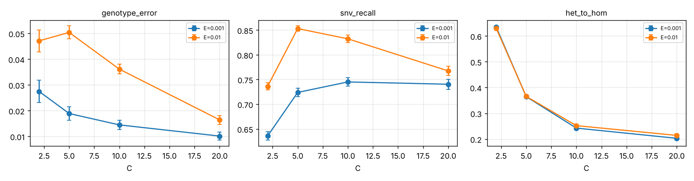
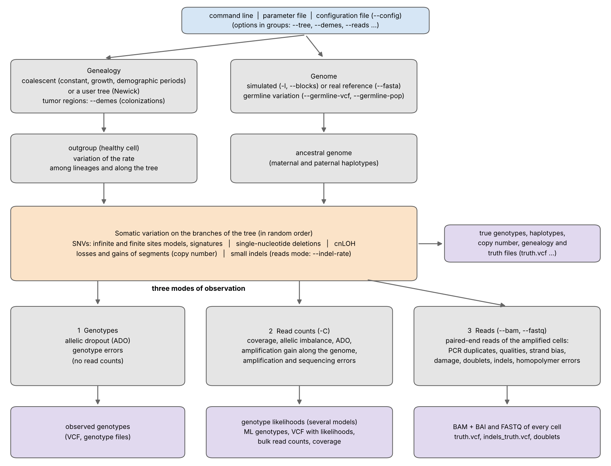
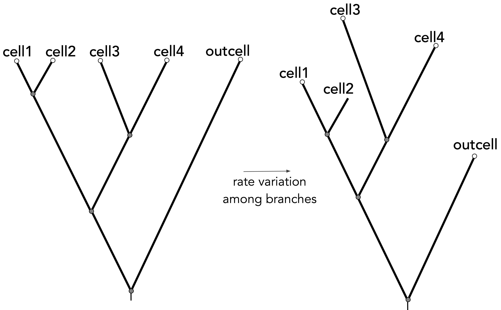

# 1. About CellCoal

CellCoal simulates the somatic evolution of single-cells including genotypes resulting from single-cell DNA sequencing. CellCoal generates a coalescent tree and can simulate a sample of diploid genomes from somatic cells –no recombination– from a growing population, together with another genome as outgroup. A typical example would be a sample of single-cell genotypes from a growing tumor population together with a healthy cell used as outgroup. CellCoal implements multiple mutation models for single-nucleotide variants (0/1, DNA, infinite and finite site models, single-nucleotide deletions, copy-neutral LOH, cancer mutational signatures) and is able to generate a .VCF file with NGS read counts and genotype likelihoods considering technical artifacts like allelic imbalance, allelic dropout, sequencing error, amplification error, plus doublet cells. It also simulates copy-number losses and gains of chromosome segments on the tree, and it works at three levels of detail (section 4.2): genotypes, read counts (the number of reads of each nucleotide in each cell and site) and, optionally, paired-end reads (BAM and FASTQ files) of the amplified cells. A chromosome can be simulated in blocks, from a real reference.

## 1.1 Development of CellCoal 2

**CellCoal 2 was developed together with Claude.** The CellCoal 2 series (versions 2.0.0 onwards) was developed by Claude, an AI model made by Anthropic, working as a coding agent (Claude Code) in collaboration with David Posada. Claude took part in all the work on the code: finding and fixing bugs, making the program faster and lighter in memory, splitting the source into modules, new features (sparse and streamed genomes, BCF output, `--summary`, `--sweep`, `--config`, `--check`), the test suite, the continuous integration, the packages for Linux, macOS and Windows, the releases and the documentation, including this text. David Posada defined the goals, made the scientific and design decisions, tested the program and approved every release, and is the author of CellCoal and responsible for it. The 2020 article describes version 1, which was written before this work.

# 2. Citation

If you use CellCoal, please cite it as:

Posada D. 2020. CellCoal: coalescent simulation of single-cell sequencing samples. *Molecular Biology and Evolution* 37: 1535-1542. [https://academic.oup.com/mbe/article/37/5/1535/5728646](https://academic.oup.com/mbe/article/37/5/1535/5728646){target="_blank"}.

# 3. Quickstart

This chapter takes you from nothing to a first simulation, a few typical analyses and an experiment over many conditions. Every command in it was run with the version of this manual and the output shown is the real one. The sections after it describe all the options.

## 3.1 Installation

CellCoal is a single command-line program (no graphical interface) for Linux, macOS and Windows. Choose one of the following ways.

**Prebuilt program (the quickest).** Each release at <https://github.com/dapogon/cellcoal/releases> has, among its assets, a file for each system (with its `.sha256`):

| System | File | Notes |
|:--|:--|:--|
| Linux (x86_64) | `cellcoal-x.y.z-linux-x86_64.tar.gz` | static, multithreaded |
| macOS (Apple silicon) | `cellcoal-x.y.z-macos-arm64.tar.gz` | includes `libomp.dylib` |
| macOS (Intel) | `cellcoal-x.y.z-macos-x86_64.tar.gz` | includes `libomp.dylib` |
| Windows (x86_64) | `cellcoal-x.y.z-windows-x86_64.zip` | includes the DLLs it needs (from release 2.2.5) |

Unpack it and run `cellcoal` (`cellcoal.exe` on Windows) from the folder that results; the folder also has the manual, the example parameter files (`examples`, `parameters`) and the plotting tools. On Linux and macOS, `tar xzf cellcoal-x.y.z-linux-x86_64.tar.gz` and then `cd cellcoal-x.y.z-linux-x86_64`. On macOS, the program is not signed by Apple, so the first time the system says that it *could not verify that cellcoal is free of malware*. It is not a problem of the program: the files downloaded from the internet carry a quarantine mark, which you remove for the whole unpacked folder (the program and `libomp.dylib`) with `xattr -dr com.apple.quarantine .` from inside it. Another way is to open *System Settings > Privacy & Security* after the first attempt and press *Open Anyway*. With Homebrew (below) or when building from the source the warning does not appear.

**Homebrew (macOS and Linux).**

    brew tap dapogon/cellcoal https://github.com/dapogon/cellcoal
    brew install cellcoal

**Conda.** The folder `conda` of the repository has a recipe; build it with `conda build conda` and install the result with `conda install --use-local cellcoal`.

**From the source code (any system with a C compiler and `make`).** Download the source of a release (or `git clone https://github.com/dapogon/cellcoal`), move into the folder and type:

    make
    make test          # optional: runs the test suite (several minutes)
    sudo make install  # optional: installs as cellcoal in /usr/local (PREFIX=... to change it)

The program is `bin/cellcoal-x.y.z`; `make install` copies it as `cellcoal`, with `cellcoal-bulk-vaf`, `cellcoal-plots`, the manual and the examples. The Makefile detects OpenMP (multithreading) by itself: `-fopenmp` with gcc and clang on Linux, Homebrew's `libomp` on macOS (`brew install libomp`), and it is always used on Windows; if it is not available the program is built single-threaded with identical results (`make OMPFLAG=` forces that). Do not add `-ffast-math` or `-march=native` to the flags if you need identical results across machines. On **Windows** use MSYS2 (UCRT64): `pacman -S make diffutils mingw-w64-ucrt-x86_64-gcc mingw-w64-ucrt-x86_64-libgomp python`, and then `make` (section 8.3).

**The plotting tools** (`tools/cellcoal_plots.py`, `tools/bulk_vaf.py`) need Python 3 with `numpy` and `matplotlib` (`pip install numpy matplotlib`). The simulator itself does not need Python.

**Check the installation.** `cellcoal -?` prints the version and a list of all the options with their default values. In the examples below, write `bin/cellcoal-x.y.z` (or the path to the program) if you did not install it as `cellcoal`.

## 3.2 Your first simulation

Create an empty folder to work in and type:

    cellcoal -n1 -s6 -l1000 -u1e-6 -e10000 -1 -6 -#1 -oFirst

It simulates one replicate (`-n1`) of a sample of 6 tumour cells (`-s6`), plus a healthy cell used as outgroup, with 1000 sites (`-l1000`), a somatic mutation rate of 10^-6^ per site and generation (`-u1e-6`) and an effective population size of 10000 (`-e10000`). `-1` writes the genotypes of the sites that have mutated, `-6` the genealogy, `-#1` fixes the seed of the random numbers (the same seed and the same options always give the same data) and `-oFirst` is the name of the folder for the results. Options are a letter followed by the value, without a space, and the ones you do not write have the defaults of section 9. The program prints a summary on the screen and writes the folder *First*:

| File | Content |
|:--|:--|
| `snv_gen` | the genotypes of the variable sites (option `-1`) |
| `trees` | the genealogy of the cells, in Newick format, with the branch lengths in expected mutations per site, which is the time multiplied by the mutation rate (option `-6`) |
| `log` | what the program did, with the version, the options, the seed and the time |
| `run.json` | the same record in a format that is easy to read from a script; a run can be repeated with `cellcoal --config First/run.json` |

The tree looks like this (the file has it on one line; the last cell, `outgcell`, is the healthy one):

    (((cell0004:0.004826,cell0006:0.004826):0.001157,
      ((cell0001:0.002138,(cell0003:0.000414,cell0002:0.000414):0.001724):0.000367,
        cell0005:0.002505):0.003478):0.002991,outgcell:0.008974);

and `snv_gen` has, after the number of replicates and the label `[#1]`, the number of cells and variable sites (here `7 70`), the positions of those sites and one line per cell with its genotype at each of them (`CG` is a heterozygous genotype, `AA` a homozygous one):

    cell0001  CG TC AA AC GT CC GA CC CC TT CA TT AA AA GG AA CG GG AA ...
    cell0002  CG TC AA AC GT CC GG CC CC TT CA TT AA AA GC AG CC GG TA ...

The healthy cell does not carry the somatic mutations, so the cells with a genotype that differs from its own are the mutated ones. If the program stops with *the diploid infinite sites model (ISM) has been violated*, the mutation rate and the population size give more mutations than sites: lower `-u` (or `-e`), or increase `-l`.

## 3.3 Examples

**Read counts, genotype likelihoods and a VCF file.** Most users simulate the sequencing of the cells. In this mode CellCoal simulates the number of reads of each nucleotide in each cell and site (read counts); individual reads, as BAM and FASTQ files, are the third mode (4.2). With a sequencing coverage (`-C`) the program simulates the read counts of every cell at every site and writes a VCF file with the read counts and the genotype likelihoods:

    cellcoal -n1 -s20 -l5000 -u1e-6 -e10000 -C10 -V5 -E0.001 -P0.2 0.02 -#1 -oReads

`-C10` is the mean sequencing depth, `-V5` the overdispersion of the depth (the coverage of single cells is very uneven), `-E0.001` the sequencing error and `-P0.2 0.02` the mean and variance of the allelic dropout (ADO) rate among cells, which the amplification of one cell's DNA produces. The result is the file `vcf` (a plain-text VCF 4.3; it can be compressed with `-z` or written as BCF with `--bcf`), `ado_cells` (the dropout rate of each cell) and the usual `log` and `run.json`. In the VCF each cell has, at each variable site, the called genotype (`GT`), the depth (`DP`), the read counts of A, C, G and T (`RC`), the log~10~ likelihoods of the genotypes, the true genotype in the sample (`TG`) and more fields that are described in section 6.12. For several replicates use `-n` and, to have one file for each, `-v`. Other outputs are the read counts as a pileup (`-9`) or in CATG format (`-8`), and the true genotypes (`-1`) and haplotypes (`-2`).

**Genotypes with errors, without read counts.** To study methods that start from genotypes, you can skip the read counts and add allelic dropout (`-D`) and genotyping errors (`-G`, mean and variance of the error rate) directly to the true genotypes:

    cellcoal -n1 -s6 -l1000 -u1e-6 -e10000 -D0.1 -G0.01 0.001 -1 -#1 -oErrors

The file `snv_gen` has now missing alleles (`?`) where there was a dropout and wrong alleles where there was an error.

**A look at the data.** `cellcoal_plots.py` (or `cellcoal-plots`, if the program is installed) draws the most common plots of a results folder. For a run with read counts and the SNV genotypes (`-1`):

    cellcoal -n1 -s20 -l3000 -u1e-6 -e10000 -C10 -V5 -E0.001 -P0.2 0.02 -1 -#6 -oLook
    python3 tools/cellcoal_plots.py all Look --outdir Look/plots

makes `report.html` with the read depth, the genotypes without read counts, a heatmap of the cells and variable sites, and the bulk VAF, and the PNG of each. The heatmap of that run (light grey: like the healthy cell, orange: one allele differs, red: both, dark grey: no reads):

{width=75%}

**Bulk sequencing of the same tumour.** If you want what a bulk sample would give, option `-0` writes the read counts pooled over the cells (one line per site, small even for thousands of cells), and `bulk_vaf.py` draws the distribution of the variant allele frequency (VAF), in this example as if the bulk was sequenced at 100x:

    cellcoal -n1 -s30 -l20000 -u1e-6 -e10000 -C10 -V5 -E0.001 -0 -Z -#2 -oBulk
    python3 tools/bulk_vaf.py --bulk Bulk/bulk --depth 100 --out vaf.png --tsv vaf.tsv

(`-Z` does not write the VCF, which is the big file; it needs another output such as `-0`.)

{width=75%}

**Doublets.** Two cells captured together appear in the data as one cell with the read counts of both. `-B0.1 0.01` makes about 10% of the cells doublets (the second number is the variance of the rate among cells). The VCF then has, for a doublet, the genotype called from the mixed read counts (`GT`, `ML`) and, in `DG`, the genotype of the second cell of the pair; `TG` is the true genotype of the cell itself, which ignores the doublet. The error of the doublets is reported apart in `--summary` (`doublet_error`).

    cellcoal -n2 -s20 -l3000 -u1e-6 -e10000 -C10 -V5 -E0.001 -B0.1 0.01 -#5 -oDoublets

**Many replicates and a table of results.** `--summary` writes `summary.tsv`, one line per replicate, with the depth of the tree, the number of mutations and, when there are reads, how well the genotypes were recovered (called fraction, genotype error, precision and recall of the variable sites, the error of heterozygous and homozygous genotypes, of doublets, and the simulated allelic dropout). Twenty replicates take about a second:

    cellcoal -n20 -s20 -l5000 -u1e-6 -e10000 -C10 -V5 -E0.001 -P0.2 0.02 -B0.1 0.01 --summary -#3 -oSummary

| replicate | tmrca | mutations | called_fraction | genotype_error | snv_recall | het_to_hom | ado_simulated |
|--:|--:|--:|--:|--:|--:|--:|--:|
| 1 | 0.745775 | 631 | 0.984100 | 0.010121 | 0.776545 | 0.188136 | 0.160035 |
| 2 | 2.112792 | 1268 | 0.974520 | 0.021775 | 0.761830 | 0.257183 | 0.214341 |
| 3 | 2.235561 | 1163 | 0.983140 | 0.021462 | 0.734308 | 0.191595 | 0.142880 |

(the first three replicates, and only some of the columns; the file has all of them). The table can be read with any tool (R, Python, a spreadsheet).

**Options in a file.** The options can be in a parameter file (`-Ffile`, with the options in blocks and comments between brackets, see the files in `examples`) or in a JSON or YAML file (`--config`). The files `examples/parameters.GTR.reads` and `examples/config.example.yaml` are complete examples with read counts:

    cellcoal -Fexamples/parameters.GTR.reads
    cellcoal --config examples/config.example.yaml

The first writes its results in the folder `results_GTR_reads` (the name is in the file) and the second in `Results`, the default. In a parameter file the seed has to be in the file as well; with `--config`, the options typed after the file replace the ones in it (for example `--config file.yaml -n1`).

**Copy-number losses and gains.** CellCoal can also add losses and gains of segments of the genome to the tree, together with the point mutations (section 5.2.8). With a loss and a gain rate above zero, `--phase` separates the maternal and paternal copies in the genotypes, and `cnv_segments` gives the true number of copies of every cell:

    cellcoal -n1 -s6 -l2000 -u1e-6 -e10000 --seg-loss-rate 1e-6 --seg-gain-rate 1e-6 --seg-len 300 --phase -1 -#5 -oCopies

In this run four of the six cells have lost the paternal copy of the sites 628 to 823 (`cnv_events` lists the event and the cells that carry it; `cnv_segments` has one row per cell and segment, for example `cell0002 628 823 1 0 1`: one maternal copy, no paternal copy, one copy in total), and in `snv_gen` the genotypes of the SNVs inside the lost segment of those cells show only the maternal allele (`G|-`).

**Reads.** To benchmark a caller, the simulation can go one step further and write the paired-end reads of every cell as BAM and FASTQ files (section 5.5):

    cellcoal -n1 -s5 -l20000 -u1e-7 -e10000 -C10 -E0.001 --ado-block 3000 -D0.1 --bam --fastq -#1 -oReadsMode

The folder `ReadsMode/reads_1` has one BAM and one FASTQ pair per cell, the reference `ref.fa` and the file `truth.vcf` with the true genotypes.

## 3.4 Tutorial: how do coverage and sequencing error change the results?

Simulating one data set tells little: one wants to know how a result changes when a condition changes. `--sweep` runs the program for every combination of the values that you list, with the same seed for all, and puts the metrics of `--summary` in one table. Here, the depth (`-C`) and the sequencing error (`-E`) are varied, with 10 replicates of 20 cells for each of the 8 combinations, 2 combinations at a time:

    cellcoal -n10 -s20 -l3000 -u1e-6 -e10000 -V5 -P0.2 0.02 -#4 \
             --sweep "C=2,5,10,20 E=0.001,0.01" --sweep-jobs 2 -oSweep

The key is the letter of the option (or its long name, as in `--config`), a range can be written `LOW..HIGH..STEP`, and the options of the command line that are not swept are the same in all the runs. The folder *Sweep* has `sweep.tsv` (for each combination, the mean of every metric over the replicates and its standard error, `_se`), `sweep_replicates.tsv` (every replicate) and `runs` (the summary of each combination, which lets `--sweep-resume` continue a sweep that was interrupted). Add `--sweep-keep` to keep the results of every run as well. Then:

    python3 tools/cellcoal_plots.py sweep Sweep/sweep.tsv --out sweep.png --metrics genotype_error,snv_recall,het_to_hom

{width=100%}

How to read it:

- `genotype_error` falls with the depth, and it is always higher with the larger sequencing error. At 20x and an error of 0.001 only 1% of the genotypes called are wrong.
- `snv_recall` (the fraction of the truly variable sites where some cell is called variant) is lowest at 2x, where many cells have no reads at a site, and it does not keep rising with the depth: from 5x on it stays between 0.74 and 0.85. It is not just a matter of reads, which agrees with the last panel.
- `het_to_hom` is the fraction of the truly heterozygous genotypes that are called homozygous. It is 0.63 at 2x, 0.25 at 10x and 0.20 at 20x, and it never goes below `ado_simulated` (the allelic dropout that was simulated, 0.187 in all the runs, see `sweep.tsv`). The difference between the two is the loss of an allele only because of a low depth, and it is the part that more coverage removes; the rest is the dropout, which no depth fixes. That is why single-cell data are so different from bulk data.

You can sweep any option of the simulation (the sequencing error `E`, the dropout `P`, the doublet rate `B`, the number of cells `s`, the mutation rate `u`, ...) and combine up to the number of values that you can wait for; `-n`, `-o`, `-#` and `-F` cannot be swept. When a metric cannot be computed (for example, without read counts) its columns show `NA`.

## 3.5 Good to know

- **Reproducibility.** The same seed (`-#`) and options give identical results in every run and independent of the number of threads (section 4.1). Without `-#`, the seed is taken from the clock and is written in `log` and `run.json`.
- **Threads.** `OMP_NUM_THREADS=4 cellcoal ...` chooses the number of threads for the read counts, the VCF and the reads (one cell per thread in the reads mode; the memory grows a little with the threads, see section 5.5); by default all the cores are used.
- **Size.** The VCF is by far the largest file (for example, 770 MB for 2 replicates of 100 cells with 30,000 sites). For many cells or sites use `-z` (compressed), `--bcf`, or write only what you need with `-Z` and `-0`, `-8` or `-9`. Runs with many sites keep the genotypes in a compact (sparse) form and, when the read counts would not fit in memory, they are generated and written site by site (section 5.4).
- **The help.** `cellcoal -?` (or `--help`) lists every option with its default value; `cellcoal --version` prints the version.
- **Check before running.** `cellcoal --check` followed by your options (or alone, to check the `parameters` file) validates them and shows what the run would do: replicates, cells, sites, expected number of mutations and tree depth, outputs, and whether the results folder exists (a run deletes it). Nothing is simulated; invalid options give a non-zero exit code.
- **Next.** Section 4 describes how options are given; section 5 how the data are simulated; section 6 every option.

# 4. Basic usage

CellCoal does not have a Graphical User Interface (GUI). It works on the Linux/Mac command line in a non-interactive fashion. It can run in two main ways parsing its arguments from a parameter file, or parsing its arguments directly from the command line.

If no arguments are passed in the command line, CellCoal will look for a file called *parameters* in the current working directory:

`bin/cellcoal-x.y.z`

The *parameters* file is a text file that contains the different arguments for the program. The arguments correspond to different letters whose case (uppercase or lowercase) makes a difference. Comments within brackets are allowed. To avoid unexpected problems, users are encouraged to maintain the same order of the arguments as in the example files. For clarity, the example parameters files are divided in different blocks or sections including related arguments.

Alternatively, users can specify their own parameter file **(option -F)**, for example:

`bin/cellcoal-x.y.z -Fexamples/parameters.ISM.binary`

Otherwise, CellCoal will run under the arguments specified in the command line, using default values for the absent arguments. For example, one could type:

`bin/cellcoal-x.y.z -n100 -s20 -l1000 -e10000 -g1.0e-04 -k1 -i1 -b1 -j250 -p0.0 -f0.3 0.2 0.2 0.3 -r0.00 0.03 0.12 0.04 0.11 0.00 0.02 0.68 0.68 0.02 0.00 0.11 0.04 0.12 0.03 0.00 -1 -2 -3 -4 -6 -9 -v -x -#200011`

where *-n* is the number of replicates, *-s* is the number of sampled cells, *-l* is number of sites, *-e* is the effective population size, *-g* is the growth rate, *-k* is the root branch length ratio, *-i* is the rate variation among branches, *-b* specifies the alphabet (DNA), *-j* is a fixed number of mutations, *-p* is the proportion of alternative model sites, *-f* are base frequencies, *-r* is the mutation matrix, *-1* to *-x* control output options, and *-#* is the seed for random number generation.

A brief usage guide plus the current default values for the different parameters can be obtained with the argument -?:

`bin/cellcoal-x.y.z -?`

## 4.1 Parallel execution and reproducibility

CellCoal uses OpenMP to generate read counts, to print the VCF file and to simulate the reads (cell by cell) in parallel. The number of threads is controlled with the environment variable `OMP_NUM_THREADS`, for example:

    OMP_NUM_THREADS=4 bin/cellcoal-2.0.1 -Fexamples/parameters.GTR.reads

If the variable is not set, OpenMP uses all the available cores. Use `OMP_NUM_THREADS=1` to run on a single core.

The genotype likelihoods of SNV sites can be kept in memory to avoid recalculating them when printing. The amount of memory used for this cache can be set, in megabytes, with the environment variable `CELLCOAL_GL_CACHE_MB` (default 256; 0 disables the cache). This setting only affects speed and memory, never the results.

> **Reproducibility.** For a given seed (option -#) and a given set of arguments, the results are identical in every run and *independent of the number of threads*. To achieve this, the read counts of each site are generated from an independent random stream derived from the seed and the site number. As a consequence, **the results obtained with a given seed in version 2.0.0 are different from those obtained with versions 1.x** (the statistical properties are the same). If you need to reproduce an old analysis, use the original version. Note that if no seed is specified the current time is used, and that when the arguments are read from a parameter file (option -F) the seed has to be specified inside that file.

**The run record.** Every run writes `Results/run.json`, a record of how it was run: program version, command line, options (including the seed that was used), number of replicates, cells and sites, number of threads, the `CELLCOAL_*` and `OMP_NUM_THREADS` environment variables that were set, the genome storage (dense or sparse) and read mode (stored or streamed) that were used, compiler, OpenMP, and the elapsed (wall clock) and CPU seconds. Together with the program version it is all that is needed to repeat a run (`--config Results/run.json`, section 6.11.2). The time reported at the end of a run is the elapsed time, followed by the CPU time.

## 4.2 The three modes and their options

CellCoal produces data in one of three ways, and each option belongs to one or more of them. `--check` says which mode the options give, and an option that the mode does not use is an error (reads mode, or a read-counts option without `-C` and `--bam`) or a note (genotypes mode).

| Mode | How | What it simulates | Output |
|---|---|---|---|
| **Genotypes** | no `-C` | genotypes of the cells with allelic dropout and genotyping error (`-G`) | genotype and haplotype files (`-1` ... `-5`, `-Y`) |
| **Read counts** | `-C` | read counts per base, cell and site (not individual reads), ML genotypes | VCF with genotype likelihoods, `-8` CATG, `-9` PILEUP, `-0` bulk, `--bcf` |
| **Reads** | `-C` and `--bam` and/or `--fastq` | paired-end reads of the amplified cells, as molecules with PCR duplicates | BAM(+BAI), FASTQ.gz, `ref.fa`, `truth.vcf`, optional healthy `normal.bam` |

| Options | Genotypes | Read counts | Reads |
|---|---|---|---|
| tree, demography, mutation, signatures, `-c`, `-d`, `-H`, `-T` | yes | yes | yes |
| allelic dropout: `-D`, `-P`, `-Q`, `--ado-block` | yes | yes | yes |
| `-G` genotyping error | yes | no | no |
| `-C`, `-J`, `-A`, `-E`, `-X`, `--gain-sd/--gain-len`, `--amp-signature`, `--amp-cell-var`, `--cov-ado-corr` | no | yes | yes |
| `-V`, `-O`, `-R`, `-I`, `-B`, `--cov-doublet-corr`, `--ado-doublet-corr`, `--min-alt-reads`, `--min-alt-vaf`, `-M`, `--coverage`, `--fast`, `-8`, `-9`, `-0`, `--bcf`, `-z`, `-Z` | no | yes | no |
| `--bam`, `--fastq`, `--read-len`, `--insert-mean`, `--insert-sd`, `--dup-mean`, `--bulk-depth`, `--qual-sd`, `--qual-slope`, `--strand-bias`, `--seq-context`, `--damage`, `--indel-rate`, `--indel-ins`, `--indel-len`, `--indel-max`, `--homopolymer-error` | no | no | yes |
| `--blocks`, `--fasta`, `--region`, `--germline-vcf`, `--germline-pop`, `--region-rates` | no | yes | yes |

Where two options look alike they do different things: `-M` keeps the sites whose **pooled** VAF (all the cells together) is at least M, whereas `--min-alt-reads` and `--min-alt-vaf` keep the sites where some **cell** has a call supported by enough reads; `-D/-P/-Q` set how much allelic dropout there is and `--ado-block` how it is spread along the genome (in contiguous segments). `-F` (parameter file) and `-U` (diploid genome in FASTA) are older: `--config` reads the options from a JSON or YAML file, and `--fasta` with `--region` and `--germline-vcf` gives a real reference.

## 4.3 Large data sets: sparse genomes and streamed read counts

CellCoal chooses how to store the data according to their size, and the results do not depend on that choice (except where noted).

**Sparse genomes.** When dense genomes would exceed 2048 MB (environment variable `CELLCOAL_DENSE_MB`), the genomes are stored sparsely: only the varying sites keep per-node columns (`CELLCOAL_SPARSE=1` forces and `CELLCOAL_SPARSE=0` disables it). Allelic dropout and genotyping errors are then applied lazily by an observation layer (same distributions, different random stream; the dropout at invariant sites is not counted). 10,000 cells x 1,000,000 sites runs in about 7 s and 360 MB for genotype outputs. Dense genomes use one byte per site. The full-sequence outputs (`-4`, `-5`, `-Y`) stop with an error on data sets above the dense limit unless the read counts are streamed. The copy-number engine (section 5.2.8) works with sparse genomes too: 10,000 cells x 1,000,000 sites with losses and gains take about 0.7 s and 260 MB for the genotype outputs.

**Streamed read counts.** When the per-cell, per-site read data would exceed 2048 MB (environment variable `CELLCOAL_STREAM_MB`), read counts and genotype likelihoods are simulated, and the VCF, PILEUP and CATG files written, in blocks of sites with small memory (`CELLCOAL_STREAM=1` forces and `CELLCOAL_STREAM=0` disables it). The results are the same as without streaming for the same seed and any number of threads. Everything that can be requested with read counts is available while streaming: VCF, PILEUP, CATG (`-8`), the bulk file (`-0`), the ML genotypes and haplotypes (`-1`, `-2`, `-3`, `-4`), the ancestors (`-5`) and the true haplotypes (`-Y`). The maximum-likelihood alleles of every site are written block by block to a temporary file (one byte per cell and site) and the files are produced from it row by row, so the memory is that of the streamed read counts and not that of all the genomes (200 cells x 60,000 sites with `-3 -4 -Y`: 106 MB instead of 825 MB; 1,000 cells x 30,000 sites with `-1` and `-8`: 191 MB instead of 1.7 GB). The temporary file has `cells x sites` bytes, about a third of the full genotype file; the files themselves still have `cells x sites` characters per haplotype, so very large genomes produce very large files. The computing time is still proportional to cells x sites and the VCF lists every apparent SNV.

**Cache of genotype likelihoods.** The likelihoods of SNV sites can be kept in memory to avoid recalculating them when printing; the memory of that cache is set, in megabytes, with `CELLCOAL_GL_CACHE_MB` (default 256; 0 disables it). Besides, the log10 genotype likelihoods of a cell and site depend only on its four read counts and on its amplification errors. Each thread keeps a cache of the likelihoods already computed, so cells and sites with the same counts share them. It is exact (the output is bit-identical, also without `--fast`) and helps most at low coverage with a common amplification error (no `-A`, or the same value everywhere): the simulation of the read counts is then about 30% faster. When the amplification error is random in every cell and site (`-A` with variance) there are no repetitions and the cache switches itself off after 4096 lookups. `CELLCOAL_NO_GL_CACHE=1` disables it; the tests use it to check that it does not change the results.

**Speed and memory.** In a test with 300 cells, 3000 sites, genotype likelihoods, ADO, doublets and one replicate, version 1.3.4 needed 17-19 s and about 1 GB, whereas version 2 needs about 4.9 s and 134 MB with one thread and about 3.4 s with two. The improvements include a compact storage of the genotype likelihoods, memoization of logarithms (exact), faster VCF formatting, the allocation of the per-cell, per-site blocks only when an option needs them (runs that print only SNV genotypes use about 66% less memory), and the OpenMP parallelization of the read counts and the VCF (`OMP_NUM_THREADS`). `--fast` (section 6.11.4) is faster still. The CI compares the speed with the latest release (section 8.1).

# 5. CellCoal implementation

The main steps of CellCoal are:

1.  Coalescent simulation of the genealogy of a sample of cells (the user can also specify a tree with branch lengths).

2.  Addition of an outgroup (a healthy cell) and, optionally, modification of the branch lengths.

3.  Simulation of a reference and an ancestral genome, with or without germline variation, or reading of a real reference.

4.  Addition of mutations along the tree in order to obtain the true genotypes: SNVs, single-nucleotide deletions, copy-neutral LOH, and losses and gains of segments (copy-number events).

5.  Addition of technical errors without generating read counts (ADO + genotype errors) OR addition of technical errors while generating read counts (ADO + amplification error + sequencing error) OR simulation of the paired-end reads of the amplified cells.

6.  Estimation of genotype likelihoods under various models.

7.  Print genotypes/haplotypes, VCF and other files.

8.  Print summary statistics.

{width=90%}

::: caption
**Fig. 1.** Main flow of CellCoal 2: the genealogy (with tumor regions if wanted), the genome, the somatic variation on the branches, and the three ways of observing the cells: genotypes, read counts or reads.
:::

## 5.1 Coalescent genealogy

CellCoal simulates a cell genealogy under the standard neutral coalescent, going backward in time (Fig. 2 left). Note that the coalescent assumes the cell sample comes from a much larger population, which in this case can be constant or growing. In the coalescent we use the *effective population size (N)*, a well-known quantity in population genetics that refers to the number of individuals in an ideal population.

> In CellCoal, time is scaled in units of *N* generations

CellCoal can consider continuous exponential population growth (Fig. 2 middle) (Slatkin and Hudson, 1991) (SH91) and multiple demographic periods (Fig. 2 right). For the latter, the exponential growth rate during the period (positive or negative) will be deduced from the specified *N* at the beginning and at the end of the period. The growth rate derived for the last period will continue into the indefinite past. This implementation is borrowed from Hudson (2002).

CellCoal also implements the coalescent parameterization of Ohtsuki and Innan (2017) (OI17) for cancer cell populations. The only difference with the SH91 model is a factor of *2b*, where *b* is the birth rate, due the consideration of overlapping generations, and the use of absolute times (expected time until a birth event). Note that if we believe that the cancer cell population starts from a single ancestral cell then we do not get an exponential growth model exactly, so both OI17 and SH91 are approximations.

> CellCoal implements two parameterizations of the coalescent with exponential growth, the first proposed the Slatkin and Hudson (1991) model, and the second developed by Ohtsuki and Innan (2017) \>(OI17) specifically for cancer cell populations.

{width=100%}

::: caption
**Fig. 2.** A random coalescent genealogy for a sample of 4 cells under constant (left), and growing population size (middle) and demographic periods (right). The effective population size is indicated as blue background. In the right, from Period 0 to Period 1 the population size experiences a severe bottleneck.
:::

### 5.1.1 Adding an outgroup

After the sample genealogy is simulated, two additional branches are added: a **root branch** and an **outgroup branch** (Fig. 3), in order to include an outgroup cell in the sample. In phylogenetics an outgroup is a distant taxon that serves as a reference and is often used for rooting purposes. The length of these two branches is controlled by the user (Fig. 3).

{width=60%}

::: caption
**Fig. 3.** Outgroup addition. The length of the root branch will be controlled by the user with the parameter -k, which specifies the length of this branch as a proportion of the sample MRCA mean depth. The length of the outgroup branch depends on the parameter -q, which is the length of this branch as a proportion of the sample/outgroup most recent common ancestor (MRCA) mean depth. In this example, the corresponding values were -k0.5 -q1.0.
:::

In a tumor scenario, the outgroup cell will be naturally a healthy cell (Fig. 4)

{width=70%}

::: caption
**Fig. 4.** Addition of a healthy cell in a tumor scenario. In this case we expect that the healthy cell has evolved much slower than the tumoral cells, so a small (or zero) outgroup might make more sense. In this example, the corresponding values where -k0.5 -q0.05.
:::

**Tumour only.** With `--no-outgroup` only the tumour cells are reported. The healthy cell is still simulated (it defines the reference, the healthy root genome with all the alleles 0, and the trunk of `-k` is kept, so the truncal mutations are variants in every cell), but it is not in the outputs:

- the outgroup is not in the tree file, the VCF/BCF, CATG, PILEUP or the genotype files, nor in the statistics, and it does not decide whether a site is a variable site;
- the tree written with `-6` contains the ingroup only, which is the format `-T` expects, so it can be read back without editing;
- the simulation of the tumour cells is not changed.

### 5.1.2 Rate variation among lineages

The standard coalescent results in an ultrametric tree, where all the tips are at the same distance from the most recent common ancestor (MRCA) of the sample. These branches can be modified by introducing rate variation among linages/branches, here using multipliers sampled from a Gamma distribution (see Fig. 5). This approach was introduced by Yang (for an easy review see Yang 1996) to add substitution rate variation among different nucleotide sites in a DNA sequence. Biologically this is interesting if we want to simulate for example a situation under which some lineages evolve at different rates.

{width=60%}

::: caption
**Fig. 5.** Rate variation among branches. Rate variation among lineages can be a product for example of changes in the mutation rate.
:::

### 5.1.3 Rate switches along the genealogy

Alternatively to the gamma rate variation, a few *rate switches* can be introduced in the genealogy (option -N). Each switch chooses one branch of the ingroup tree at random, with probability proportional to its length (the root branch is excluded, and the same branch is never chosen twice), and multiplies by a given factor the length of that branch *and* of all the branches descending from it. Because mutations accumulate along branches, a factor larger than 1 produces a clade with an accelerated mutation rate (for example, a mutator lineage), and a factor smaller than 1 a clade that evolves more slowly. If a switch falls inside the subtree of another switch, their factors are multiplied. With the noisy option -y2 or higher, the node chosen by each switch, its factor and the cells in the affected clade are printed on screen for each replicate (for example, `node 17 *0.20 ( 1 5 9 7 )`); the log file records the number of switches and their factors. For example, `-N2 4 0.2` introduces two switches, one that makes a clade evolve four times faster and another that makes a clade evolve five times slower. This option cannot be combined with rate variation among lineages (-i). See section 6.2.

### 5.1.4 Tumor regions: the structured coalescent with colonizations

By default the cells are a random sample of one panmictic population. A tumor is not like that: the primary tumor and its metastases are different regions whose cells are related inside each region more than between regions, and the SNVs shared by the cells of a region but not by the others are what spatial studies work with. The structured coalescent samples the cells from **demes** (regions). The model is one of **colonization, not of continuous migration**: the demes do not exchange cells; each metastasis is *founded* at a time by one or a few cells of its source deme and then grows apart. This assumes that the seeding happened in a single event (monoclonal, or polyclonal with several founders at the same time). It is an idealization: in a real tumor a metastasis can receive cells again later, or seed the primary tumor, and those later events are not part of the model (the cells that arrive late would make the metastasis look less like a clade of its source, as the polyclonal case does).

```
cellcoal -l1000 -u1e-7 --demes n=20:10:10,size=1:0.5:0.2,time=2:0.5,source=1:2,founders=1:3
```

Deme 1 is the primary tumor, and the other demes are colonized from another deme:

- `--deme-n` (`n=` in the group `--demes`) gives the number of cells of every deme, separated by `:` (`20:10:10` is three regions with 20, 10 and 10 cells). The number of cells is their sum and `-s` is ignored. The primary tumor (deme 1) can have 0 cells (`0:10:10`), for a primary tumor that is not sampled. The cells are numbered by deme, and the file `demes.tsv` of the results folder lists the deme (1, 2, ...) of every cell.
- `--deme-time` (`time=`, needed) is the time of colonization of the demes 2, 3, ..., in units of *N* generations before the present (`time=2:0.5`: the deme 2 was founded 2*N* generations ago and the deme 3, 0.5*N* generations ago).
- `--deme-source` (`source=`) is the deme that founded each of the demes 2, 3, ...; by default all come from the deme 1. A metastasis can seed another one (`source=1:2`: the deme 3 comes from the deme 2). The source has to exist when the colonization happens, so it has to be older than the deme that it founds.
- `--deme-founders` (`founders=`) is the number of cells that found each of the demes 2, 3, ...; by default 1 (a monoclonal metastasis: all the cells of the deme descend from one cell, and the deme is a clade of the tree), and more cells give polyclonal seeding, where the deme descends from several cells of the source and its cells are not a clade.
- `--deme-size` (`size=`) is the effective size of every deme relative to `-e` (default 1 for all). Two cells of the same deme coalesce at the rate 1/size per *N* generations, so a small deme is more clonal (its cells coalesce sooner), as a recently founded metastasis is.

Looking back in time, the cells of a deme coalesce among themselves until the colonization; there they go through the bottleneck of the founders (they coalesce until at most the founders remain) and continue in the source deme, where they can coalesce with the cells of the source. With one founder the mean coalescence time of two cells of a deme of size *s* founded at *T* is *s*(1 - exp(-*T*/*s*)), and between a cell of the primary tumor (size 1) and a cell of that deme it is *T* + 1; the simulation reproduces both (*s* = 0.5, *T* = 1: 0.43 and 2.0).

![Fig. 6. Structured coalescent with colonizations (`--demes`). **a**, the model: the primary tumor (deme 1) and metastases that are founded by colonization from a source deme, at a time, by one or a few cells; there is no exchange of cells afterwards. **b**, a genealogy of 17 cells from a real run (`--demes n=6:5:6,size=1:0.5:2,time=1.5:0.5,source=1:2,founders=1:1`), with the cells coloured by deme and the colonization times (in the time scale of the tree, from the root) as dashed lines: with one founder the cells of deme 3 are a clade, nested in the clade of the cells that descend from deme 2. **c**, a run with three founders of deme 3 (`founders=1:3`): the cells of the deme descend from several cells of deme 2 and are not a clade.](media/fig_demes.png){width=100%}

::: caption
**Fig. 6.** Structured coalescent with colonizations (`--demes`). **a**, the model: the primary tumor (deme 1) and metastases that are founded by colonization from a source deme, at a time, by one or a few cells; there is no exchange of cells afterwards. **b**, a genealogy of 17 cells from a real run (`--demes n=6:5:6,size=1:0.5:2,time=1.5:0.5,source=1:2,founders=1:1`), with the cells coloured by deme and the colonization times (in the time scale of the tree, from the root) as dashed lines: with one founder the cells of deme 3 are a clade, nested in the clade of the cells that descend from deme 2. **c**, a run with three founders of deme 3 (`founders=1:3`): the cells of the deme descend from several cells of deme 2 and are not a clade.
:::

This model cannot be combined with growth, demographic periods or a user tree (the sizes of the demes are constant), and all the other options (mutation models, copy number, reads, doublets...) work as usual on the genealogy that it produces. The doublets (`-B`) choose their donor among all the cells, not within the deme.

## 5.2 Somatic mutation models

CellCoal simulates the evolution of the genotypes along the genealogy by adding somatic events to an ancestral genome at the *sample/outgroup MRCA*. There are five kinds of events, which differ in what they do to the genome of a cell:

| Event | Option | Effect on the genotype of a site |
|---|---|---|
| **SNV** (single-nucleotide variant) | `-u` (rate) or `-j` (fixed number) | the allele of one copy of one haplotype changes |
| **Single-nucleotide deletion** | `-d` | one haplotype loses the site (`-`): one nucleotide, not a segment |
| **Copy-neutral LOH** (cnLOH) | `-H` | one haplotype takes the allele of the other (A/G becomes A/A or G/G) |
| **Segment loss** | `--seg-loss-rate` | a random copy of a haplotype is lost over a segment of sites |
| **Segment gain** | `--seg-gain-rate` | a random copy of a haplotype is duplicated over a segment of sites |

The first three are the original events of CellCoal; copy-number losses and gains (section 5.2.8) are one more type of mutation, and they are simulated together with all the others, in the order in which they happen on the branches. CellCoal considers two possible **alphabets (0/1 or DNA; option -b)** and several single-nucleotide mutation models (infinite and finite sites models, including trinucleotide mutational signatures), which can be mixed along the genome. All of them work with all the kinds of events.

> The default SNV model is a diploid infinite site model (ISM), with no deletions, cnLOH or copy-number events.

> CellCoal does not simulate other structural variants (inversions, translocations): the copy-number alterations are the single-nucleotide deletions (`-d`), cnLOH (`-H`) and the losses and gains of segments (`--seg-loss-rate`, `--seg-gain-rate`). **Small insertions and deletions** (indels of 1 to `--indel-max` bases, 10 by default and 32 at most) are a different thing: they exist only in the reads mode (`--indel-rate`, section 5.5), as events of the genealogy that change the sequence of the reads, not the genotypes of the sites.

**Two ways of adding the events.** When no loss or gain of segments is requested, SNVs, cnLOH and single-nucleotide deletions are added one kind after another, as in the earlier versions of CellCoal. When the loss or the gain rate is above zero, all the kinds of events are planned together and applied branch by branch in random order (section 5.2.8), because the order matters when the copy number changes.

### 5.2.1 The starting genome: simulated or a real chromosome

Before any mutation, CellCoal needs the genome that the cells inherit: the **ancestral genome**, which is the genome of the healthy cell and of the common ancestor of all the cells. The somatic events (SNVs, deletions, cnLOH, copy-number losses and gains) are then added to it along the tree. The starting point is always **one reference sequence** (the one that the REF column of the VCF shows): the ancestral genome is that sequence, present in the maternal and in the paternal haplotype, plus, optionally, **germline variation** (the sites where the individual differs from the reference, which make the two haplotypes differ).

There are two ways to get the reference, and then you can add germline variation to it.

**1. A simulated reference (default).** Nothing to give.

- Binary alphabet (`-b0`): all the sites are 0.
- DNA (`-b1`): a random sequence with the nucleotide frequencies of `-f`. If genetic signatures are used (`-S`), the sequence is drawn with the trinucleotide frequencies of the human genome (GRCh37), so that the signatures find the contexts they need.

**2. A real reference, such as a human chromosome.** You give a FASTA file with one sequence and the cells start from it: `--fasta FILE` (plain or `.gz`), with `--region chrom:start-end` to choose a chromosome or a region of any length. The sequence is simulated in blocks of `-l` sites on one tree, so the memory is that of one block (section 5.3). The VCF has the real positions, and REF is the base of the FASTA.

> `-U FILE` is the format of the older versions, kept for compatibility: a diploid genome of up to 10^6^ sites, with the maternal and the paternal sequence (each on one line and of the same length). Use `--fasta` instead.

**3. Germline variation (optional).** The ancestral genome is the reference with its germline SNPs:

- `-c RATE` adds SNPs at random, at that rate per site (with rate 0 the ancestral genome is the reference);
- `--germline-vcf FILE` puts the real germline SNVs of an individual (GT `0|1`, `1|0`, `1|1`) into the healthy genome; those sites are flagged `GERMLINE` instead of `SOMATIC` in the VCF. It is used with `--fasta`, and not together with `-c`;
- `--germline-pop FILE` gives the germline variation of a **population** and samples one individual from it: `FILE` is a VCF of sites with the allele frequency in `INFO/AF` (gnomAD, 1000 Genomes or any other: only the first 8 columns are used; plain or `.gz`). At every biallelic SNV of the chromosome the genotype of the individual is drawn with Hardy-Weinberg proportions: homozygous reference with probability (1-f)^2, heterozygous with 2f(1-f) (the alternative allele on a random haplotype) and homozygous alternative with f^2, where f is the frequency. So a human chromosome gets the density and the frequency spectrum of the population (most of the variants are rare and absent in the individual; the common ones are heterozygous in about half of the individuals), instead of the SNVs of one real person. The sites are sampled independently, so there is **no linkage disequilibrium** between them, and a new individual is drawn in every replicate. Sites with several alternative alleles, without `AF` or fixed (`AF` 0 or 1) are skipped. It is used with `--fasta`, not together with `-c` or with `--germline-vcf`; the sites carry the flag `GERMLINE`. Its use: the common germline SNPs are what makes a somatic caller call false SNVs when the allelic dropout or the coverage hides one of the two alleles, and with a population VCF you can test the filters that use a list of known polymorphisms.

**Which human genome?** CellCoal does not include a human reference: you give it the FASTA of the assembly that you prefer, and the program does not need to know which one it is. Any version works (GRCh38/hg38 from UCSC, Ensembl or NCBI, or GRCh37/hg19); use the one of the data that you want to mimic or compare with. The germline VCF has to be of the same assembly, and `--region` uses the sequence names of your FASTA (`chr21` in UCSC files, `21` in Ensembl) and its 1-based coordinates. The `N` bases (telomeres, centromeres, gaps) are left out of the simulation and the VCF, and lower case (soft-masked repeats) is read as upper case. With a real FASTA the mutation models, the signatures and the copy-number events work as with a simulated reference, and a signature uses the real trinucleotide contexts of the sequence, which does not depend on the assembly. The reads mode (`--bam`, `--fastq`) writes the reads of the whole chromosome in its real coordinates (section 5.5).

> Example, 20 cells from 10 Mb of human chromosome 21: `cellcoal -s20 -u2e-8 -l1000000 --fasta hg38.fa.gz --region chr21:20000000-30000000 --blocks 10 -C10 -E0.001 -P0.2 0.02 -oChr21` (10 blocks of 1 Mb of GRCh38 on one tree, with the real positions in the VCF).

Once the ancestral genome is in place, the mutations are introduced according to the mutation model.

### 5.2.2 Infinite-site SNV models

CellCoal implements several types of **single-nucleotide mutation models (option -m)**. Infinite-sites models (ISM) allow a given site to change only once. However, in a diploid scenario we can implement this model in at least two ways. Under the **diploid ISM**, a given site can change only once in either the maternal and paternal genomes. That is, the change will be for example either 0/0 -\> 1/0 or 0/0 -\> 0/1 but not both (where 0 is the ancestral allele and 1 the derived one). In consequence, under the diploid ISM, homozygous mutants (1/1) are not possible. A different implementation of the ISM, called here **haploid ISM**, considers instead maternal and paternal sites as different locations, so it allows for two somatic mutations to take place at the same site if they occur in the maternal and paternal genome. Thus, under this model 1/1 genotypes are possible. In both ISMs, the number of somatic mutations is distributed as a *Poisson* according to the total tree length (which is a function of the mutation rate and time), unless a **fixed number of mutations (option -j)** is requested. For the haploid ISM the expected number of mutation events along the tumor genealogy (the coalescent tree of the sampled cells) can be easily calculated:

$$ E\left( \text{number of mutations} \right) = \Theta \sum_{i=1}^{n-1} \frac{1}{i} $$

where $\Theta$ = 4*N*$\mu$*L*, being *N* the **effective population size (option –e)**, $\mu$ the **mutation rate per site per generation (option -u)**, and *L* the **number of sites (option -l).** This expectation is reported in the log file (when the genealogy is constant in size) and does not include the mutations that occur on the branch leading to the healthy (outgroup) cell or on the transforming branch, so the observed mean number of mutation events is higher when those branches are present (see options -k and -q). Alternatively, it is also possible to specify a **fixed number of mutations** **(option -j)** to take place along the genealogy.

The specific sites where the ISM mutations occur are selected uniformly along the genome, unless mutational signatures are requested (see below). The particular branches of the cell genealogy where mutations are located are selected according to their lengths. That is, longer branches will receive more mutations on average.

### 5.2.3 Infinite-site mutational signatures

For DNA data, mutational signatures (sensu Alexandrov *et al.* 2013) can be simulated under a **diploid infinite trinucleotide model (ISTM) (option -S)**, that considers the nucleotide context of the mutated site (bases immediately 5’ and 3’). Currently, 30 distinct signatures can be incorporated (<https://cancer.sanger.ac.uk/cosmic/signatures>) and mixed in different proportions. As in ISMs, the number of somatic mutations is distributed as a *Poisson* according to the total tree length.

Importantly, for computational efficiency, in the current implementation we assume that the genomic context is constant along the tree. That is, we select a site based on the context in the ancestral genome, before locating it in a given tree branch. Thus, this assumption will be broken in the case of contiguous mutations.

> IMPORTANT: In order to get the expected counts under each signature, one should always simulate long genomes, otherwise rare trinucleotide will not be available and, depending on the signature, could significantly bias the observed counts. For the same reason, the number of mutations should be small relative to the number of available sites of the most frequent contexts: under the infinite-sites model a site cannot mutate twice, so when the contexts favored by a signature (for example, CpG sites in signature 1) are exhausted, the observed proportions drift away from the signature.

**Signature profiles from a file.** `-S` uses the 30 COSMIC v2 signatures built into the program (they have exactly the values of `data/signatures/COSMIC_v2_SBS_GRCh37.txt`; signature 1 has 67.5% C>T in the profile, and in a simulation the share depends on how many CpG contexts the sequence has: a human sequence has few, e.g. about 59% in 200 kb of hg38). With `--signature-file FILE` the profiles come from a table in COSMIC format instead: a header line (`Type`, name of signature 1, 2, ...) and 96 lines `A[C>A]A v1 v2 ...` (the reference base is the pyrimidine; the columns are normalized to sum 1). The signature numbers of `-S` are then the columns of the file. The folder `data/signatures/` has `COSMIC_v3.6_SBS1_SBS5_GRCh37.txt` (SBS1 and SBS5 of COSMIC v3.6) and `PTA_artifact_SCAN2.txt` (the SNV artifact signature of PTA of SCAN2, Luquette *et al.* 2022; 68% C>T). Example, 40% SBS1 and 60% SBS5: `-S2 1 0.4 2 0.6 --signature-file data/signatures/COSMIC_v3.6_SBS1_SBS5_GRCh37.txt`. With a real reference as root (`-U`), SBS1 alone gives 98.7% C>T, 94% of them in CpG.

### 5.2.4 Finite-site SNV models

CellCoal also implements several **finite-sites mutation models (option -m)** (FSM) for SNVs. In this case, multiple mutations can happen along a branch. Typically, these models assume a continuous Markov process and are very typical in phylogenetics, where they are often referred as substitution models (<https://en.wikipedia.org/wiki/Models_of_DNA_evolution>).

For 0/1 data, the model implemented is known as Cavender-Farris-Neyman or Mk2 model (see Lewis 2001), and is equivalent to a Jukes-Cantor (1969) model for two alleles. For DNA data, reversible (assume that the rate X-\>Y is the same as Y-\>X) and non-reversible models can be built by specifying the **nucleotide frequencies (option -f)** (at equilibrium; they are not expected to change along the genealogy), a **transition/transversion rate ratio (option -t)** or a full 4x4 **instantaneous mutation rate matrix (option -r)**, plus **rate variation among sites** **(option -a)** (using a Gamma distribution; see Yang 1996). One can define in this way popular models like Jukes-Cantor (1969), Hasegawa-Kishino-Yano (1985) or General-Time-Reversible (Tavaré 1986). It is also possible to specify non-reversible models (i.e., asymmetrical rates among nucleotides).

### 5.2.5 Mixed ISM-FSM

Both ISM and FSM for SNVs can be incorporated by setting up a **proportion of sites expected to evolve under each type of model (option –p).** Each site is then assigned to the alternative model (option -m) with probability p, and to the default diploid ISM with probability 1-p. Also, a **relative mutation rate (option –w)** can be specified for the sites evolving under the alternative model

### 5.2.6 Single-nucleotide deletions

**Single-nucleotide deletions (option -d)** (e.g., N/N -\> –/N, or N/N -\> N/–) can be added also assuming a haploid ISM. As for SNVs, the number of single-nucleotide deletions will be distributed as a *Poisson* according to the total deletion tree length (which in this case is a function of the deletion rate and time). The specific sites where the deletions occur are selected uniformly along the genome. The particular branches of the cell genealogy where deletions are located are selected according to their (deletion) lengths.

### 5.2.7 Copy-neutral LOH

**Copy-neutral loss of heterozygosity (cnLOH) (option -H**) events (e.g., A/G -\> A/A, or A/G -\> G/G) can be added assuming a haploid ISM, which means that cnLOH cannot happen in the same site twice unless they occur in a different maternal/paternal genome. As for SNVs, the number of cnLOH events will be distributed as a *Poisson* according to the total cnLOH tree length (which in this case is a function of the cnLOH rate and time). The specific sites where the cnLOH events occur are selected uniformly along the genome. The particular branches of the cell genealogy where cnLOH events are located are selected according to their (cnLOH) lengths.

### 5.2.8 Copy-number losses and gains of segments

A **loss** removes one copy of a haplotype over a segment of sites, and a **gain** adds one extra copy. They are controlled by a rate per haplotype and generation, like the other mutations (`--seg-loss-rate`, `--seg-gain-rate`; group `--mutation loss-rate=...,gain-rate=...`), by the mean length of the segments (`--seg-len`, default 1000 sites; `--seg-loss-len` and `--seg-gain-len` set it separately for losses and gains) and by the maximum number of copies of a site (`--seg-max-copies`, default 4 in the two haplotypes together; the code allows up to 16). A segment starts at a uniform site, has a geometric length and is clipped at the end of the genome.

**Haplotypes are sets of copies.** Every haplotype (maternal and paternal) is a set of copies, and the phase of every copy is known. A cell starts with one copy of each haplotype. A loss falls on a random copy of the haplotype; if it was the last copy, the haplotype is deleted over the segment (a single-nucleotide deletion is the loss of one site). A gain copies the alleles that a random copy has at that moment, so the new copy is identical to the copy it came from, and the two copies then accumulate their own mutations.

**Everything is interleaved, in a random order.** The events of every kind (SNVs, single-nucleotide deletions, cnLOH, losses and gains) are planned for every branch of the tree and applied in the order in which they happen along the branch, so the order matters and the result is what the process would have made in a cell:

- an SNV before a gain is in both copies, an SNV after it in one only;
- an SNV inside a segment that is lost later is lost: the cells that carry the loss do not have it (with `-j` the number of SNVs is the number planned, not the number that survive; the log and `summary.tsv` report how many were lost, in `segment_losses`, `snv_lost_segments` and `segment_gains`, which appear only when the option is used);
- the SNV rate applies to every copy, so a segment with three copies receives three times the SNVs of a segment with one.

**Every substitution model works with copy-number events.** The infinite sites models (diploid and haploid ISM; a violation of the model is an error, as without copy-number events), the genetic signatures (the context is that of the root genome, as without copy-number events; a new copy draws its sites from the signature again), Mk2, the finite sites DNA models (JC, HKY, GTR and the non-reversible GTnR), the mixtures of default and alternative sites (`-p`, `-w`, section 5.2.5) and the gamma rate variation among sites (`-a`). Every copy of a segment mutates at the rate and with the model of its site. The finite sites models are simulated exactly as a Markov chain: the jumps of the chain are events, so they are ordered with the losses and gains.

**Limits.** The time and memory grow with the number of copies and with the events (a segment with several copies is stored for every cell that carries it). The observed genotypes (maximum likelihood, `NG`) stay diploid (section 5.2.9). Complex structural variants are not simulated.

### 5.2.9 Genotypes with several copies, phase and the true copy number

The text genotypes (SNV and full genotypes) list the alleles of all the copies, the maternal ones first and then the paternal ones (`GGA`, `AGT-`; a deleted haplotype is `-`). With **`--phase`** (group `--output phase`) the maternal and the paternal copies are separated by `|`, so the phase is explicit: `GG|A` is two maternal copies with G and one paternal with A; `AGT|-` is three maternal copies and the paternal lost.

| Output | What it shows with copy-number events |
|---|---|
| SNV and full genotypes (`-1`, `-3`), haplotypes (`-2`, `-4`, `-Y`, `-5`) | the alleles of all the copies; the haplotype files have one row for every copy (`cell0001m`, `cell0001m2`, `cell0001p`, ...; `-` where the cell has fewer copies) |
| VCF | `TG` lists the alleles of all the copies (`A|G|G`) and the extra FORMAT field `CN` gives the number of copies of each haplotype (`2|1`) |
| Read counts and reads | the reads of a haplotype are shared among its copies: a site with copies A,A,G has allele fractions 2/3 and 1/3 for that haplotype |
| `cnv_events` (`cnv_events_dir/` with `-v`) | one row per loss or gain, in the order in which they were applied: type, haplotype, start and end of the segment (1-based, inclusive) and the cells that carry it |
| `cnv_segments` | the true number of copies of every cell by segments of sites with the same copies: `cell start end maternal_copies paternal_copies total_copies` |

`cnv_events` and `cnv_segments` are the truth for evaluating a copy-number caller. The observed genotypes (maximum likelihood, `NG`) stay diploid: like a diploid caller on real data, they ignore the extra copies.

## 5.3 A long chromosome in blocks, and real references

`--blocks B` simulates a chromosome of B blocks of `-l` sites on **one** coalescent tree (made in the first block and reused in the others). With no recombination the sites are independent given the tree, so the blocks add up to a long chromosome without holding it in memory. The output is that of one data set: one VCF with the positions of the chromosome (CHROM `--contig`, default `chr1`; ID `snv<position>`), `summary.tsv` with one row per block and a TOTAL row (counts added, rates averaged, precision/recall/singleton recall weighted), `coverage.tsv` in chromosome coordinates, and `blocks_info.txt`. `-n` is ignored. `--ado-block` and `--gain-sd` continue from one block to the next (`--ado-origin` is set by the program; give `--ado-seed` to fix the processes). Copy-number events work inside each block.

`--fasta FILE` (plain or `.gz`, several lines per sequence, upper or lower case) uses a real reference: with `--region chrom:start-end` (1-based, inclusive) the region, otherwise the first sequence; `-l` is the size of the blocks and `--blocks B` limits their number. Sites that are not A, C, G or T are left out (not simulated, not in the VCF, not in the invariant counts); the positions of the VCF are the real ones. The reference base is the REF of the VCF.

`--germline-vcf FILE` gives the germline SNVs of the healthy genome (SNVs only; GT 0|1, 1|0, 1|1, 0/1, 1/1; unphased heterozygous genotypes are phased at random; it cannot be used with `-c`). Those sites carry the flag `GERMLINE` instead of `SOMATIC` in the VCF. `--germline-pop FILE` takes the sites of a population VCF with their allele frequency (`INFO/AF`) and samples the genotypes of one individual with Hardy-Weinberg proportions (section 5.2.1).

**Blocks and reads.** `--blocks` or `--fasta` together with `--bam`/`--fastq` simulates the reads of a whole chromosome: the reads of each block are written, in the coordinates of the chromosome, to one BAM (+BAI) and one FASTQ pair per cell (`reads_1/cellNNNN.*`), so a block is processed and released before the next one and the memory is that of one block. The BAM header and `ref.fa` have the length of the chromosome (`chrom:start-end` regions keep the real coordinates; what lies before the region, after the last block and the masked sites are `N`), and `truth.vcf` has the real CHROM and POS, REF = the reference base and the flag GERMLINE at the germline sites. No read spans the boundary between blocks nor a masked site, and the coverage, the amplification error and the gain of a cell are the same in all the blocks (the per-cell parameters are drawn in the first block).

`tools/chrom.py` is a wrapper of these options that writes the files of earlier versions (`chrom.vcf`, `chrom_summary.tsv`, `chrom_coverage.tsv` and one BED per cell) and uses `--min-alt-reads 2 --min-alt-vaf 0.3` by default. Not combined with `--bam`/`--fastq` or `-U`.

**Mutation rate along the chromosome (`--region-rates`).** Real mutation rates are not the same along the genome: late-replicating, gene-poor or closed chromatin regions accumulate more mutations than early-replicating, open ones. `--region-rates FILE` gives the relative mutation rate of regions of the chromosome. **It only makes sense when the sites have coordinates, that is, with a chromosome: a simulated one (`--blocks`) or a real one (`--fasta`).** Without them (the plain `-l` genome of the older mode) the sites have no position, so there are no regions, and the program stops with an error.

The file has one region per line, with the fields separated by blanks or tabs and the coordinates of a BED file (the start is 0-based and the end is not included): chromosome, start, end and a multiplier of the mutation rate. Lines that start with `#` are comments, and the file can be compressed (`.gz`). Sites outside the regions have multiplier 1, and the regions cannot overlap.

```
# chromosome  start     end       multiplier
chr21         20000000  22000000  3.0
chr21         25000000  26000000  0.2
```

The multipliers are divided by their mean over the chromosome, so the average rate (and therefore `-u`, theta and the expected number of SNVs) does not change: the option changes where the mutations are, not how many. With a multiplier of 3 and a mean of 1.5, a site has twice the mean rate. With blocks, a block in a hot region has more SNVs than one in a cold region, and a multiplier 0 gives a region without mutations. With `--fasta` only the lines of the chromosome of the FASTA are used (`chr21` and `21` are the same chromosome), and the coordinates are those of the FASTA, not of `--region`. With a simulated chromosome the coordinates go from 1 to the number of blocks times `-l`.

It works with every model of sites (infinite sites, finite sites and mixtures), with the gamma variation among sites (`-a`; both factors multiply) and with copy-number events. It cannot be combined with the mutational signatures. Under the infinite sites models the sites are chosen with probability proportional to their rate; under the finite sites models the rate of the site is multiplied.

> Example: `cellcoal -s20 -u2e-7 -l5000 --blocks 4 --region-rates hot.bed -1 -oHot` (four blocks of 5000 sites; with a file that gives multiplier 4 to the first 5000 positions, the first block has about 2.5 times the SNVs of the plain run, and the others fewer).

{width=100%}

::: caption
**Fig. 7.** A chromosome in blocks and the regional mutation rates. **a**, `--blocks` simulates the chromosome in blocks of `-l` sites on one genealogy, so the memory is that of one block. **b**, `--region-rates` with multipliers 4 (positions 0 to 10,000) and 0.25 (10,000 to 25,000), from real runs: the number of SNVs of every block follows the multiplier of its region, and the total does not change.
:::

## 5.4 Single-cell genomics

CellCoal can simulate the technical artifacts resulting from single-cell genomics, like allelic dropout (ADO), allelic imbalance, sequencing error, amplification error, plus doublet cells. For this, CellCoal implements three different strategies (section 4.2):

**What is simulated.** In the read-counts mode CellCoal does not simulate individual reads (no sequences, base qualities, FASTQ or BAM files; those are the reads mode, section 5.5). It simulates *read counts*: for each cell and site, how many reads support each of the four nucleotides, and the genotype likelihoods that follow from those counts. When this manual says "reads" it means those counts (the depth of a site is the total number of reads in it, and an "error read" is one of the counted reads that carries a wrong base).

1.  **No read counts are generated**; instead ADO and genotyping errors are directly imposed on the evolved genotypes at the tip of the genealogy.

2.  **Read counts are simulated** at a variable depth along the genome, including allelic imbalance, ADO, amplification and sequencing errors. Then, genotype calling is performed under different maximum likelihood models for single-cells.

3.  **Reads are simulated** (`--bam`, `--fastq`): paired-end reads of the amplified genome of every cell, with PCR duplicates, base qualities and strand bias (section 5.5).

### 5.4.1 Fixed or variable allelic dropout (ADO)

During the amplification of single-cells, one or both alleles at a single site can be lost, so a truly heterozygous genotype might appear as a homozygote (e.g., 0/1 =\> 0/\_ or 0/1 =\> \_/1). CellCoal can remove alleles from single chromosomes at a **fixed ADO rate per genotype (option -D)**. Alternatively, ADO rates per genotype can be specified to vary **across cells (option -P)** and/or **across sites (option -Q)** according to a *Beta-binomial* distribution. The ADO rate of each cell and the ADO rate of each site are sampled once and reused for all the genotypes of that cell or site (this was not done correctly before version 2.0.0). In this case, the total ADO rate is the combination of both:

`totalADO = ADOcell + ADOsite - (ADOcell * ADOsite)`

> CellCoal uses a *Beta-binomial* distribution (<https://en.wikipedia.org/wiki/Beta-binomial_distribution>) to add flexibility in the specification of different parameters, in particular to model variations across cells and sites. CellCoal uses a *Beta* parameterization based on mean and variance (see Fig. 8 for a few examples).

{width=40%}

::: caption
**Fig. 8.** Examples of probability densities for three different *Beta* distributions.
:::

The ADO rate of every cell (`-P`) is written to the file `ado_cells` (`ado_cells_dir/ado_cells.NNNN` with `-v`): one section `[#replicate]` per replicate with the columns `cell` and `ado_rate`, including the outgroup (healthy) cell. It is the rate of the cell itself; the dropout probability of a genotype also combines it with the rate of its site (`-Q`).

**Dropout in contiguous segments (`--ado-block`).** By default ADO is drawn independently at every site. In real data whole segments of one allele are lost (a region of a chromosome that was not amplified). With `--ado-block L` every allele of every cell is a two-state chain along the genome, *present* or *lost*, with segments of exponential length: lost segments of mean length L sites and present segments of mean length L(1-a)/a, where a = 1 - sqrt(1-D) is the ADO rate of an allele. The fraction of the genome lost is therefore the same as without `--ado-block`, but the lost sites are contiguous. A cell can lose one allele and keep the other, so at a heterozygous site the genotype looks homozygous over a whole segment. The ADO rate of the cells can still vary (`-P`); ADO among sites (`-Q`) cannot be combined with `--ado-block`. To simulate a long chromosome in pieces (`tools/chrom.py`), `--ado-origin O` gives the position of the first site of the piece on the chromosome and `--ado-seed S` the seed of the segments (and of the ADO rate of the cells): the segments are generated from the start of the chromosome with a seed that depends only on S, the cell and the allele, so consecutive pieces see one continuous process. The likelihood models of the genotype caller still assume the mean ADO rate (`-D`). Sparse and dense genomes give the same data.

### 5.4.2 Genotyping error

**Genotype errors (option -G)** can be directly introduced in the observed genotypes at a given rate per genotype, which is sampled from a *Beta-binomial* distribution (therefore, if desired, it can change across cells and sites). For DNA data, nucleotides are substituted by a different one according to a user-defined error matrix (option -X); the rows of the matrix are normalized, so the substituted nucleotide is drawn with probabilities proportional to the entries of its row (with the default matrix each of the three other nucleotides has probability 1/3; before version 2.0.0 the first non-zero entry was always chosen). These errors encapsulate into a single class different types of error than can take place along the single-cell genomics pipeline, like amplification, sequencing and calling errors.

### 5.4.3 Sequencing coverage

For each individual genotype the program will generate read counts at a certain sequencing coverage or depth. For a given site the number of reads will follow a *Poisson* distribution around the **mean coverage (option -C)**, unless **coverage dispersion (option -V)** is specified, in which case the coverage per site will follow a *Negative Binomial* distribution. Reads will randomly assigned to the maternal or paternal genome, according to a given **allelic imbalance (option -I)** whose *Beta-binomial* mean by default is 0.5 (i.e., the same probability for maternal or paternal read). If the genotype is haploid due to ADO, the expected **haploid coverage reduction (option -R)**, which is 0.5 by default, can also be specified.

**Variation of the depth among sites and cells (`-O`, `-J`).** Some sites are covered more than others in all the cells (mappability, capture or amplification bias) and some cells are sequenced deeper than others (library size, amplification efficiency). `-O` multiplies the depth expected at every site by a gamma variate shared by all the cells and `-J` multiplies the depth of every cell, at all its sites, by a gamma variate; both have mean 1, so `-C` stays the mean.

**Amplification gain along the genome (`--gain-sd`, `--gain-len`).** Single-cell whole-genome amplification (MDA, PTA...) does not cover the genome evenly: the depth of a cell changes smoothly over regions of kilobases to megabases, and the two haplotypes are amplified differently. With the default model the depth of every site is drawn independently, so there is no such structure. With `--gain-sd S --gain-len L` every haplotype of every cell has a *gain*: a lognormal multiplier with mean 1 and log-standard deviation S that is constant over segments of exponential length (mean L sites) and independent between segments. The mean read depth of each allele is multiplied by its gain, so one mechanism produces autocorrelated coverage (the total depth is the sum of the two haplotypes), allelic imbalance that changes along the genome (the haplotypes have different gains) and, together with `-D` / `--ado-block`, dropout where the gain is low. `--ado-block` is the all-or-nothing version of the same idea; the gain is the continuous one, and both can be used together. The process starts at chromosome position 0 and is generated from a seed that depends only on `--ado-seed`, the cell and the haplotype, so that the pieces of a chromosome simulated with `--ado-origin` (as `tools/chrom.py` does) see one continuous process. Example: `-C30 --gain-sd 0.6 --gain-len 40000` gives windows of 5 kb with a correlation between neighbours of 0.86 and the same mean depth (30); without it the correlation is 0. Larger S and L mimic MDA, smaller values PTA; these parameters have to be taken from real data (for example from the per-cell coverage profile that `--coverage` writes). Needs read counts (`-C`).

### 5.4.4 Amplification error

In order to obtain enough DNA material from single-cells for sequencing library construction, the genomes of single cells are most often amplified. During this amplification step, the DNA polymerase can introduce nucleotide errors that can appear in a high proportion of the resulting templates for that site if occurring during the first amplification cycles. If many templates contain an error, many reads will be also be wrong for the specific site. The **amplification error (option -A)** for a given maternal/paternal site follows a *Beta-binomial* distribution with mean and variance specified by the user. The probability of the different types of errors (e.g., A=\>C, A=\>G, A=\>T ,etc.) can be indicated using an **4x4 error matrix (option – X)**. CellCoal considers two different amplification error models:

**Four-template model**: In this case all four bases can be present, due to *multiple* amplification errors, in the set of amplified templates (Fig. 9).

{width=55%}

::: caption
**Fig. 9.** Four-template model for amplification ($\gamma$) and sequencing ($\varepsilon$) error.
:::

**Two-template model**: In this case only the original base and a single alternative can be present, due to a *single* amplification error, in the set of amplified templates (Fig. 10).

{width=50%}

::: caption
**Fig. 10.** Two-template model for amplification ($\gamma$) and sequencing ($\varepsilon$) error.
:::

**Amplification error that varies among cells (`--amp-cell-var`).** With `-A MEAN VAR MODEL` the fraction of wrong templates of every cell, site and haplotype comes from the same beta distribution in all the cells. In real data some cells amplify much worse than others. `--amp-cell-var V` (or `amplification_error_cell_variance: V` in a configuration file) first draws, for every cell and replicate, its own mean amplification error from a beta distribution with mean `MEAN` (from `-A`) and variance `V`; then the fraction of wrong templates of every site and haplotype of that cell is drawn from a beta distribution with that mean and a variance that keeps the concentration of `-A`, that is `VAR * m_i (1 - m_i) / (MEAN (1 - MEAN))` for a cell with mean `m_i`. It needs `-A`, and `V` has to be smaller than `MEAN (1 - MEAN)`. The mean of every cell is written to `cell_params` (new column `amplification_error`). The per-cell means are drawn from the main random stream after the other per-cell parameters, so the rest of the simulation (genealogy, mutations, coverage and ADO of the cells) is the same with and without the option; stored and streamed read counts give the same files. Without the option the output is identical to the previous version.

Example, with the mean amplification error of the cells spread roughly between 0.01 and 0.1 and the ADO rate of the cells roughly between 0.2 and 0.5:

```
cellcoal -n10 -s100 -l100000 -u5.3e-7 -m2 -p1 -q0 -P0.35 0.0075 -C10 -E0.01 -A0.055 0.003 0 --amp-cell-var 0.0007 -9 -5 -Y
```

**Trinucleotide profile of the errors (`--amp-signature`).** The amplification error (`-A`) is by default the same at every site and its substitutions follow the error matrix (`-X`). With `--amp-signature FILE`, `FILE` is a table in COSMIC format (the first column is used; see `--signature-file`) with the 96-context profile of the errors, for example `data/signatures/PTA_artifact_SCAN2.txt`, the PTA artifact signature of SCAN2 (Luquette *et al.* 2022; 68% C>T). Then:

- the mean amplification error of a site depends on its trinucleotide context (taken from the healthy root genome): the rate of the context is the mass of the profile in that context divided by the frequency of the context in the sequence, so that the mean over the sequence is still the `-A` value;
- the variance keeps the concentration of `-A`, and the substitution of an error is drawn with the probabilities of the three substitutions of that context in the profile (a purine base uses the reverse complement context);
- the genotype likelihoods use the same context-specific substitutions.

Needs read counts (`-C`) and `-A`; the first and last sites of the genome have no context and use the matrix `-X`. In a simulation with the PTA profile the spectrum of the errors reproduces the 96-context signature (correlation 1.0 with 10 cells at 30X, `-A0.02 0.0002 0`). Without `--amp-signature` the data are unchanged.

### 5.4.5 Sequencing error

Once the genomes have been amplified, during sequencing, additional errors can add to the reads. **Sequencing error (option -E)** is assumed to be constant across sites and cells. The probability of the different types of errors (e.g., A=\>C, A=\>G, A=\>T, etc.) uses the same 4x4 error matrix **(option – X)** as the amplification error.

### 5.4.6 Cell doublets

Sometimes, due to errors during the cell isolation process, a single sequencing library can contain DNA templates from two cells, and therefore reads which are assume to come from a single cell come in fact from two different cells. This is called a *doublet*. CellCoal can consider the effect of cell doublets by producing the read counts of two of the sampled cells and adding them as if they originated from a single cell, given a user-specified **doublet rate per cell (option -B)**.

### 5.4.7 Correlations among the parameters of the cells

In real data the cells that amplify badly often have both low coverage and high allelic dropout. `--cov-ado-corr RHO` (or `cov_ado_correlation: RHO` in a configuration file), with RHO between -1 and 1, correlates the coverage multiplier of the cells (`-J`) with their ADO rate (`-P`); both options are required. RHO < 0 means that cells with more dropout have less coverage (the usual case), RHO > 0 the opposite, and 0 (the default) no relation.

It works as a Gaussian copula on the ranks: the coverage multipliers that `-J` has drawn are reassigned to the cells so that their ranks follow `RHO z + sqrt(1-RHO^2) e`, where `z` are the normal scores of the ranks of the ADO rates and `e` is standard normal noise. Only the assignment changes, so the ADO rates (see `ado_cells`) and the distribution of the coverage multipliers are exactly those requested without the option, and the rank (Spearman) correlation of the two is close to RHO. The observed depth is noisier than the multiplier, so the correlation measured in the data is somewhat smaller. Without the option the output is bit-identical to previous versions.

Doublets can be correlated with the other per-cell parameters too. `--cov-doublet-corr RHO` correlates (-1 to 1) the coverage multiplier of a cell (`-J`) with the cell being a doublet (`-B`); `--ado-doublet-corr RHO` does the same with the ADO rate (`-P`). They can be combined with `--cov-ado-corr`; the three correlations must form a valid correlation matrix (otherwise the program stops with a parameter error). The cells are ranked with a Gaussian copula: each cell gets a latent score that is a mixture of the standardized latent coverage and ADO values and independent noise, and the cells with the highest scores become the doublets, so the number of doublets is the same as without the correlation. The correlation is between latent variables; the observed correlation between a 0/1 doublet indicator and a continuous variable is smaller (about 0.75 times the latent value with 30% of doublets). The coverage, ADO rate and doublet status of every cell are written to `cell_params` (columns `cell`, `coverage_multiplier`, `ado_rate`, `doublet`, `donor`) whenever a correlation is used. Without the new options the output is identical to the previous version. Stored and streamed read counts give the same files.

### 5.4.8 Genotype likelihoods

CellCoal can simulate genotype likelihoods for single-cell NGS data, given the read counts simulated, and the sequencing and amplification errors specified by the user, plus ADO, under three different models: GATK standard, 4-template and 2-template models. The basic model used to calculate the genotype likelihoods is similar to that implemented in GATK (DePristo et al. 2011; see also Korneliussen et al. 2013):

$$ \Pr\left( D \middle| G = \{ A_{1},A_{2}\} \right) = \prod_{i = 1}^{M}{\Pr\left( b_{i} \middle| G = \{ A_{1},A_{2}\} \right)} = \prod_{i = 1}^{M}\left( \frac{1}{2}\ p\left( b_{i} \middle| A_{1} \right) + \frac{1}{2}\ p\left( b_{i} \middle| A_{2} \right) \right) $$

where

*G* = genotype

*A* = allele

*M* = number of reads

*b~i~* = observed base in read *i*

$\varepsilon$ = probability of sequencing error

Moreover, it is straightforward to include ADO in this computation, as in Zafar et al. (2016):

$$ \begin{aligned} \Pr\left( D \middle| G = \{ A_{1},A_{2}\} \right) = (1-\delta) \prod_{i = 1}^{M}{\Pr\left( b_{i} \middle| G = \{ A_{1},A_{2}\} \right)} + \\ \delta \left( \frac{1}{2} \prod_{i = 1}^{M}{\Pr\left( b_{i} \middle| G = \{A_{1}, -\} \right)} + \frac{1}{2} \prod_{i = 1}^{M}{\Pr\left( b_{i} \middle| G = \{ -, A_{2}\}\right)}\right) = \\ (1-\delta) \prod_{i = 1}^{M}\left( \frac{1}{2}\ p\left( b_{i} \middle| A_{1} \right) + \frac{1}{2}\ p\left( b_{i} \middle| A_{2} \right) \right) + \\ \delta/2 \prod_{i = 1}^{M} p \left(b_i|A_1 \right) + \delta/2 \prod_{i = 1}^{M} p \left(b_i|A_2 \right) \end{aligned} $$

where $\delta$ is the probability of ADO at a given site.

Importantly, CellCoal can calculate the genotype likelihoods, with or without ADO, under three different models: GATK-like, 4-template and 2-template models, which only differ in how the probability of a particular read given the true allele, *p(b\|A)*, is calculated, as explained in the next three subsections.\
\

#### 5.4.8.1 GATK-like model

It assumes the same sequencing error rate ($\epsilon$) for all bases and sites, and no amplification error. In this case, the probability of a particular read given the true allele, *p(b\|A)*, is:

$$ p\left(b|A\right) = \left\{\begin{matrix} \varepsilon/3, b\neq A \\ 1 - \varepsilon, b = A \\ \end{matrix} \right. $$

 where

*b* = observed base in read

*A* = true allele

$\varepsilon$ = probability of sequencing error per site

\

#### 5.4.8.2 Four-template amplification error model

This model extends the previous one in order to consider the amplification error, which, together with the sequencing error, can be different for distinct bases **(option – X**) and that is sampled for each site from a *Beta-binomial* distribution with mean and variance specified by the user **(option -A)**. It allows for multiple amplification errors at a single site, and therefore that all four templates are possible (the correct one and the other three; see Fig. 8 above). In this case, *p(b\|A)* is:

$$ p\left(b|A\right) = \sum_{j = 1}^{4}{p\left( t_{j} \middle| A \right)\ p\left( b|t_{j} \right)} = \sum_{j = 1}^{4}\gamma_{A \rightarrow t_{j}}\varepsilon_{t_{j} \rightarrow b} $$

where

$$ \gamma_{i \rightarrow j} = \left\{ \begin{matrix} \gamma e_{i \rightarrow j}, i \neq j \\ 1 - \gamma, i = j \\ \end{matrix} \right.\ \ \ ,\ \ \ \varepsilon_{i \rightarrow j} = \left\{ \begin{matrix} \varepsilon e_{i \rightarrow j}, i \neq j \\ 1 - \varepsilon, i = j \\ \end{matrix} \right.\ $$

and where

*b* = observed base in read

*A* = true allele

*t~j~* = amplified allele template

$\varepsilon$ = probability of sequencing error for a given site

$\gamma$ = probability of amplification error for a given site

$\gamma_{i \rightarrow j}$ = probability of amplification of base *i* into template base *j*

$\varepsilon_{i \rightarrow j}$ = probability of sequencing error from template base *i* to read base *j*

$e_{i \rightarrow j}$ = relative probability of amplification/sequencing error from base *i* to base *j*\
\

Note that if the amplification and sequencing errors are constant, the probability of observing a read *r* coming from an allele *A* simplifies to:

$$ p\left( b \middle| A \right) = \left\{ \begin{matrix} \left( 1 - \gamma \right)\ \varepsilon/3\ + \ \gamma\ \frac{1 - \varepsilon/3}3, b \neq A \\ \left( 1 - \gamma \right)\left( 1 - \varepsilon \right)\ + \ \gamma\ \varepsilon/3,b = A \\ \end{matrix} \right.\ $$

\

#### 5.4.8.3 Two-template amplification error model

This model is very similar to the previous one, but it assumes that only a single amplification error can occur at a single site, and that therefore only two templates (the “correct” one and a wrong one) are possible (see Fig. 9 above). In this case *p(b\|A)* is:

$$ p\left(b|A\right) = \sum_{\substack{j = 1 \\ j \neq A}}^{4}{p\left( t_{j} \middle| A \right)\ p\left( b|t_{j} \right)} = \sum_{\substack{j = 1 \\ j \neq A}}^{4}e_{A \rightarrow t_{j}} \ [(1-\gamma) \ \varepsilon_{A \rightarrow b} + \gamma \ \varepsilon_{t_j \rightarrow b}] $$

where

*b* = observed base in read

*A* = true allele

*t~j~* = amplified allele template

$\varepsilon$ = probability of sequencing error for a given site

$\gamma$ = probability of amplification error for a given site

$\gamma_{i \rightarrow j}$ = probability of amplification of base *i* into template base *j*

$\varepsilon_{i \rightarrow j}$ = probability of sequencing error from template base *i* to read base *j*

$e_{i \rightarrow j}$ = relative probability of amplification/sequencing error from base *i* to base *j*\
\

### 5.4.9 How the dropout, the coverage and the amplification fit together, and how to simulate MDA and PTA

The options of the amplification act in a fixed order, from what happens to the alleles to what the sequencer reads:

1. **Allelic dropout** (`-D`, `-P`, `-Q`, `--ado-block`): some alleles are lost. It is decided for every allele of every cell, before there are reads, and it is all or nothing (a heterozygous site looks like a homozygote).
2. **Amplification gain** (`--gain-sd`, `--gain-len`): every allele that was not lost gets a multiplier of its depth, smooth along the genome. It is the *continuous* version of the dropout: where the gain is very low the depth is close to zero and the allele is practically lost, where it is high the allele is over-represented. The two are independent mechanisms and can be combined: the dropout removes alleles completely, and the gain varies the depth of the others.
3. **Genotype errors** (`-G`), in the modes that use them.
4. **Coverage and reads**: the depth of every site is drawn around `-C` (`-V` dispersion, `-O` variation among sites, `-J` variation among cells), multiplied by the gain of the allele; an allele without a partner after dropout gets the haploid reduction `-R` in the read counts mode. Then come the amplification error (`-A`, `--amp-signature`) and the sequencing error (`-E`).

So the dropout *is* part of the coverage: an allele that dropped out has no reads whatever `-C` is, and the gain changes how many reads the others have. There is no double counting if the options are read as different causes. **`-D` is the probability that an allele disappears; `--gain-sd` is how unevenly the surviving alleles are amplified; `-V`, `-O` and `-J` are the sampling noise of the sequencing on top of that.** If you have measured coverage profiles of your cells, `--coverage` writes the depth along the genome of the simulated ones to compare, and a sensible way to calibrate is: choose `--gain-sd` and `--gain-len` so that the autocorrelation and the spread of the depth look like those of the real cells, and then `-D` or `--ado-block` so that the fraction of heterozygous sites with one allele lost matches the real one.

**MDA and PTA.** CellCoal has no option that says "MDA" or "PTA", because what distinguishes the methods is quantitative and depends on the protocol, the polymerase, the cell and the pipeline. The methods differ in which of these properties they have, and each property is one option:

| Property | MDA | PTA | Options |
|---|---|---|---|
| Evenness of the coverage along the genome | low: large smooth changes of the depth | high | `--gain-sd` (larger for MDA), `--gain-len` |
| Allelic imbalance and dropout | frequent | much less | `-D`, `-P`, `--ado-block`, and the gain |
| Errors made in the amplification, and how much they spread | the errors of the early cycles are copied to many templates | the amplification is quasilinear from the primary template and the errors do not propagate | `-A` (mean and variance; smaller for PTA), `--amp-signature` |
| Variation of the depth among cells | large | smaller | `-J` / `-P` |

`examples/config.mda.yaml` and `examples/config.pta.yaml` are two complete configurations (read counts mode) that differ in those options. **Their numbers are illustrative, not measured**: the published comparisons (for example Gonzalez-Pena et al. 2021, *PNAS* 118: e2024176118) give the order of the differences (PTA covers more of the genome, more uniformly, with less dropout and fewer false positives than MDA), not parameters for a model like this one, so the values have to be taken from your own data. With the two examples, `cellcoal --config examples/config.pta.yaml` and the same with `mda`, the effect of the method on the calling can be compared with the same genealogy (same seed).

## 5.5 Reads of single-cell genomes (BAM and FASTQ)

With `--bam` and/or `--fastq` (and `-C`, diploid DNA) CellCoal does not simulate read counts but paired-end reads of the amplified genome of every cell, for benchmarking any single-cell caller (SCAN2, PTATO, SCcaller, Monovar...). Output in `<results>/reads_<n>/`: `cellNNNN.bam` (+ `.bai`, sorted, one read group per cell), `cellNNNN.R1.fastq.gz` and `.R2.fastq.gz`, `ref.fa` and `ref.fa.fai` (the healthy root genome, contig `--contig`, default `chr1`) and, with `--bulk-depth D`, `normal.bam`/FASTQ of the healthy genome (no amplification).

Model. For every cell and haplotype, molecules (fragments of length N(`--insert-mean`, `--insert-sd`)) start along the genome with a density set by `-C` and `-J`, the gain (`--gain-sd`/`--gain-len`: a multiplier per haplotype and segment, which is the amplicon structure) and the allelic dropout (`-D`, `--ado-block`: fragments that fall in a lost segment are not produced). Errors of the amplification (`-A`, `--amp-signature`) are events at sites with a fraction of the molecules carrying the wrong base; the molecule carries them and **copies them to its PCR duplicates** (`--dup-mean M`: extra copies per molecule, geometric; default 0.3, about 23% duplicates). Sequencing errors (`-E`) are independent in each read. Reads are 150 bp (`--read-len`), flags 99/147/83/163, duplicates marked 1024, tags `RG`, `HP` (haplotype 1/2) and `MI` (molecule).

**Memory.** The genome of every cell is simulated in tiles of 262,144 bases, and the BAM records that are complete after each tile are written at once, so the memory of the reads does not depend on the length of the genome or on the depth (a few tens of MB per thread). What is left is the memory of the simulation itself (about 240 bytes per site for 4 cells, and more for more cells): a chromosome in blocks (section 5.3) needs only that of one block (4 Mb in 20 blocks, 8 cells, 30X: 87 MB), and without blocks 4 Mb need about 1 GB. Every cell and haplotype has its own random stream that goes on from tile to tile, so the BAM files are the same for any size of tile (environment variable `CELLCOAL_READ_TILE`, for tests) and for any number of threads; only the order of the records of the FASTQ files depends on the size of the tile. The molecules are numbered (`MI` tag) in an order that depends on the haplotype, not in the order of the positions.

Truth: `reads_<n>/truth.vcf` has the true genotype of every cell (before dropout and genotyping errors; GT maternal|paternal, INFO `NC` cells carrying the allele, `GERMLINE` for sites where the healthy genome differs from `ref.fa` or is heterozygous). `tools/benchmark.py eval truth.vcf caller.vcf` gives cell-level and site-level precision/recall of any caller's VCF (and singleton recall); `tools/benchmark.py pileup reads_1` is a naive pileup baseline with and without the PCR duplicates.

Doublets (`-B`, section 5.4.6) work here too: the BAM and FASTQ files of a doublet contain the reads of the cell and of its donor (each with its own coverage multiplier and amplification), and `doublets.tsv` in the reads folder lists every doublet and its donor (the same pairs are in `cell_params`). Limits of this first version: no indels, one contig, the quality is constant (Phred from `-E`). `tools/bamcheck.py ref.fa x.bam` is a dependency-free BAM checker.

By default every base of the reads has the same quality, Q = -10 log10(E). **`--qual-sd S`** and **`--qual-slope B`** make it variable: the probability of a sequencing error of a base is `E * w * m`, where `w` rises along the read (log-slope `B` between the first and the last cycle; positive = worse towards the end, as in Illumina) and `m` is a lognormal multiplier of every base (log-sd `S`); both have mean 1, so `-E` stays the mean error. The quality written to the BAM and the FASTQ is the quality of that probability (Q = -10 log10 p, between 2 and 41), so it is calibrated: the observed error rate of the bases with Q 20-23 is about 0.007. The cycle of the second read of a pair runs from its own 5' end. Quality-aware callers can then be tested; `benchmark.py pileup --min-bq Q` ignores the bases below Q. Default 0 and 0 (constant quality): the data are identical to before.

**Errors that depend on the sequence (`--seq-context FILE`).** Illumina errors are not uniform along the sequence: some motifs (such as GGC, a C that follows GG) and homopolymers fail much more than the rest, so the false SNVs of real data pile up in some contexts. `FILE` has one context per line, with the three bases in the direction of the sequencing (the two bases read before and the base itself) and a multiplier of the error probability of that base; `N` stands for any base, lines that start with `#` are comments, and a later line overrides an earlier one on the contexts that both match. For example:

```
# a C after GG is read with 8 times the usual error; the homopolymers of G with 3 times
GGC  8
GGG  3
```

The contexts that no line mentions have multiplier 1. The multipliers are divided by their mean over the trinucleotides of the reference, so `-E` is still the mean error of the reads and only its distribution along the sequence changes (with the example, `GGC` has an error of about 7 times `-E`). The second read of a pair is read in the opposite direction, so its context is the reverse complement of the genome (it is read in its own direction, as the sequencer does). It combines with `--qual-sd` and `--qual-slope` (the factors multiply), needs `-E` greater than 0, and the qualities written are calibrated, so a quality-aware caller sees the low qualities of the risky contexts. The substitutions follow the error matrix (`-X`). It works in the reads mode only. Without the option the data are identical to before.

**Damage of the library (`--damage SPEC`).** Oxidation (G>T) and deamination (C>T) damage the DNA before the PCR and create false SNVs with a signature that callers use to filter them: the change is seen in only one orientation of the reads (the *orientation bias*, F1R2 against F2R1). `SPEC` is a list of items `FROM>TO:RATE` separated by commas, for example `G>T:0.002,C>T:0.001`, where RATE is the probability that a FROM base of a strand of the molecule is damaged. A damaged G of the top strand is a T in the read that sequences that strand (the forward read); a damaged G of the bottom strand is a C of the genome that is seen as an A in the reverse read. The damage happens in the molecule, **before the PCR duplicates**, so the duplicates inherit it (unlike the sequencing errors, which are independent in each read), and it also happens in the healthy bulk sample (which a caller can use to remove it). It works in the reads mode only; without the option the data are identical to before.

**Insertions and deletions (`--indel-rate R`).** Without this option the reads have substitutions only (CIGAR `150M`). With it, small insertions and deletions happen on the branches of the genealogy, on one haplotype, and every cell below the branch inherits them; the reads that overlap an indel carry it and their CIGAR has `I` and `D` operations (an inserted base at the end of a read is soft-clipped, `S`). It is the way to evaluate indel callers and the realignment, and the false SNVs that an aligner leaves around an indel. `R` is the rate of indels relative to the substitution rate (`-u`): `--indel-rate 0.1` gives one indel for every ten substitutions, a realistic proportion. `--indel-ins F` is the fraction of insertions (default 0.5), `--indel-len M` the mean length (default 2, a geometric distribution) and `--indel-max N` the maximum length (default 10, up to 32). The indels are placed at random over the chromosome, following `--region-rates` if it is given (the number of indels of a block and their positions follow the multipliers of the regions, as the substitutions do), and are **left-aligned** against the reference, as a variant caller reports them (the same indel in a homopolymer or a repeat always has the same position). The inserted bases are random. If an indel falls inside a deletion of the same haplotype it is lost with it. A substitution inside a deleted segment is not seen. The truth is `reads_<n>/indels_truth.vcf`: one line for each indel (VCF representation: `POS` is the base before the indel, a deletion has the deleted bases in `REF`, an insertion has the new bases in `ALT`), with `TYPE`, `LEN`, `NC` (cells that carry it) and the true genotype `GT` of every cell (maternal|paternal, 1 when the haplotype carries the indel). `truth.vcf` keeps the substitutions only. Indels work with `--blocks`/`--fasta` and with the doublets (the reads of the donor carry the donor's indels), and give the same BAM for any tile size and number of threads; they combine with segment losses and gains (the extra copies of a haplotype carry its indels; the reads of a lost segment do not exist). The indels of the genealogy are somatic (there are no germline indels), and the sequencing indel errors are made with `--homopolymer-error`. It works in the reads mode only; without the option the data are identical to before.

**Indel errors of the sequencer (`--homopolymer-error P`).** The most common false indels of real data are made in homopolymers: the polymerase or the sequencer adds or loses a base of a run of equal bases. With this option every run of 3 or more equal bases of a read, at the time of the sequencing, gets one base more or one base less (equal probability) with probability `P` times (length - 2), up to 0.5 (a run of 3 bases changes with probability `P`, one of 6 with `4P`; a typical value is 0.001). The errors are independent in each read, also in the PCR duplicates, and they are indels of the read, not of the genome: the CIGAR has the `I` or `D` (the deleted base is the first of the run and the inserted one follows it, left-aligned), the rest of the read is aligned as usual, and `indels_truth.vcf` does not list them. It works with or without `--indel-rate`, in the BAM and the FASTQ and in the healthy bulk sample, and it gives the same BAM for any tile size and number of threads. Reads mode only; without the option the data are identical to before.

![Fig. 11. Indels in the reads mode. **a**, an indel is an event of the genealogy that changes the haplotype of the cells below its branch; the reads that overlap it carry it, and the CIGAR has `D` and `I` operations (the reference and haplotype rows are aligned; `-` marks a deleted or an inserted base). **b**, an indel in a repeat has equivalent placements; CellCoal reports the leftmost one, as a variant caller does. **c**, `--homopolymer-error`: a run of equal bases of a read gets one base more or less (an error of the read, not of the genome). **d**, lengths of the indels from real runs (`--indel-len 2` and `4`, `--indel-max 10`): geometric, with the excess at the maximum.](media/fig_indels.png){width=100%}

::: caption
**Fig. 11.** Indels in the reads mode. **a**, an indel is an event of the genealogy that changes the haplotype of the cells below its branch; the reads that overlap it carry it, and the CIGAR has `D` and `I` operations (the reference and haplotype rows are aligned; `-` marks a deleted or an inserted base). **b**, an indel in a repeat has equivalent placements; CellCoal reports the leftmost one, as a variant caller does. **c**, `--homopolymer-error`: a run of equal bases of a read gets one base more or less (an error of the read, not of the genome). **d**, lengths of the indels from real runs (`--indel-len 2` and `4`, `--indel-max 10`): geometric, with the excess at the maximum.
:::

**`--strand-bias P`** makes a fraction P of the errors of the amplification strand specific: the molecule that carries the error shows it only in the reads of one strand (the left read of the pair is the forward strand, the right read the reverse strand). In real data many artifacts (damage, copy errors of one strand) have this signature and callers filter them with the alternative reads on each strand. `benchmark.py pileup --both-strands` adds the baseline that requires alternative reads on both strands: with `--strand-bias 0.8` (20 cells, 8X) the false positives of the baseline fall from 1229 (duplicates out) to 407 and its recall from 0.74 to 0.58. Default 0.

In reads mode allelic dropout has to be given in segments (`--ado-block`); with `-D` alone (independent at every site) almost no fragment of 300 bp survives, and CellCoal now says so instead of writing empty BAM files.

## 5.6 Which sites are called: `--min-alt-reads` and `--min-alt-vaf`

A site is written to the VCF when some cell has a non-reference maximum-likelihood genotype. With many cells this is almost always true, because a small genotype error per cell adds up (100 cells, 10X, error 0.001, ADO 0.25: about 85,000 of 200,000 sites). `--min-alt-reads M` asks for at least M reads of the alternative allele in a cell that is called non-reference. It does not count cells, so singletons (a mutation in one cell only) are kept.

Example (100 cells, 100 kb, 10X, ADO 0.25, error 0.001, `-u2.4e-8`, one replicate, 68 singleton sites):

| M | sites in the VCF | precision | recall | singleton recall |
|---|---|---|---|---|
| 1 | 42,638 | 0.008 | 0.985 | 0.93 |
| 2 | 460 | 0.71 | 0.96 | 0.82 |
| 3 | 318 | 1.00 | 0.94 | 0.72 |
| 4 | 303 | 1.00 | 0.89 | 0.57 |
| 5 | 282 | 1.00 | 0.83 | 0.38 |

Almost all the false sites left with M=2 have exactly 2 alternative reads and a low fraction of the reads of the cell (VAF below 0.3), while true singletons are mostly heterozygous (VAF near 0.5). `--min-alt-vaf F` adds that condition: with `--min-alt-reads 2 --min-alt-vaf 0.3` the precision of the example above is 0.97, keeping 98% of the true sites (93% of the singletons) that M=2 keeps. A VAF threshold assumes balanced amplification; with strong allelic imbalance true singletons can be lost, and the singleton recall of the summary shows it.

The summary table has `singleton_sites` and `singleton_recall`, so that the loss of singletons can be checked for any setting.

# 6. Arguments

The options are grouped as in `cellcoal --help`. Every option has a single-letter or long name (`-C10`, `--bam`) and can also be given inside a group (`--depth mean=10`, `--reads bam`) or as a key of a configuration file (section 6.11.2); the three forms give identical results. Parameter files (`-F`) use the letters.

## 6.1 Coalescent arguments

In this section we describe the arguments that control the simulation of the cell genealogy under the neutral coalescent. Here we can indicate the number of replicates, the number of cells in the sample, the number of sites or loci, and characteristics of the population from which the cells have been sampled, like effective population size, exponential growth or demographic periods.

    [COALESCENT]
    [number of replicates] n100
    [number of cells] s20
    [number of sites] l1000
    [effective population size] e10000
    [exponential growth rate] g1e-4 [ln2=0.6931 max]
    [demographics] [h2 1000 100 40000 200 30000 20000]
    [birth rate] K2
    [death rate] L0.3

**n#: number of replicates; integer \[1-inf)**

The number of cell samples to be generated. Each sample is an independent realization of the whole process (coalescent, mutations, NGS; see below).

**s#: number of cells; integer \[2-inf)**

The number of cells to be generated for each sample.

**l#: number of sites; integer \[1-inf)**

The total length, in base pairs or nucleotides, of the genomic region simulated. This length includes variable and non-variable sites.

**e#: effective population size; integer \[1-inf)**

The effective size of the population from which the sample was theoretically drawn.

**h# \# \# \# demographic periods; several integers \[1-inf)**

The number of demographic periods, from present to past, and the effective population size during those periods. The first number specifies the number of periods. Then for each period there should be three consecutive numbers indicating the effective population size at the beginning and at the end of the period, and the duration of the period in generations. This option is incompatible with the *exponential growth rate option (-g)* below.

> These parameters are looking back in time, so it is not a good idea to imply a negative growth rate for the last period, as the coalescent time could become infinite in the past.

**g#: exponential growth rate; double (-inf, +inf)**

The rate of exponential growth per individual per generation. This option is incompatible with the **demographic periods (-h) option**.

> The coalescent looks back in time, so it is not a good idea to specify a negative growth rate, as the coalescent time could become infinite in the past.

**K#: birth rate (OI17 model); double \[0-inf)**

Cell division rate (birth rate) per time unit, in the Ohtsuki and Innan (2017) model. Assumed to be constant over time.

**L#: death rate (OI17 model); double \[0-inf)**

Cell death rate per time unit, in the Ohtsuki and Innan (2017) model. Assumed to be constant over time.

> In the OI model, birth rate \>\> death rate, so there is exponential growth with rate = birth rate - death rate

## 6.2 Genealogy modifiers

    [GENEALOGY MODIFIERS]
    [root branch length ratio] k0.5
    [outgroup branch length ratio] q1.0
    [rate variation among branches] i1.2
    [tree rate switches] [N2 4 0.2]

**k#: root branch length ratio; double \[0-inf)**

Length of the root branch as a proportion of the mean depth of the *sample MRCA*. Note that this branch is attached before introducing rate variation among branches. See Figs. 3-4.

**q#: outgroup branch length ratio; double \[0-inf)**

Length of the outgroup branch as a proportion of the mean depth of the *sample/outgroup MRCA*. Note that this branch is attached before introducing rate variation among branches. See Figs. 3-4.

**i#: rate variation among branches; double (0-inf)**

Amount of rate variation among lineages, specified with the alpha shape parameter of a continuous *Gamma* distribution with mean 1. The smaller the shape the strongest the heterogeneity introduced. See Fig. 5.

**N# \# \# ...: tree rate switches; integer \[1-numCells\] followed by that many doubles (0-inf)**

Number of rate switches along the genealogy, an integer between 1 and the number of ingroup cells, followed by one rate multiplier per switch (each a double \> 0). Each switch chooses a branch at random, with probability proportional to its length (no branch is chosen twice), and multiplies the length of that branch and of all the branches descending from it by its multiplier (see section 5.1.3). For example, `N2 4 0.2` makes two switches, one with multiplier 4 and another with multiplier 0.2. With the noisy option -y2 or higher, the chosen nodes, their multipliers and the cells in each affected clade are printed on screen for each replicate; the log file records the number of switches and their multipliers. This option cannot be used together with rate variation among lineages (option -i).

**--no-outgroup: tumour only**

Leaves the healthy outgroup cell out of the outputs (section 5.1.1). Group `--tree no-outgroup`.

**--deme-n N1:N2:...: structured coalescent, cells of every deme**

Number of cells of every region (deme), separated by `:` (at least two demes; the first is the primary tumor and can have 0 cells); the number of cells is their sum and `-s` is ignored. The file `demes.tsv` lists the deme of every cell (section 5.1.4). Group `--demes n=...`.

**--deme-time T2:T3:...: structured coalescent, colonization times**

Time of colonization of the demes 2, 3, ..., in *N* generations before the present (needed with `--deme-n`). Group `--demes time=...`.

**--deme-source S2:S3:...: structured coalescent, source deme**

Deme that founded each of the demes 2, 3, ... (default: all from the deme 1); it has to be older than the deme that it founds. Group `--demes source=...`.

**--deme-founders F2:F3:...: structured coalescent, founder cells**

Number of cells that found each of the demes 2, 3, ... (default 1, a monoclonal metastasis). Group `--demes founders=...`.

**--deme-size S1:S2:...: structured coalescent, size of the demes**

Effective size of every deme relative to `-e` (greater than 0; default 1 for all). Group `--demes size=...`.

## 6.3 Mutation models

    [MUTATION MODEL]
    [alphabet binary:0 DNA:1] b1
    [germline SNP rate] [c1e-5]
    [mutation rate] u1e-6
    [deletion rate] d1e-6
    [CN\_LOH rate] [H1e-5]
    [fixed number of mutations - ISM] [j1000]
    [trinucleotide genetic signature - ISM] S2 11 0.3 22 0.7
    [alternative mutation model ISMhap:0 Mk2:1 finiteDNA:2] [m0]
    [proportion of alternative model sites] [p0]
    [alternative/default model relative mutation rate] [w1]
    [base frequencies] [f0.3 0.2 0.2 0.3]
    [transition/transversion ratio] [t1.7]
    [rate variation among sites] [a1.0]
    [mutation matrix ACGT x ACGT] [r0.00 0.03 0.12 0.04
    0.11 0.00 0.02 0.68
    0.68 0.02 0.00 0.11
    0.04 0.12 0.03 0.00]

**b#: alphabet: integer \[0/1\]**

Alphabet for the simulated characters, which can be binary or DNA nucleotides, as follows:

    0 = binary (0,1 states)
    1 = DNA (A,C,G,T states)

**c#: germline mutation rate: double \[0-inf)**

Germline mutation rate per site per generation, which is the same as the probability of introducing a mutation in the ancestral genome (i.e., a SNP in comparison with the reference genome).

**u#: somatic mutation rate: double \[0-inf)**

Nucleotide mutation rate per site per generation.

**d#: somatic deletion rate: double \[0-inf)**

Deletion rate per site per generation under a haploid ISM.

**H#: copy-neutral loss-of-heterozygosity rate: double \[0-inf)**

Copy-neutral LOH rate per site per generation under a haploid ISM.

**--seg-loss-rate RATE: segment loss rate: double \[0-inf)**

Rate per haplotype and generation of losses of a segment of one copy (section 5.2.8). Group `--mutation loss-rate`. Default 0.

**--seg-gain-rate RATE: segment gain rate: double \[0-inf)**

Rate per haplotype and generation of gains (an extra copy of a random copy of the haplotype over a segment). Group `--mutation gain-rate`. Default 0.

**--seg-len L: mean segment length: double \[1-inf)**

Mean length, in sites, of the lost and gained segments (geometric). Default 1000. `--seg-loss-len` and `--seg-gain-len` set the mean for losses and for gains separately (groups `--mutation loss-length`, `gain-length`).

**--seg-max-copies N: maximum number of copies: integer \[2-16\]**

Maximum number of copies of a site, the two haplotypes together. Default 4.

**--compress-level N: compression of BAM, BCF and FASTQ.gz: integer \[1-9\]**

zlib level of the BGZF files (BAM, BCF and the FASTQ.gz of the reads mode). The default, 6, writes the same files as the earlier versions. Level 1 is about 40% faster in the reads mode (the compression is more than half of its time) and the files are about 20% larger; the content is the same. Group `--output compress-level`.

**--phase: show the phase**

Separates with `|` the maternal and the paternal copies in the genotypes (section 5.2.9). Group `--output phase`.

**j#: fixed number of mutations: integer \[0-inf)**

Number of ISM mutations to be added along the genealogy.

**S# \# #: trinucleotide genetic signature/s: integer \[1-inf), integer \[1-30\], double \[0-1\]**

Genetic signatures to be implemented, and their proportions. The first number should be the number of distinct signatures, followed by the signature/s IDs and the expected proportion of mutations to be drawn from each particular signature. If these proportions do not add to one they will be rescaled. For example:

S1 5 1.0 implies that mutations will come from signature 5 only.

S2 11 0.3 22 0.7 implies that mutations will come from two signatures: from signature 11 with probability 0.3, and from signature 22 with probability 0.7.

> Note that to get the expected counts under each signature it is important to simulate long genomes, otherwise rare trinucleotide will not be available and, depending on the signature, could bias the observed counts.

**--signature-file FILE: signature profiles from a file**

Table in COSMIC format with the 96-context profiles used by `-S` instead of the 30 built-in signatures (section 5.2.3). Group `--mutation signature-file`.

**m#: alternative mutation model: integer \[0-2\]**

Alternative mutation model (the default model is ISM diploid). The options are as follows:

    0 = ISM haploid
    1 = MK2
    2 = finite DNA

**p#: proportion of alternative model sites: double \[0-1\]**

Proportion of sites that will be simulated under the alternative model specified with the -m option.

**w#: alternative/default model relative mutation rate: double \[0-inf)**

Ratio of the mutation rate for sites evolving under the alternative mutation model, relative to the mutation rate for the sites evolving under the null mutation (option -u).

**f# \# \# #: base frequencies: double \[0-inf)**

Nucleotide ACGT frequencies at equilibrium for the DNA finite-site models. If they do not add to one they will be rescaled.

**t#: transition/transversion ratio: double (0-inf)**

Ratio of the number of *transitions* to the number of *transversions* for DNA finite-site models. This ratio, often referred as ti/tv, is 0.5 when *transitions* and *transversions* are equally probable, as there are twice as many possible *transversions* as *transitions* .

**a#: rate variation among sites: double (0-inf)**

Amount of mutation rate variation among sites, specified with the *alpha shape parameter* of a continuous gamma distribution with mean 1. The smaller the shape the strongest the heterogeneity introduced.

**r#4×4: mutation matrix: double \[0-inf)**

This 4×4 matrix specifies the relative mutation rates (instantaneous substitution rates in the case of finite-site models; often called in this case as Q-matrix) among the different nucleotides, in order ACGT for rows and columns. It does not need to be symmetrical, but all diagonals should be zero. If this option is active, the transition/transversion ratio (-t) is ignored. For example, for the Jukes-Cantor (1969) model this matrix would be:

$$ \mathbf{Q} = \left[\begin{array} {rrrr} 0 & 1 & 1 & 1 \\ 1 & 0 & 1 & 1 \\ 1 & 1 & 0 & 1 \\ 1 & 1 & 1 & 0 \\ \end{array}\right] $$

For the General-Time-Reversible (GTR) (Tavaré 1986) model: 

$$ \mathbf{Q} = \left[\begin{array} {rrrr} 0 & 2.1 & 0.3 & 5.6 \\ 2.1 & 0 & 1.5 & 7.8 \\ 0.3 & 1.5 & 0 & 1.4 \\ 5.6 & 7.8 & 1.4 & 0 \\ \end{array}\right] $$

And for a General-Time-Non-Reversible (GTnR) model: 

$$ \mathbf{Q} = \left[\begin{array} {rrrr} 0 & 2.1 & 0.3 & 5.6 \\ 1.9 & 0 & 1.5 & 7.8 \\ 2.1 & 3.7 & 0 & 1.4 \\ 0.8 & 2.4 & 0.9 & 0 \\ \end{array}\right] $$

## 6.4 scWGA parameters

    [scWGA PARAMETERS]
    [fixed allelic dropout (ADO)] [D0.2]
    [ADO per cell] [P0.1 0.01]
    [ADO per site] [Q0.1 0.01]
    [maternal allelic imbalance] [I0.5 0.01]
    [amplification error] A0.2 0.01 0
    [doublet rate per cell] [B0.0]

**D#: fixed allelic dropout (ADO) rate: double \[0-1\]**

Fixed probability of not amplifying one allele, per genotype and cell.

**P#: ADO per cell (mean, variance): double \[0-1\] double (0-inf)**

Probability of allelic dropout at a given genotype, per cell. This probability follows a *Beta-binomial* distribution with *mean* and *variance* specified by the user.

> WARNING: In CellCoal, for the *Beta-binomial* distributions the variance has to be bigger than 0 and smaller than *mean* × (1-*mean*).

**Q#: ADO per site (mean, variance): double \[0-1\] double (0-inf)**

Probability of allelic dropout at a given genotype, per site. This probability follows a *Beta-binomial* distribution with *mean* and *variance* specified by the user.

**I#: maternal / paternal allelic imbalance: (mean, variance): double \[0-1\] double (0-inf)**

Probability of a read coming from the maternal chromosome relative to the probability of coming from the paternal chromosome. This probability follows a *Beta-binomial* distribution with *mean* and *variance* specified by the user.

**A# \# #: amplification error (mean, variance, model): double \[0-1\] double (0-inf) int \[0/1\]**

Expected *Beta-binomial* probability (*mean*) of introducing an amplification error per read per site, plus the *variance* of this error across sites, plus the amplification model (0: four-template-model; 1: two-template model). For DNA data, the specific amplification error is selected according to the error matrix (option -X).

**B#: doublet rate per cell: double \[0-1\] double (0-inf)**

Probability of a doublet per cell, which follows a *Beta-binomial* distribution with *mean* and *variance* specified by the user. Doublets are simulated at the level of the read counts, so this option only has an effect when read counts are simulated (option -C).

**--ado-block L: dropout in segments: double \[1-inf)**

Allelic dropout in contiguous segments of mean length L sites instead of independently at every site (section 5.4.1). Needed in reads mode. `--ado-origin O` and `--ado-seed S` make the segments continuous across the pieces of a chromosome. Group `--ado block,origin,seed`.

**--amp-cell-var V: amplification error among cells: double (0-inf)**

Variance of the mean amplification error among cells (section 5.4.4); needs `-A`, and V has to be smaller than MEAN (1 - MEAN). Group `--amplification cell-var`.

**--amp-signature FILE: trinucleotide profile of the amplification errors**

COSMIC-format profile of the errors (section 5.4.4); needs `-A` and read counts. Group `--amplification signature`.

**--gain-sd S, --gain-len L: amplification gain along the genome**

Log-standard deviation and mean segment length of the lognormal gain of every haplotype and cell (section 5.4.3); needs read counts. Group `--amplification gain-sd,gain-len`.

## 6.5 Genotyping parameters

    [GENOTYPING PARAMETERS]
    [genotyping error; no read counts] [G0.1 0.01]

**G#: genotyping error (mean, variance): double \[0-1\] double (0-inf)**

Probability of introducing an error (false positive or false negative), as a result of amplification/sequencing/calling altogether, per genotype and cell.

This probability follows a *Beta-binomial* distribution with *mean* and *variance* specified by the user. Note that the variance has to be bigger than 0 and smaller than *mean* × (1-*mean*).

In the case of DNA data, the specific error is selected according to the error matrix (option -X).

If this option is active, no read counts are simulated. In fact, it is not allowed to specify -G and -C (see below) at the same time.

## 6.6 NGS parameters

    [NGS PARAMETERS]
    [sequencing coverage; read counts simulated] C10
    [coverage dispersion] [V5]
    [haploid coverage] [R0.5]
    [sequencing error] [E0.00]
    [error matrix ACGT x ACGT] X0 1 1 1
    1 0 1 1
    1 1 0 1
    1 1 1 0

**C#: sequencing coverage: integer \[1-inf)**

In the read-counts mode CellCoal simulates the number of reads of each nucleotide in each cell and site (read counts). Expected number of reads per site and cell. It is the mean of a *Poisson* distribution if there is no dispersion (option -V). In the case of dispersed coverage (option -V \> 0), this is the mean of a *Negative Binomial distribution*. If there is no allelic imbalance (option -I = 0.5), then the reads are randomly assigned to the maternal/paternal chromosomes.

**V#: coverage dispersion: double (0-inf)**

Alpha shape of the gamma distribution in a Negative Binomial distribution (i.e., *dispersion* parameter) whose mean *mu* is the sequencing coverage (option -C). The smaller this value is, the more dispersed is the coverage.

> Note: A *Negative-binomial* distribution can arise as a mixture of *Poisson* distributions with mean distributed as a Gamma distribution with scale parameter (1 - *prob*)/*prob* and shape parameter *dispersion*, where *prob* = *dispersion*/(*dispersion*+*mu*). The variance is *mu* + *mu*^2^/*dispersion*.

**O#: coverage dispersion between sites: double (0-inf)**

Some sites are covered more than others in all the cells (mappability, capture or amplification bias). With this option the depth expected at each site, in every cell, is multiplied by a gamma variate with mean 1 and shape # (variance 1/#), drawn once per site and shared by all the cells; the smaller the value, the larger the differences between sites. It combines with the dispersion within a site (option -V). For example, with -O3 the squared coefficient of variation of the depth of the pooled (bulk) read counts across sites is about 1/3. Without this option sites have no systematic differences in depth.

**J#: coverage dispersion between cells: double (0-inf)**

Some cells are sequenced deeper than others (library size, amplification efficiency). With this option the depth expected in every cell, at all its sites, is multiplied by a gamma variate with mean 1 and shape # (variance 1/#), drawn once per cell and replicate and shared by all its sites. It multiplies with the between-site factor (option -O) and with the dispersion within a genotype (option -V): the three act on the mean of the Poisson (or Negative Binomial) distribution of the reads of each allele as mean = coverage x site factor x cell factor, and the Negative Binomial of option -V adds independent noise on top. A doublet adds the reads of its donor, which keeps the cell factor of the donor. For example, with -J4 the squared coefficient of variation of the mean depth between cells is about 1/4.

**R#: haploid coverage: double \[0-1\]**

Expected proportion of reads (*expected* *coverage*, option -C) to be obtained from a haploid template (e.g., after a deletion or ADO) in comparison with the expected coverage for a diploid region.

**E#: sequencing error: double \[0-1\]**

Probability of introducing a (constant) sequencing error per read site. For DNA data, the specific sequencing error is selected according to the error matrix (option -X)

**X#4×4: error matrix: double \[0-inf)**

This 4×4 matrix specifies the relative error rates among the different nucleotides due to sequencing or amplification errors (the matrix is the same for both types of errors), in order ACGT for rows and columns. It does not need to be symmetrical, but all diagonals should be zero.

**--cov-ado-corr RHO, --cov-doublet-corr RHO, --ado-doublet-corr RHO: correlations among the parameters of the cells: double \[-1,1\]**

Correlate the coverage multiplier of the cells (`-J`), their ADO rate (`-P`) and their being a doublet (`-B`) (section 5.4.7). The three correlations must form a valid correlation matrix. Group `--cell-corr ado-depth,depth-doublet,ado-doublet`.

**--min-alt-reads M, --min-alt-vaf F: sites written to the VCF**

A site is written only if some cell has a non-reference call with at least M reads of the alternative allele and at least a fraction F of the reads of that cell (section 5.6). Group `--call-filter reads,vaf`.

**--coverage W: coverage per window**

Writes `coverage.tsv`, the mean depth of every cell over the non-variable sites in windows of W sites. Group `--depth window`.

**--fast: faster read counts**

See section 6.11.4.

## 6.7 Read simulator parameters

These options need read counts (`-C`) and diploid DNA, and are described in section 5.5. Group `--reads`.

| Option | Group key | Meaning (default) |
|---|---|---|
| `--bam`, `--fastq` | `bam`, `fastq` | write BAM (+ index) and/or FASTQ files of the amplified cells |
| `--read-len N` | `length` | read length (150) |
| `--insert-mean M`, `--insert-sd S` | `insert` | insert size, mean and standard deviation (400, 60) |
| `--dup-mean M` | `duplicates` | mean extra PCR copies of a molecule (0.3) |
| `--contig NAME` | `contig` | name of the contig (`chr1`) |
| `--qual-sd S`, `--qual-slope B` | `qual-sd`, `qual-slope` | variation of the base quality among bases and along the read (0, 0: constant) |
| `--seq-context FILE` | `seq-context` | error multiplier of trinucleotide contexts in the direction of the sequencing (e.g. `GGC 8`) |
| `--damage SPEC` | `damage` | damage of the library before the PCR, `FROM>TO:RATE` items (e.g. `G>T:0.002,C>T:0.001`) |
| `--indel-rate R`, `--indel-ins F`, `--indel-len M`, `--indel-max N` | `indel-rate`, `indel-ins`, `indel-len`, `indel-max` | small insertions and deletions in the reads: rate relative to `-u` (0), fraction of insertions (0.5), mean (2) and maximum (10) length; truth in `indels_truth.vcf` |
| `--homopolymer-error P` | `homopolymer-error` | sequencing indel errors in homopolymers of 3 or more bases: probability P times (length - 2) per run, per read (0; e.g. 0.001) |
| `--strand-bias P` | `strand-bias` | fraction of the amplification errors seen on one strand only (0) |
| `--bulk-depth D` | `bulk-depth` | also simulate a healthy bulk sample (`normal.bam`) at depth D |

## 6.8 Chromosome parameters

Group `--chromosome` (section 5.3).

| Option | Group key | Meaning |
|---|---|---|
| `--blocks B` | `blocks` | simulate a chromosome of B blocks of `-l` sites on one tree |
| `--fasta FILE` | `fasta` | real reference in FASTA (plain or `.gz`) |
| `--region chrom:start-end` | `region` | region of the FASTA (1-based, inclusive) |
| `--germline-pop FILE` | `germline-pop` | germline SNVs of a population (VCF with `INFO/AF`): the genotype of the individual is sampled (not with `-c`, `--germline-vcf`) |
| `--germline-vcf FILE` | `germline-vcf` | germline SNVs of the healthy genome (SNVs only, not with `-c`) |
| `--region-rates FILE` | `region-rates` | relative mutation rate of regions (BED: chromosome, start, end, multiplier); needs `--blocks` or `--fasta` (section 5.3) |

## 6.9 Output options

All the output files produced by the program are printed inside folder called by default *Results*, located at the same level as the executable. CellCoal always writes a log file; a vcf file is also written when read counts are simulated (option -C).

The *log file* contains a summary of the simulation settings. The *vcf* file contains the SNV genotypes in standard VAriant Calling Format (.VCF; <https://samtools.github.io/hts-specs/VCFv4.3.pdf>).

Other, optional outfiles can contain full information on genotypes (-1, -3) or haplotypes (-2, -4, -9), or about the trees (–6), times (–7). For a detailed description of these options see below.

    [OUTPUT]
    [print SNV genotypes] 1
    [print SNV haplotypes] 2
    [print full genotypes] 3
    [print full haplotypes] 4
    [print ancestors] 5
    [print trees] 6
    [print times] [7]
    [print CATG] [8]
    [print PILEUP] [9] [print bulk read counts] [0] [no VCF] [Z] [gzip VCF] [z] [min VAF in VCF] [M]
    [print true haplotypes] [Y]
    [print replicates in individual folders] v
    [print consensus IUPAC haplotypes] [x]
    [results folder name] oresults
    [user tree file] [Tusertree.0001]
    [user genome file] [Uusergenome.fas]

**1: print SNV genotypes**

Prints the observed (if no read counts are produced) or maximum likelihood (ML) (if read counts are produced, option -C) maternal and paternal genotypes at variable sites (single nucleotide variants – SNVs), to a file called *snv_gen* inside the *Results* folder, in *Phylip* format (<http://evolution.genetics.washington.edu/phylip/doc/sequence.html>). If the option -v is active, each replicate will be printed to an individual file called *snv_gen.####*, where \#### is the replicate number, in a subfolder *snv_genotypes_dir* inside the *Results* folder.

**2: print SNV haplotypes**

Prints the observed/ML maternal and paternal haplotypes at SNV sites to a file called *snv_hap* inside the *Results* folder. If the option -v is active, each replicate will be printed to an individual file called *snv_hap.####*, in a subfolder *snv_haplotypes_dir* inside the *Results* folder. If the option -x is active, a single consensus sequence with IUPAC codes will be printed (see option -x below).

**3: print full genotypes**

Prints the observed/ML genotypes at all sites to a file called *full_gen* inside the *Results* folder. If the option -v is active, each replicate will be printed to an individual file called *full_gen.####*, in a subfolder *full_genotypes_dir* inside the *Results* folder.

**4: print full haplotypes**

Prints the observed/ML maternal and paternal haplotypes at all sites to a file called *full_hap* inside the *Results* folder. If the option -v is active, each replicate will be printed to an individual file called *full_hap.####*, in a subfolder *full_haplotypes_dir* inside the *Results* folder. If the option -x is active, a single consensus sequence with IUPAC codes will be printed (see option -x below).

**5: print MRCA sequences**

Prints genotypes/haplotypes also for the sample MRCA and sample/outgroup MRCA (see Fig. 3).

**6: print trees**

Prints the cell genealogy for each replicate in Newick format.

**7: print times**

Prints for each replicate a list of the coalescent events and branch lengths in coalescent time.

**8: print CATG**

Prints read counts in CATG format (in addition to VCF). Basically, in the CATG format the first line has the number of samples and the number of sites. Following this is a transposed data matrix with the consensus base calls where each row is a site and each column a different sample. To the right of each site is a tab-separated list of counts of the four bases at that site in the order C, A, T, and G. More information at <http://nbviewer.jupyter.org/gist/dereneaton/d2fd4e70d29f5ee5d195/testing_cat.ipynb#View-the-.cat-results-files>. For example:

    12 44500
    1A0 1B0 1C0 1D0 …
    YCCCCCCCCCCC 10,0,10,0 20,0,0,0 20,0,0,0 20,0,0,0 …
    GGGGGGGGGGGG 0,0,0,20 0,0,0,20 0,0,0,20 0,0,0,20 …
    AAAAAAAAAAAA 0,20,0,0 0,20,0,0 0,20,0,0 0,20,0,0 …
    CCCCCCCCCCCC 20,0,0,0 20,0,0,0 20,0,0,0 20,0,0,0 …
    AAAAAAAAAAAA 0,20,0,0 0,20,0,0 0, 20,0,0 0,20,0,0 …

**9: print PILEUP**

Prints the read counts in *PILEUP* format (see <http://samtools.sourceforge.net/pileup.shtml>) to a file called *pileup* inside the *Results* folder. If the option -v is active, each replicate will be printed to an individual file in a subfolder *pileup_dir*. It requires simulating read counts (option -C).

**0: print pooled (bulk) read counts**

Prints, for every site, the read counts pooled over the tumour cells, the bulk VAF and the true VAF to a file called *bulk* inside the *Results* folder (subfolder *bulk_dir* with -v). It requires simulating read counts (option -C); see section 7.2.

**Z: do not print the VCF**

Skips the VCF file (the largest read output). It needs another read output: -8 (CATG), -9 (PILEUP) or -0 (bulk). With only -0 and -Z the genotype likelihoods are not computed and the read counts are streamed, which is faster.

**z: compress the VCF**

Writes the VCF compressed with gzip (*vcf.gz*); gzip must be installed. The content is the same as without -z.

**M: minimum VAF in the VCF**

E.g. -M0.02. The VCF lists only apparent SNVs whose pooled VAF in reads (alternate reads over the reads of all the cells) is at least this value, which removes sites that only carry sequencing errors.

**Y: print true haplotypes**

Prints the true maternal and paternal haplotypes at all sites to a file called *true_hap* inside the *Results* folder. If the option -v is active, each replicate will be printed to an individual file called *true_hap.####*, in a subfolder *true_haplotypes_dir* inside the *Results* folder. If the option -x is active, a single consensus sequence with IUPAC codes will be printed (see option -x below).

**v: print replicates in individual files**

Prints the outputfiles for each replicate

**x: print consensus IUPAC haplotypes**

Prints maternal and paternal sequence as a single consensus sequence with IUPAC codes as follows:

  IUPAC codes                                                       
  ------------- ------------ ------------ ------------ ------------ ------------
  A/A =\> A     A/C =\> M    A/G =\> R    A/T =\> W    A/\_ =\> a   A/- =\> a
  C/A =\> M     C/C =\> C    C/G =\> S    C/T =\> Y    C/\_ =\> c   C/- =\> c
  G/A =\> R     G/C =\> S    G/G =\> G    G/T =\> K    G/\_ =\> g   G/- =\> g
  T/A =\> W     T/C =\> Y    T/G =\> K    T/T =\> T    T/\_ =\> t   T/- =\> t
  \_/A =\> a    \_/C =\> c   \_/G =\> g   \_/T =\> t   */* =\> -    \_/- =\> -
  -/A =\> a     -/C =\> c    -/G =\> g    -/T =\> t    -/\_ =\> -   -/- =\> -

**--bcf: write the likelihoods as BCF**

`--bcf` (or `bcf: true` in a configuration file) writes the genotype likelihoods as a BCF file instead of a VCF file: `Results/vcf.bcf` (`vcf_dir/vcf.NNNN.bcf` with `-v`). With several replicates it needs `-v`, because a BCF file cannot hold several data sets; it cannot be combined with `-z` or `-Z`. The file is BCF 2.2 in a BGZF container, as written by bcftools, with the same fields as the VCF (a field with the same name has the same values; floats are stored as 32-bit floats). It can be read with `bcftools view`, `bcftools query`, htslib, pysam, etc.; the program also writes the CSI index (`vcf.bcf.csi`, section 8.2), so region queries (`bcftools view -r 1:1000-2000 vcf.bcf`) work at once.

**--phase: show the phase**

With copy-number events, separates the maternal and the paternal copies of the genotypes with `|` (section 5.2.9). Group `--output phase`.

**--summary: one row of metrics per replicate**

Writes `summary.tsv` (section 7.1). Group `--output summary`.

**o\$: results folder name**

Name of the folder where the output data files will be stored, at the same level as the program executable. By default, this folder is called *Results*.

**T\$: user tree file**

Name of the file with a rooted tree with branch lengths in Newick format to be used as the cell genealogy for the simulation of genotypes, instead of a random coalescent tree.

    ((D:0.03,B:0.04):0.02,(C:0.06,A:0.07):0.05);

> in the tree file please add a new line after the semicolon.

If a user tree is specified, the user should also make sure the number of cells is the same as the number of tips in the tree. If using the command line, one should type, for example:

`./bin/cellcoal-x.y.z -T./examples/usertree.0001 -s4`

**U\$: user genome file**

Name of the file with a diploid reference genome in FASTA format, with a maximum size of 10^6^ sites.

    >maternal genome
    AAAAAAACCTGAAACCTTCAGAAGCTGTTTCAGTAGGTAAAGAAAAAGG…
    >paternal genome
    AAAAAAACCTGAAACCTTCAGAAGCTGTTTCAGTAGGTAAAGAAAAAGG…

## 6.10 Other options

    [OTHER]
    [tumor labels] [W]
    [noisy] y1
    [seed] #1542634309 [if no seed is specified, the current time will be used as seed]

**-W: tumor labels** Use tumor nomenclature for cell labels

  **Meaning**            **Standard label**   **Tumor label**
  ---------------------- -------------------- -----------------
  sample cell 1          cell0001             tumcell0001
  outgroup cell          outgcell             healthycell
  sample MRCA            ingrroot             tumoralroot
  sample-outgroup MRCA   outgroot             healthyroot

**-y#: noisy**

Amount of information to be printed to the screen:

    0: does not print anything
    1: + simulation summary
    2: + replicate information
    3: + calculation status and event information.

**-##: seed**

Seed for the random number generator. If no seed is specified, the current time will be used as seed.

## 6.11 Running options: parameter files, configuration files, --check, --fast and --sweep

### 6.11.1 Parameter file

By default, the parameter file is called *parameters*. Alternatively, the user can indicate the name of the parameter file name at the command line with the **option -F**, like this:

`bin/cellcoal-x.y.z -Fexamples/parameters.ISM.binary`

### 6.11.2 Configuration files (--config)

A run can be described in a JSON or YAML file instead of a long list of options:

`bin/cellcoal-x.y.z --config examples/config.example.yaml`

The keys are the option letters (`"s": 20`, `"A": [0.05, 0.01, 0]`, `"1": true`) or the long names: `replicates` (-n), `cells` (-s), `sites` (-l), `population_size` (-e), `growth_rate` (-g), `mutation_rate` (-u), `ado` (-D), `coverage` (-C), `coverage_dispersion` (-V), `coverage_dispersion_sites` (-O), `coverage_dispersion_cells` (-J), `sequencing_error` (-E), `amplification_error` (-A), `doublet_rate` (-B), `print_snv_genotypes` (-1), `print_catg` (-8), `print_pileup` (-9), `print_bulk` (-0), `replicate_folders` (-v), `seed` (-#) and so on for every option (the complete list is in `src/config.c`). Values can be numbers, strings, `true` (the option without a value), `false` (the option is left out) or lists. The YAML dialect is deliberately small: `key: value`, `key: [a, b]`, `- item` lines and `#` comments, without nesting. The file is turned into the usual options, so options written after `--config` override it (`--config run.yaml -n1`), and `--config` can appear anywhere in the command line.

`Results/run.json` has an `options` object with the options of that run, including the seed that was used, and it can be given directly to `--config`: `bin/cellcoal-x.y.z --config Results/run.json` repeats the run (same program version and number of cells and sites, any number of threads).

`--help` lists every option by sections and, at the end, the key of the configuration file of each one (e.g. `amplification_error` for `-A`). Examples for the three modes: `examples/config.genotypes.yaml`, `examples/config.readcounts.yaml` and `examples/config.reads.yaml`.

Related options can also be given as one grouped option, `--GROUP key=value,key,...`, where `:` separates several numbers. The groups are `--tree`, `--mutation`, `--substitution`, `--ado`, `--errors`, `--amplification`, `--depth`, `--cell-corr`, `--call-filter`, `--reads`, `--chromosome` and `--output`. For example, `--ado cells=0.1:0.001,sites=0.2:0.01 --depth mean=20,cells=0.3 --output snv-genotypes,vcf-gz` is the same as `-P0.1 0.001 -Q0.2 0.01 -C20 -J0.3 -1 -z`. The single-letter options keep working and give identical results; `--help` lists every group, its keys, and the single-letter equivalent of each key. The group names can be used as keys in configuration files.

Errors in the file are reported with the line and column and the text of the line, and a misspelled key suggests the closest option name:

```
!!! CONFIG ERROR in run.json, line 3, column 3: unknown option: cell  (did you mean 'cells'?)
     3 |   "cell": 5,
       |   ^
```

### 6.11.3 --check

`cellcoal --check` followed by your options (or alone, to check the `parameters` file) validates them and shows what the run would do: the mode (genotypes, read counts or reads), replicates, cells, sites, the expected number of mutations and tree depth, the outputs, and whether the read counts will be streamed. It simulates nothing. An option that the mode does not use is reported (section 4.2).

### 6.11.4 Fast mode (--fast)

`--fast` (or `fast: true` in a configuration file) makes the simulation of the read counts about 25-30% faster. It changes only how the read data are sampled, never the tree, the mutations or the true genotypes:

- Poisson numbers of reads: inversion with a single uniform number (mean < 30) or the transformed rejection method PTRS of Hormann (1993), instead of multiplying uniform numbers until a threshold is crossed;
- binomial numbers of error reads: geometric jumps between the errors, one logarithm per error instead of one uniform number per read;
- the genotype likelihoods are computed in `double` with the 16 genotypes as arrays: the base-10 logarithms and powers use a polynomial approximation with a relative error below 1e-8 instead of the C library, in loops without calls that the compiler vectorizes.

The distributions are the same as in the default mode, but the random numbers are consumed in a different order, so a given seed gives different read counts (and likelihoods in the last digits). As in the default mode, results do not depend on the number of threads. Without `--fast` the output is bit-identical to previous versions.

`tests/fast_stats.py` checks that the distributions agree: it runs the same seeds with and without `--fast` in three scenarios (plain, with doublets and coverage dispersion, with high coverage) and compares depth, read counts of each nucleotide, error reads and genotype likelihoods with Kolmogorov-Smirnov and z tests. The same test detects a 2% change in the mean coverage, and checks directly that cells and sites with the same read counts in both modes have the same genotype likelihoods (without amplification error, whose per-site value is random).

### 6.11.5 --sweep

`--sweep "KEY=V1,V2,... KEY2=..."` runs the program for every combination of the values and collects the metrics of `--summary` in a table, with `--sweep-keep`, `--sweep-jobs N` and `--sweep-resume` (section 7.1).

## 6.12 The VCF file

In the read-counts mode CellCoal simulates the number of reads of each nucleotide in each cell and site (read counts). The fields of the VCF (`DP`, `RC`, `PL`/`GL`) are computed from those counts.

When read counts are simulated (option -C), CellCoal writes a *vcf* file (VCF v4.3) with one line per SNV site and one column per cell (plus the outgroup cell). If the option -v is active, each replicate is written to a separate file inside the *vcf_dir* subfolder. The INFO fields are `AA` (ancestral allele), `NS` (number of samples with data), `AF` (true alternate allele frequency, ignoring doublets) and `SOMATIC`. Sites for which fewer than half of the samples have data are flagged with the filter `s50`. For each cell, the FORMAT fields are:

A genotype likelihood that is exactly zero (log10 = -inf; this happens, for instance, when the sequencing error is zero, option -E0, the default) is written as `.` (the VCF missing value) in the fields `G10`, `G10N`, `GL`, `GLN`, `PL` and `PLN`.

  Field           Description
  --------------- -------------------------------------------------------------------------------------------------------------------------------
  `GT`            Called maximum likelihood genotype
  `DP`            Read depth
  `RC`            Read counts for A, C, G, T
  `G10`, `G10N`   Log10 genotype likelihoods of the 10 unphased genotypes (order AA AC AG AT CC CG CT GG GT TT), raw and normalized
  `GL`, `GLN`     Log10 genotype likelihoods for the genotypes formed by the REF and ALT alleles of the line (in VCF order), raw and normalized
  `PL`, `PLN`     Phred-scaled genotype likelihoods (−10 × log10, non-negative integers), raw and normalized
  `ML`            Maximum likelihood genotype
  `NG`            Genotype in the NGS library (considers ADO and deletions; ignores doublets)
  `DG`            Genotype in the NGS library for the second cell if there is a doublet
  `TG`            True genotype (considers deletions; ignores ADO and doublets)

With copy-number events the field `TG` lists the alleles of all the copies (`A|G|G`) and an extra field `CN` gives the number of copies of each haplotype (`2|1`); the observed genotypes (`GT`, `ML`, `NG`) stay diploid (section 5.2.9). With `--blocks` or `--fasta` the VCF has the positions of the chromosome (CHROM `--contig`, ID `snv<position>`), and the sites of the germline VCF carry the flag `GERMLINE` instead of `SOMATIC`.

# 7. Summaries, sweeps and plots

## 7.1 Summary table and parameter sweeps

**`--summary`** writes `summary.tsv` in the results folder, one row per replicate: `replicate`, `tmrca`, `mutations`, `deletions`, `cnloh`, `snv_true` (variable sites of the true genotypes, before dropout and errors), `snv_observed` (after dropout, errors and read counts) and `snv_ratio` (observed over true; it can be above 1 because errors create false variants). With read counts (`-C`) it adds ten metrics against the true genotypes, computed for the tumour cells (not the healthy cell) site by site while the read counts are simulated, so they are the same with stored and streamed read counts: `called_fraction` (genotypes called from the read counts over cells x sites), `genotype_error` (called genotypes that differ from the true unphased genotype over called genotypes; a true genotype with one deleted allele counts as homozygous for the other, and a cell with both alleles deleted is left out; a doublet is judged against its own true genotype), `snv_precision` and `snv_recall` (sites where the called genotypes show a variant, against the sites that are variable in the true genotypes). Five more split the error: `het_error` and `hom_error` (error of the cells whose true genotype is heterozygous or homozygous), `het_to_hom` (heterozygous cells that are called homozygous, which is the visible footprint of allelic dropout; it is almost all of `het_error` when there is dropout), and `doublet_error` and `singlet_error` (error of the cells that are doublets, judged by their doublet genotype, and of the others; `NA` when there are no doublets). `ado_simulated` is the allelic dropout that was simulated in the genotypes: the heterozygous genotypes that lost one allele, over those that kept at least one. It is the value to compare with `het_to_hom` (what is seen in the called genotypes): `het_to_hom` is a little higher because a low depth can also leave a heterozygous cell with reads of one allele only, and the difference shrinks as the coverage grows. CellCoal does not detect doublets, so there is no precision or recall for them. Without read counts these columns are `NA`.

**`--sweep "KEY=V1,V2,... KEY2=..."`** runs the program once for every combination of the listed values and collects the metrics of `--summary` in a table, instead of writing a script. A key is an option letter (`C`, `E`, `s`, ...) or a long name (`coverage`, `cells`, `cov-ado-corr`, ...). A value can be a range `LOW..HIGH..STEP`; options that take several numbers use colons (`A=0.05:0.01:0,0.1:0.02:0`). All the runs use the same seed (`-#`, or one drawn at random and printed), so a parameter that does not alter the random numbers consumed before the tree (for example `C` or `E`) gives the same genealogies in all the runs and the differences between rows are due to the parameter only; parameters that change the stream (for example `J`, `s`) give different genealogies. The other options of the command line (or of `--config`, where `sweep: "C=2,5"` is also allowed) are common to all the runs. Output, in the folder of `-o` (default `Sweep`): `sweep.tsv` (one row per combination: the values, the number of replicates `n`, and the mean and the standard error `_se` of every metric) and `sweep_replicates.tsv` (all the replicates of all the runs). The run folders are deleted unless `--sweep-keep` is given; the summary of every finished run is kept in `<dir>/runs`. `--sweep-jobs N` runs N combinations at the same time (each with `OMP_NUM_THREADS` set to the number of cores divided by N, unless the variable is already set; on Windows the runs go one after another). `--sweep-resume` continues an interrupted sweep: the runs whose summary is in `<dir>/runs` are not repeated, and the program refuses to resume if the folder holds a different sweep (other options, values or seed; the command lines are in `sweep_spec.txt`). Metrics that are `NA` in every replicate are `NA` in `sweep.tsv`; otherwise the mean and the standard error use the replicates that have a value. `python3 tools/cellcoal_plots.py sweep Sweep` draws the metrics (mean and standard error) against the first parameter, one line per value of the second (`--x`, `--metrics`, `--logx`). `-n`, `-o`, `-#` and `-F` cannot be swept. Example: `cellcoal -n50 -s20 -l10000 -u1e-6 -e10000 -b1 -E0.001 --sweep "C=2,5,10 E=0.001,0.01" -oCovErr`.

## 7.2 Bulk read counts and VAF

Option `-0` (needs simulated read counts, `-C`) writes the file `bulk` (`bulk_dir/bulk.NNNN` with `-v`) with one line per site: site, reference, readsA, readsC, readsG, readsT, depth, alt_reads, bulk_vaf, true_alt_alleles and true_vaf. The read counts are pooled over the tumour cells, as in a bulk sample, and only sites with alternate reads or a true alternate allele are listed. Its size depends on the number of sites, not cells. `python3 tools/bulk_vaf.py --bulk Results/bulk --min-reads 10 --out vaf.png` plots the true and read-based VAF distributions (`--min-vaf` hides the sequencing-error floor, `--logy` uses a log axis, and `--depth` and `--purity` sample the pooled read counts at a realistic bulk depth and dilute them with healthy cells). With `-Z` no VCF is written: 5,000 cells x 20,000 sites with read counts and `-0 -Z` takes about 19 s and writes a 1 MB file.

The script `tools/bulk_vaf.py` (Python with numpy and matplotlib) plots the variant allele frequency (VAF) distribution of the sample as if it were sequenced in bulk. With `--vcf` it uses the simulated read counts: the read counts (RC field) of all the tumour cells are pooled and VAF = alternate reads / total reads for every site (the healthy cell is excluded; `--min-reads` sets a minimum pooled depth). Without it, it takes the SNV genotypes written by `-1` and computes VAF as the fraction of alternate alleles among the tumour cells, optionally sampling reads at a given depth (`--depth`) and tumour purity (`--purity`). `--out` sets the plot file and `--tsv` writes the values per site.

Example: `python3 tools/bulk_vaf.py --vcf Results/vcf_dir/vcf.0001 --min-reads 10 --out vaf.png`. With simulated read counts, sequencing and amplification errors give almost every site a few alternate reads, so non-mutated sites appear at the error rate near zero. The VCF grows with cells x sites (about 360 bytes per cell and site), so for thousands of cells keep the number of sites low.

Other summary plots are made by `tools/cellcoal_plots.py` (numpy and matplotlib; the VCF can be gzip-compressed):

- `python3 tools/cellcoal_plots.py depth Results/vcf_dir/vcf.0001` draws the mean depth per cell, the pooled depth per site and the depth of a genotype next to a Poisson with the same mean, and prints the squared coefficients of variation between cells and between sites (about 1/alpha with options -J and -O) and the variance-to-mean ratio of the depth of a genotype (1 for a Poisson).
- `python3 tools/cellcoal_plots.py missing Results/vcf_dir/vcf.0001` draws the genotypes without read counts, per cell and per site (allelic dropout, deletions and low coverage).
- `python3 tools/cellcoal_plots.py heatmap Results/snv_genotypes_dir/snv_gen.0001` draws a cells x SNVs heatmap coloured by the number of alleles that differ from the healthy cell (as healthy, one allele, both alleles, missing), with the SNVs ordered from the most to the least shared and the cells ordered by their shared variants.

Each command writes a PNG (`--out`), can write the per-cell numbers (`--tsv`) and prints a short summary.

`python3 tools/cellcoal_plots.py all Results --outdir plots` runs everything that the files of a Results folder allow (depth, missing, heatmap and the bulk VAF of `bulk_vaf.py`, from the bulk file if there is one, else from the VCF or the genotypes) and writes `plots/report.html`, a single page with the figures, their summaries and the run record (`--replicate` chooses the replicate when the run used one folder per replicate, option -v). What cannot be drawn because an output was not requested (for example the heatmap without option -1) is listed as skipped.

## 7.3 Truth files and benchmark tools

The truth of a simulation is in the output: `truth.vcf` (reads mode), the true genotypes and haplotypes (`-1` to `-5`, `-Y`), `cnv_events` and `cnv_segments` (copy number), `ado_cells` and `cell_params` (per-cell parameters) and `summary.tsv`. `tools/benchmark.py eval truth.vcf caller.vcf` gives cell-level and site-level precision/recall of any caller's VCF (and singleton recall), and `tools/benchmark.py pileup reads_1` is a naive pileup baseline with and without the PCR duplicates (`--min-bq`, `--both-strands`). `tools/bamcheck.py ref.fa x.bam` is a dependency-free BAM checker. `tools/chrom.py` is a wrapper of the chromosome options (section 5.3).

# 8. Testing, validation and portability

## 8.1 Tests: sanitizers, fuzzing, compilers and theory

Beyond the regression suite (`make test`), the CI checks the program in several other ways, all of which can be run locally.

- **Compilers and OpenMP.** The suite also runs with clang and with gcc and clang without OpenMP (`make CC=clang`, `make OMPFLAG=`); the results must be identical.
- **Sanitizers.** A build with AddressSanitizer and UndefinedBehaviorSanitizer runs the whole suite: `make CFLAGS="-Wall -O1 -g -ffp-contract=off -fsanitize=address,undefined -fopenmp -DUSE_COLORS" LDFLAGS="-fsanitize=address,undefined"`, then `ASAN_OPTIONS=detect_leaks=0 make test`.
- **Fuzzing.** `python3 tests/fuzz.py bin/cellcoal-x.y.z --runs 400 --seed 1` gives the program random, often invalid, options and values, and randomly damaged YAML and JSON configuration files. An invalid input must be rejected with a message; a crash, a hang or a sanitizer report is a failure and the offending command or file is printed. It found a 2-byte heap overflow in the BCF writer (present in 2.2.0 and 2.2.1), a hang with an enormous gamma shape (for example `-a1e308`) and two integer overflows with absurd values; all are fixed in 2.2.2.
- **Coverage.** The CI builds with `--coverage`, runs the suite and writes the line coverage of every source file (`tools/gcov_summary.py`) in the summary of the job.
- **Speed.** `python3 tests/bench.py REFERENCE_BIN NEW_BIN` runs three fixed workloads (trees and mutations, read counts with VCF, read counts with doublets and coverage variation) with one thread and compares the time with a reference binary (the CI builds the latest release on the same runner); it fails if any workload is more than 25% slower. Comparing two builds on the same machine avoids the noise of absolute timings.
- **Theory.** `python3 tests/theory.py bin/cellcoal-x.y.z` (a few seconds, also part of `make test`) checks that the model is right, not only stable: (1) in a constant population the waiting time with k lineages is exponential with mean 2N/(k(k-1)) and the total tree length has mean 2N times the sum of 1/i; (2) with exponential growth the time to the coalescence of two cells agrees with the numerical integral of its distribution; (3) under the diploid infinite-sites model the number of mutations is Theta times the sum of 1/i (Theta = 4 N mu L) and the site frequency spectrum of the true genotypes is Theta/i; (4) the depth of the reads has the expected mean and variance (each chromosome has a negative binomial depth with mean C/2 and dispersion V, so the variance of a cell is C + C^2/2V), the fraction of error reads is the sequencing error (estimated at low rates with a zero-truncated likelihood, because the bulk file lists only sites with alternate reads), and a genotype loses an allele with probability D and both with probability (1 - sqrt(1 - D))^2. Seeds are fixed, so the result is reproducible; each statistic is a z-score that must be below 4, which detects a change of a few percent in the rates.

**Copy number.** `tests/run_tests.sh` checks the interleaved copy-number engine against the original one: with a negligible copy-number rate (`--seg-loss-rate 1e-13`) the mean number of mutation events and of variable sites agree (|z| < 2 on large numbers of replicates) for the ISM models, signatures, Mk2, JC, HKY, GTR, GTnR, mixtures of models and gamma rate variation; it also checks the phase output, the maximum number of copies, reproducibility and the files `cnv_events` and `cnv_segments`.

## 8.2 The index of the BCF file

With `--bcf` the program writes `vcf.bcf.csi` (`vcf_dir/vcf.NNNN.bcf.csi` with `-v`) next to every BCF file: a CSI index (minimum shift 14, as `bcftools index -c` makes, with more levels if the contig is longer than 512 Mb). The records of CellCoal are one base long, so every record is in a bin of the lowest level and each bin is a run of consecutive records; each bin has one chunk, its loffset is its first record, and each contig has the usual pseudo-bin with the offsets of its first and last records and the number of records (what `bcftools index -n` and `-s` report). `tests/bcf_check.py` decodes the index independently and checks that every record is inside a chunk of its bin, the loffsets, the order of the chunks and the statistics; the CI also queries a region with bcftools and compares it with the VCF. Delete or rebuild the index with `bcftools index -f` if you modify the BCF.

## 8.3 Windows (experimental)

CellCoal can be built on Windows with MSYS2 (UCRT64 or MinGW-w64 toolchain: `pacman -S make diffutils mingw-w64-ucrt-x86_64-gcc mingw-w64-ucrt-x86_64-libgomp python`, then `make`). The code that differs between systems is in `src/platform.h` (directories, in-memory streams, `getline`, 64-bit file offsets, time functions) and `src/winexe.c` (path of the executable, needed by `--sweep`). The CI has a `windows` job that builds the program, runs smoke tests (a run with read counts and `--summary`, a `--sweep`, and re-running over an existing results folder) and the whole suite. The whole suite passes on Windows (it needs `diffutils` in MSYS2 for `cmp` and `diff`; install it with `pacman -S diffutils`). Configuration files are read in text mode, so CRLF line endings are accepted. The results of the simulations are statistically correct on Windows (`tests/theory.py` passes).

The Makefile enables OpenMP automatically on Windows (the compiler ships `libgomp`), so the Windows build runs in parallel like the others (`OMP_NUM_THREADS`). The release has a Windows zip (`cellcoal-<version>-windows-x86_64.zip`) with the program and the DLLs of the compiler it needs.

From **PowerShell** (not from `cmd.exe` or MSYS2), PowerShell splits an argument such as `-E0.001` into two, `-E0` and `.001`, before the program receives it. CellCoal joins these pieces again (an option without a dot followed by an argument that starts with a dot and a digit), so the usual syntax works in PowerShell too.

On Windows `long` has 32 bits, which overflowed in the random number generator and made the coalescent times statistically wrong; the generator and the index arithmetic now use 64-bit integers explicitly. The output on Linux and macOS is unchanged (bit-identical to 2.0.2 in the regression configurations).

# 9. Default settings

By default, CellCoal will simulate 50 replicates of samples with 20 ingroup cells plus one outgroup cell, obtained from an exponentially growing population (SH91 model) with a growth rate of 1e-03 and a current effective population size of 10000. The root and outgroup branch length ratios will be 0.5, and 1, respectively. Each cell will harbor 1000 genomic sites evolving with a mutation rate of 1e-07 under a DNA ISM diploid model. By default, there will be no ADO, amplification or sequencing error, and the sequencing depth will be 5X. No read counts are simulated by default, so the only output is the log file (“*log*”), written to the results folder (“*Results*”); the other output files have to be requested with the output options (-1 to -9, -Y, -x) and the VCF file (“*vcf*”) is written when read counts are simulated (option -C). To run the program with settings equivalent to the defaults we could just type:

`bin/cellcoal-x.y.z -n50 -s20 -l1000 -e10000 -g0.001 -k0.5 -q1 -b1 -u1.0e-07 -m0 -p0.0 -D0.0 -oResults -y1`

There are no deletions, cnLOH or copy-number losses and gains (`-d`, `-H`, `--seg-loss-rate` and `--seg-gain-rate` are 0), no genetic signatures and no real reference, and the healthy outgroup cell is part of the output (`--no-outgroup` removes it).

# 10. Version history

Every release has a file with all its details (`docs/CHANGES-X.Y.Z.md`), and `docs/CHANGELOG.md` lists them, newest first. This table gives the main change of each series; every feature is described in its own section of this manual.

| Version | Main changes | Where |
|---|---|---|
| 2.6 | Reads mode in parallel by cells (the reads of a given seed change), `--compress-level` | 5.5 |
| 2.6.1 | Doublets in reads mode, `--region-rates` (mutation rate along the chromosome), `--seq-context` (errors that depend on the sequence) | 5.3, 5.5 |
| 2.7.0 | tumor regions with colonizations (`--demes`); indels in the reads (`--indel-rate`) and in homopolymers (`--homopolymer-error`); `--germline-pop` | 5.1.4, 5.5 |
| 2.6.2 | `--damage` (library damage with orientation bias); reads mode in tiles (memory independent of the genome length; the reads of a given seed change) | 5.5 |
| 2.5 | Copy-number losses and gains interleaved with SNVs, deletions and cnLOH; `--phase`, haplotypes per copy, `cnv_segments`; all the substitution models (2.5.1: Windows build; 2.5.2: README and manual) | 5.2.8, 5.2.9 |
| 2.4 | Reads (`--bam`, `--fastq`) with duplicates, qualities and strand bias; chromosome in blocks, real references, germline VCF; dropout in segments, amplification gain, signature profiles from files; the three modes are explicit | 5.5, 5.3, 5.4.1, 5.4.3, 5.4.4 |
| 2.3 | Tumour only (`--no-outgroup`); `--min-alt-reads` and `--min-alt-vaf` | 5.1.1, 5.6 |
| 2.2 | `--fast`, ADO per cell and correlations among the parameters of the cells, BCF, `--summary`, `--sweep`, `--check`, `--amp-cell-var`, quickstart, Windows, fuzzing, sanitizers and validation against theory | 6.11.4, 5.4.7, 7.1, 8.1 |
| 2.1 | Sparse genomes, streamed read counts, bulk read counts, `-Z`, `-z`, `-M`, `-O`, `-J`, modules, configuration files, run record, plots | 4.3, 7.2, 6.11.2 |
| 2.0 | Bug fixes, faster, lighter, parallel (OpenMP) read counts | 4.1 |

**Data that changed.** Output is identical from one release to the next for the same seed and options, with these exceptions: version 2.0.0 (all the data of 1.x differ, see below), 2.0.2 (germline variation `-c`), 2.1.0 (sparse genomes use another random stream), 2.1.8 (data sets with doublets) and the options that are new in each release, which change nothing when they are not used.

**Fixes of version 2.0.0 that change the data.**

-   **Genotyping error (-G).** The rows of the error matrix were not normalized, so with the default matrix the first non-zero entry was always chosen as the erroneous nucleotide. Now the nucleotide is drawn with the intended probabilities.
-   **Allelic dropout (-P, -Q).** The variation of the ADO rate among cells and among sites is now simulated correctly: one rate per cell and one rate per site, reused for all genotypes.
-   **VCF PL/PLN.** They are now −10 × log10 of the likelihood, as defined in the VCF specification (non-negative; 0 for the most likely genotype in `PLN`). Before they were 10 × log10, i.e. negative.
-   **VCF likelihoods.** Genotype likelihoods that are exactly zero (`-inf`) are printed as `.` in `G10`, `G10N`, `GL`, `GLN`, `PL` and `PLN`.

**Version 2.0.2.** Germline variation (`-c`): the germline SNPs were added only to the root genome and were not inherited by the cells; they are now passed down to all the cells and the healthy cell.

**Version 2.1.8.** The read counts of doublets are simulated site by site from the stream of each site, in stored and in streamed read counts, so both modes give the same data for the same seed.

# 11. References

Alexandrov LB et al. 2013. Signatures of mutational processes in human cancer. *Nature* 22: 415-421.

DePristo MA et al. 2011. A framework for variation discovery and genotyping using next-generation DNA sequencing data. *Nature Genetics* 43: 491–498.

Felsenstein J. 1981. Evolutionary trees from DNA sequences: A maximum likelihood approach. *Journal of Molecular Evolution* 17:368-376.

Hasegawa M, Kishino H and Yano T. 1985. Dating the human-ape splitting by a molecular clock of mitochondrial DNA. *Journal of Molecular Evolution* 22:160-174.

Hudson RR. 2002. Generating samples under a Wright-Fisher neutral model of genetic variation. *Bioinformatics* 18:337-338.

Jukes TH and Cantor CR. 1969. Evolution of protein molecules. Pp. 21-132 in H. M. Munro, ed. Mammalian Protein Metabolism. Academic Press, New York, NY.

Lewis PO. 2001. A likelihood approach to estimating phylogeny from discrete morphological character data. *Systematic Biology* 50: 913-925.

Korneliussen TS et al. 2013. Calculation of Tajima’s D and other neutrality test statistics from low depth next-generation sequencing data. BMC Bioinformatics 14:289.

Ohtsuki H, Innan H. 2017.Forward and backward evolutionary processes and allele frequency spectrum in a cancer cell population. *Theoretical Population Biology* 117: 43-50.

Slatkin M, Hudson RR. 1991. Pairwise comparisons of mitochondrial DNA sequences in stable and exponentially growing populations. *Genetics* 129: 555-562.

Tavaré S. 1986. Some probabilistic and statistical problems in the analysis of DNA sequences. Pp. 57-86 in R. M. Miura, ed. Some mathematical questions in biology - DNA sequence analysis. Amer. Math. Soc., Providence, RI.

Yang Z. 1996. Among-site rate variation and its impact on phylogenetic analysis. *Trends in Ecology and Evolution* 11:367-372.

Zafar H, Wang Y, Nakhleh L, Navin N, Chen K. 2016. Monovar: single-nucleotide variant detection in single cells. Nat Meth. 13:505–507.
